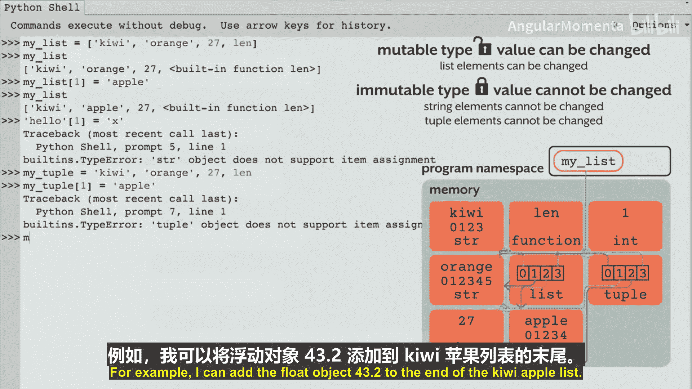

# 【阿尔伯塔大学】问题解决Python编程和电子游戏 ｜ Problem Solving, Python Programming, and Video Games p50 06_05_01_python-sequence-element-replacement -BV1N5rLBWE1c_p50-

In this video， I will show you a generalized assignmentment statement that can be used to change the elements of some sequences。

I will also describe the difference between mutable types whose values can be changed and immutable types。

 whose values can't be changed。To change an element of a sequence。

 the assignment statement must be generalized to support subscription expression as a target。

Recall the syntax for an assignment statement， where Targ was a simple identifier。

Here is the syntax for the non terminalmin state target that includes a subscription expression。

 in addition to the identifier target you saw in the assignment statement lesson。

Recall the semantics of an assignment statement whose target is an identifier。

Here are the semantics of an assignment statement whose target is a subscription expression。

For example， I can use assignment to change in an element of a list。 First。

 I will bind an identifier to the original list so I can reference and change it。

I'll display the list so I can see the original。Now I will use assignment to change the orange element to an apple。

I'll apply the semantic rules for an assignment statement whose target is a subscription expression。

In step1， the right expression is evaluated to obtain the result object Apple。In step2。

 the left expression is evaluated to obtain the primary object， which is the Kiwi orange list。

In step three， the bracketed expression is evaluated to obtain the index object 1。In step 4。

 the primary object is a list which is a sequence， in fact。

 you will see in a moment that lists are mutable sequences， so no error is reported。In step5。

 the index object is one， which is a non negative integer less than the list length4。

 so no error is reported。In step 6， the list element at indexex 1 is rebound to the Apple result object。

I can see the result by displaying my changed list。

Notice that the element orange has been replaced by the element Apple at index1 of the list。

Some sequence types have elements that cannot be changed； for example。

 string elements can't be changed。You saw that list elements can be changed when I changed orange to Apple in the Kiwi O list。

A mutable type is a type whose object values can be changed List is a mutable type since the value of a list object can be changed by replacing。

 adding or removing elements。An immutable type is a type whose object values cannot be changed。

 Strings and tuples are immutable types。For example， given this familiar tuple。

If I use the subscription assignment to try and change an element of a tuple。

 a semantic type error is reported。 Strings and tuples cannot have elements added。

 removed or replaced。The append method can be used to add an element to the end of a mutable sequence。

Appendd his two arguments， the special argument， which is a sequence and the argument that is passed into the method。

This second argument is an element to be added to the end of the special argument sequence。

 For example， I can add the float object 43。2 to the end of the Kiwi Apple list。

The append method fails when I use it on a tuple。Since I cannot apply the append method to any immutable type。

The only difference between a tuple and list types is that tuples are immutable and lists are mutable。

The int， float and bo types are also immutable。 You cannot change the value of an object whose type is int。

 float， or bo。In this video， I showed you a generalized assignment statement that can be used to change the elements of some sequences。

I also describe the difference between mutable types whose values can be changed and immutable types whose values can't be changed。

