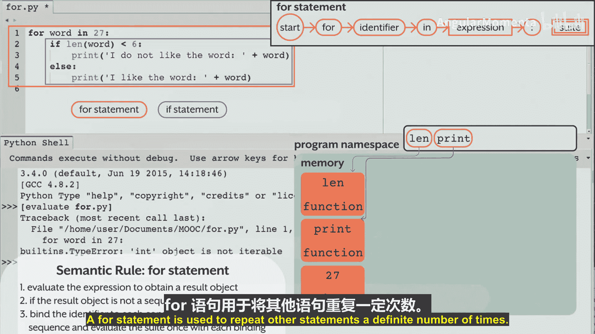

# 【阿尔伯塔大学】问题解决Python编程和电子游戏 ｜ Problem Solving, Python Programming, and Video Games p51 06_06_01_python-for-statement -BV1N5rLBWE1c_p51-

This video introduces a new kind of statement called a force statement。

A for statement often called a for loop， is used to repeat other statements a definite number of times。

Consider a sequence of elements， there are many situations in which you would like to apply the same computation to each element individually。

Let's look at a program that analyzes a given sequence of words and prints out an opinion about each word。

 depending on the length of the word。So far， all the Python statements you have seen have been evaluated exactly one time or skipped。

This program should evaluate the same group of statements multiple times。

 once for each word in the given sequence。We can use a force statement to evaluate a group of statements as many times as necessary without rewriting those statements。

Here is the program solution where I use a list of words as my sequence。I'll run the program。

For each word in the list， the program displays a sentence I like the word。

 or I do not like the word。A forest statement is another kind of compound statement In this program。

 the forest statement starts on line 3 and finishes on line 7。

Inside of the four statement is an if statement， a familiar compound statement。

I will add the fourth statement to the compound statement syntax diagram。

We will only discuss the simplest form of force statement。

 which binds a single target identifier to the elements of a sequence in order。

Here is the simplified syntax diagram for a fourth statement。It starts with the keyword token 4。

 the target identifier， the keyword token in， the expression and the colon。 together。

 these tokens make up the four header。The syntax for the four suite is the same as it was for an if statement。

You can use these syntax diagrams to verify that the fourth statement in this program has valid syntax。

Here are the simplified semantics of the force statement。

Evaluate the expression to obtain a result object。If the result object is not a sequence。

 report an error。Bind the identifier to each consecutive element of the sequence and evaluate the suite once with each binding。

Again， the semantics for the four suite are the same as they were for an if statement。

I will apply the four statement semantics to the four statement in this program。

When line3 is evaluated， the namespace contains prebound identifiers and the Idententifier word list。

 which is bound on line 1。Step1 evaluates the expression in the four statement header。

The expression is the single identifier word list。Since word list is bound to a list object。

 the result object is this three element list， where each element is a string。In step2。

 the list is a sequence， so no error is reported。In step 3。

 the target identifier in the header is word。 The suite is evaluated once for each list element。

 Word references a consecutive element in the list object。 each time the suite is evaluated。

For the first iteration of the force statement， word is bound to the string object Python。

The forest statement suite contains a single if statement， which uses if statement semantics。

Word is bound to Python， and the length of the string Python is 6。 Since 6 is not less than 6。

 The if condition is false， so the if suite is ignored。Instead， the El clause suite is evaluated。

The strings， I like the word and the de referenceence word identifier Python are concatenated。

 and the result string is displayed。The fourth statement suite is evaluated again。 This time。

 the target identifier is bound to the string chair。The length of chair is five， which is less than6。

 so the condition is true and the suite is evaluated。The strings。

 I do not like the word and chair are concatenated， and the result string object is displayed。

The four statement suite is evaluated for the last time。

 The target identifier is bound to the string， Edmonton。The length of Edmonton is 8。

 which is not less than 6。 So the if statement condition is false and the L suite is evaluated。

 The string， I like the word Edmonton is displayed。And the program is done。

I will now delete the word list and replace Word list in the fourth statement header with a different expression。

 the literal integer 27。When I run this program， an error message is displayed。

In step1 of the four statement semantics， the expression is evaluated to get a result object 27。

In step 2， the result object is an integer， which is not a sequence， so an error is reported。

The error message indicates that the int object is not iterable。Every sequence type is iterable。

 so you can use any expression that evaluate to a sequence object in a force statement。

There are some iterable objects that are not sequences， however。

 for now we will not define what iterable means。So we will only use expressions that evaluate to sequence objects in fort statements。

This lesson introduced the fourth statement， a force statement is used to repeat other statements a definite number of times。

