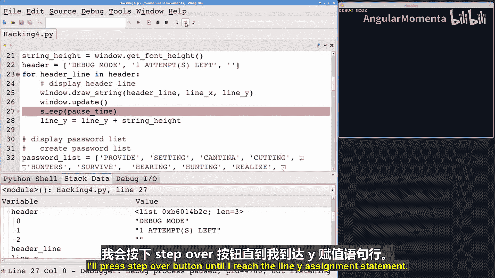
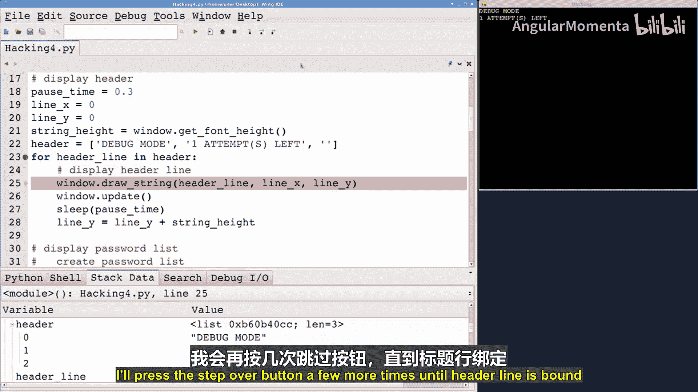
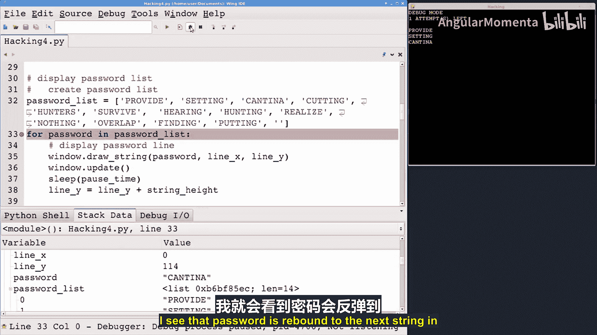

# 【阿尔伯塔大学】问题解决Python编程和电子游戏 ｜ Problem Solving, Python Programming, and Video Games p53 06_08_01_review-code-for-hacking-version-4 -BV1N5rLBWE1c_p53-

。Let's review the code for version 4。For this review。

 I'll be using the debugger to trace a force statement to showcase how to keep track of the target identifier。

To start， I'll place a break point beside the first four statement that displays the header and press the bug button。

The game window appears， but it is empty。 Since I pressed the bug button。

 the debugger stopped on the break point and highlighted four header line in header。

I'll press the step over button to enter the For statement and highlight the drawstring function call that will display the first header string。

The headerline identifier has been added to the stack data panel and is bound to debug mode。

Above this identifier is header。 The name we used to make our list。

 You can see that header is bound to a list。If I expand header。

 you can see that debug mode is the first element in the list。 You can also see the second element。

 one attempt left， and the last element， an empty string。

This tells me that my list has length  three and that it has been properly initialized with all the header strings。

Notice that the list is indexed from 0 to2 instead of one to 3。

 as was discussed in the four statement and list lesson。

I'll press the step over button until I reach the line Y assignment statement。

 debug mode appears in the window。

In the previous reflection， when we press the step over button at the end of the if statement。

 the debugger moved on to the next statement after the if。This time。

 when I press the step over button， the debugger returns to the top of the four statement and highlights4 header line in header again so that the target identifier header line can be rebounded to the next element of the header list。

When I press the step over button again， headerline in the stack data has been updated to one attempt left。

The debugger is useful for slowly tracing loops to keep track of how identifiers change。

I'll press the step over button a few more times until headerline is bound to the empty string。

 and the line Y assignment statement is highlighted。

When I press the step over button， the debugger returns to the top of the four statement and highlights four header line in header。

The interpreter must check if there are any more elements in the list。

 even though we know that there aren't。When I press the step over button again。

 the first line after the Four statement suite is highlighted， which will create the password list。

Next， I'll add another break point。 This time， it will be at the first line of the force statement that displays the passwords。

I'm going to press the bug button once more to show you a handy shortcut for loop tracing。

When a break point is placed at any line of the loop。

 pressing the bug button traces one iteration and stops at the same line that contains the break point。

This makes it easy to trace an entire iteration of a loop quickly。

2 identifiers have been added to the stack data password。

 which is currently bound to provide and password list， which is bound to a list with length 14。

If I press the bug button a few more times， I see that password is rebound to the next string and password list and then displayed in the window。

That's everything I want to show you about four statements using tracing。 Next。

 let's talk about the two software quality tests we'll add for this version。

 The first test is about literals for the literal test。

 each literal with common intent except 012 negative 10。

0 and a blank string should appear exactly once in the program。

 It is O to use identifiers instead of these special values， but it is not required。For example。

 in our code， we replaced the literal0 by line x to make its intent clear。

 We left the literal2 used to compute half of some distances since dividing by 2 is common。

Common uses of 0 and1 as starting values in a list are often not replaced。Previously。

 we discussed how finding and replacing literals might introduce errors if you aren't careful about what you replace。

 We also discussed how tedious it can be to change multiple instances of a literal throughout a program。

In your code， make sure you have bound an identifier to each of the literals that was used more than once。

 Your code should contain only one instance of each literal that has a particular intent。

This makes your code shorter and less prone to error when you change the value of a literal。

The second test is about repetition。 The repetition test ensures that adjacent duplicate statement groups have been replaced by repetition control structures。

 This makes your code shorter， easier to read and easier to change。For this version。

 you should have three four statements that have replaced the three instances of adjacent duplicate statement groups in your version 3 code。

One replaces the header， one replaces the password list， and one replaces the outcome message。

Also make sure that your code reflects the software quality tests from previous versions。

 the program and code block should be commented。 Your identifier names should be descriptive。

 and your code should reflect the design of your new algorithm。Congrats。

 you finished version 4 of hacking。

