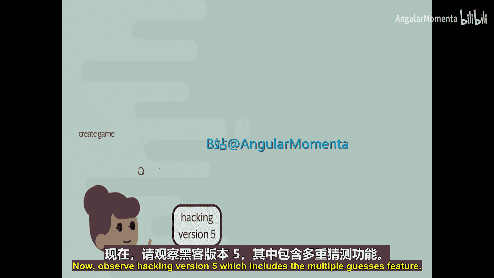

# 【阿尔伯塔大学】问题解决Python编程和电子游戏 ｜ Problem Solving, Python Programming, and Video Games p54 06_09_01_solution-issues-in-hacking-version-4 -BV1N5rLBWE1c_p54-

🎼，Hacking version 5 will add new features to the game， so you'll create a description。

 a functional test plan， and an algorithm before you write the code。First。

 let's talk about the solution issues that we should improve upon in this version。

In a game about guessing passwords， only having one guess is pretty sad。In version 5。

 you'll add the functionality to enter multiple password guesses using a new repetition control structure called a while statement。

A wild statement is a second type of loop that you'll use throughout the rest of the course。

It acts similarly to a for loop in that it performs a sequence of steps， repeatedly。

In the previous module， we used four loops to implement definite repetition。

Recall that definite repetition iterates over the elements of an explicit sequence。

 with fixed length。A for loop always uses definite iteration because it needs an iterable object。

A while loop uses indefinite repetition because it uses a condition instead of an iterable object。

A while loop performs its steps as long as its condition is true。

You'll learn more about while loops in the next programming language videos。

Both definite and indefinite repetition are examples of the control abstraction problem solving technique。

Notice that your previous description contains repeated attributes such as it is green on black and it uses small font size。

This is an example of repeating yourself， which leads to a longer description that is harder to change。

Instead， you should group common attributes of different objects together。For example。

 the description could include the object， every text object to refer to all the text that appears in the window。

This object's attributes would be are green on black and use small font size。

 Then these shared attributes do not need to be described for each individual display object。

Grouping common object attributes into a single unit is an example of a new kind of abstraction called data abstraction。

There are several ways of grouping common attributes。

 We already use data abstraction to group all attributes of a single object together。

 such as all attributes of the header or the outcome。

This allows us to describe test or reference an entire header or outcome object using a single name。

However， when different objects have common attributes。

 we also want to use data abstraction to give a common name to the shared attributes。 For example。

 dogs and cats have common attributes， such as eating meat。

So we can create a term called carnivore that contains these common attributes。

Since all display objects share their color and font size。

 we introduce every text object as an explicit common object in the description。

So we can move the shared color and font attribute to this single common object。

Now observe Haing version 5， which includes the multiple guesses feature。

