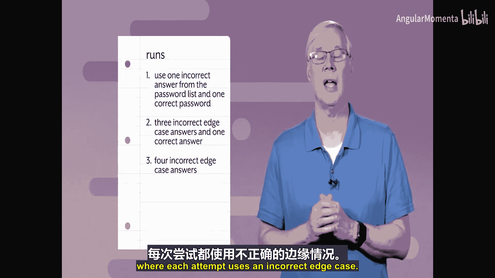

# 【阿尔伯塔大学】问题解决Python编程和电子游戏 ｜ Problem Solving, Python Programming, and Video Games p57 06_12_01_create-test-plan-for-hacking-version-5 -BV1N5rLBWE1c_p57-

Welcome back to the functionalal Test plan  builder for Haing Verion 5。

The test plan for versions 3 and 4 test two paths through the game。For this test plan。

 you need to test many more paths， Like the version 5 description。

 you'll need to accommodate each of the four behaviors that arise due to multiple guess attempts。

Testing behaviors that may occur only in very specific circumstances is called edge case testing。

Often an edge case is a program behavior that occurs when a parameter。

 such as the number of attempts， has its minimum or maximum value。For example。

 consider a test plan to check the behavior of a calculator application。

A general behavior is dividing an integer such as 100 by another integer such as 20。

I also need to check the case where the answer is not a whole number。

I should also add tests where the numerator or denominator are negative。However。

 the most interesting edge case is when I divide by zero。

Since the result of dividing by zero is undefined， it is considered an edge case that needs a separate。

 distinct test in the test plan。An appropriate response to this test would be an error or warning message。

 rather than giving a wrong number or crashing。What are some of the edge cases for hacking。

 I'll use case based decomposition to identify some of the independent edge cases for hacking。

One edge case is entering an empty string since it contains zero characters， which is a minimum。

Since there's no maximum number of characters in a string， we can't test the maximum。

But we can test a very long string。Another edge case is entering the correct password。

 but using lower case letters。To find out what the correct behavior is in this case。

You should run the program to see。😡，Your test plan must run the program three times。

With two success runs and one failure run。Your first success run will use one incorrect answer from the passwords listed and one correct answer。

Your second success run will use three incorrect edge cases。Followed by the correct answer。

Your failure run will use four attempts， where each attempt uses an incorrect edge case。

