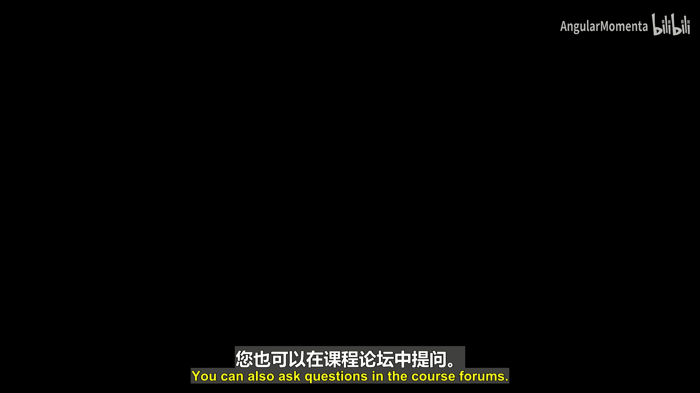

# 【阿尔伯塔大学】问题解决Python编程和电子游戏 ｜ Problem Solving, Python Programming, and Video Games p58 06_13_01_create-algorithm-for-hacking-version-5 -BV1N5rLBWE1c_p58-

You're back to the Create algorithm task in the game creation process。

We'll introduce another type of repetition control structure in version 5。In version 4。

 you use definite repetition， which requires you to know how many times you should repeat a step。

Before you perform it。In this version， the player has multiple attempts to guess the correct password。

How many times do you need to prompt the player to enter a password？

A player is allowed a maximum of four attempts， so the answer seems to be four。

But what if the player guesses correctly on the first try or the third try？

You don't know beforehand how many times you need to repeat the password prompt。

Definite repetition requires you to have this knowledge。That's where indefinite repetition。

 also called indefinite iteration comes in。Indefinite repetition performs an algorithm step repeatedly while a specified condition is true。

This is like a combination of selection and definite repetition。

Indefinite repetition is represented in the algorithm builder by a while icon。

There's a regular rectangle connected to the wild icon， by an arrow。Similarly to definite repetition。

 the step to be repeated goes in the regular rectangle。Similarly to selection。

 a condition is required in the control structure icon。Let's return to the cake mixing example。

Stiring the batter 20 times is definite repetition。

Mixing the batter until there are no lumps is indefinite repetition。

To use this condition in the indefinite while icon， I will select batter is lumpy for the rectangle。

 I will select mix and batter。My algorithm now says， while batter is lumpy， mix batter。

This means the step mixed batter will be repeated as long as the batter is lumpy。

 however long that may take。This also means that if the batter does not start lumpy。

 the step in the wild loop will never be performed。

The same rules for selection conditions apply to indefinite repetition conditions。If need be。

 I can consider multiple factors in my condition。 For example。

 I might alter my cake batter condition to be while batter is lumpy or there is flour left。

This condition will remain true if there are lumps and it will remain true if there is flour left。

You will use indefinite repetition to implement multiple guest attempts in hacking version 5。

In previous versions， you prompted the player to make a guess and then displayed the appropriate outcome message。

 depending on if the guess was correct or incorrect。In this version。

 the behavior for a correct guess is the same。But now you must ask yourself what happens if the player makes an incorrect guess？

As you indicated in your description and test plan， there are a number of things that happen。

The attempts left has to be displayed and decremented。

 The player has to be prompted to make a new guess。 And if the player only has one guess left。

 a warning must be displayed。Furthermore， you want all of this to happen every time the player makes an incorrect guess as long as four attempts have not been made。

To get started on your algorithm， replace the step prompt for guess with the step get guesses。

And expand get guesses to use indefinite repetition。

You will need that prompt for Gu step in the expanded get guesses panel。If you get stuck。

 review your description and functional test plan。

You can also ask questions in the course forums。

