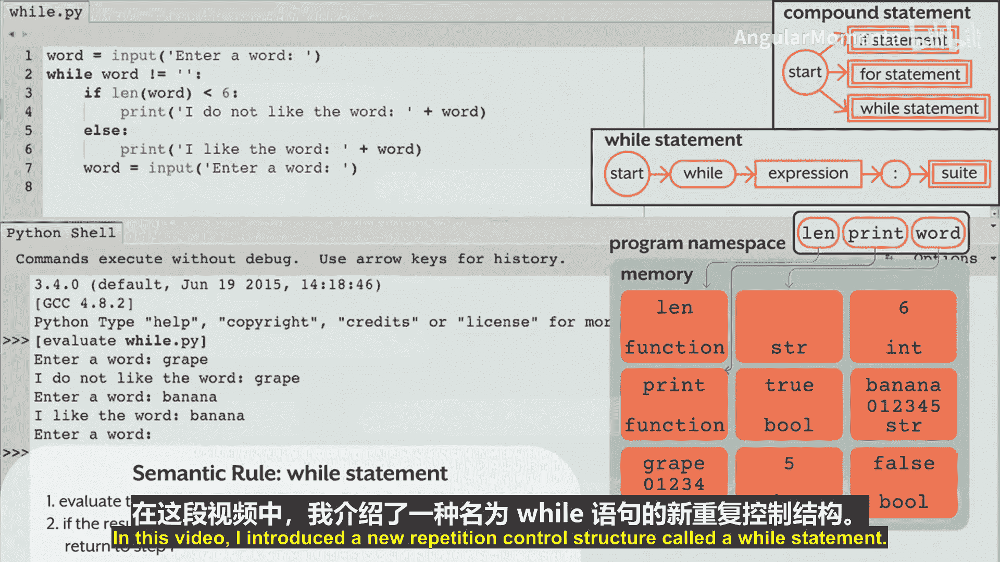

# 【阿尔伯塔大学】问题解决Python编程和电子游戏 ｜ Problem Solving, Python Programming, and Video Games p59 06_14_01_python-while-statement -BV1N5rLBWE1c_p59-

In this video， I will introduce a new kind of statement called a W statement。

Consider the program from the four statementmen lesson。

 which took a list of words and displayed an opinion about each word based on its length。

In this lesson， I want my program to check an unspecified number of words and decide if it likes each one。

 The new program should continue checking words until I indicate it should stop。

A for statement performs a computation once for each element of a sequence。 However。

 for this new program， I don't have a sequence of words。 The words are input one at a time。

 and the opinion must be displayed immediately before the next word is input。

Instead of a four statement， I'm going to use a while statement。

A wild statement is a new kind of repetition control structure that uses a Boolean expression to control the repetition instead of using a sequence。

A while statement is a compound statement， so I'll add the while statement to the compound statement syntax diagram。

Here is the program。I'll run this program。I can enter as many words as I please。

 I'll enter grape and banana。😊，When I am finished， I will enter an empty string by just pressing enter to end the wild statement。

Here is the syntax diagram for a while statement。The header of a wild semon consists of the wild keyword token。

 an expression， and a colon delimiter。The header is followed by the sweet non terminal state。

 which has the same syntax as the suites for the if and four statements。

The W statement in this program has valid syntax based on these diagrams。

Here are the simplified semantics for a while statement。

Evaluate the expression to obtain a result object。If the result object is interpreted as true。

 evaluate the suite and return to step one。A wild statements。

 expression and suite are evaluated repeatedly。 Each time the expression evaluates to an object interpreted as true。

 the suite is evaluated once。A while statement is called an indefinite repetition control structure。

 since we don't know ahead of time how many times its suite will be evaluated。

I'll apply the semantics to the W statement in the program。When the wild statement is reached。

 the namespace contains some prebound identifiers and word， which is bound to grape。In step 1。

 the expression in the wild header is evaluated。This expression is a binary expression that dereences the identifier word to obtain the string object grape and then applies the not equal operator to the string object grape and the empty string。

Grape is not equal to the empty string， so the expression evaluates to the result object true。

In step two， since the result object is true， the wild suite is evaluated。

This suite contains two statements， an if statement that checks the length of word and an assignment statement that inputs another word。

Since grape has length 5， which is less than6， the if condition evaluates to true。

 and the if clause suite is evaluated。The interpreter concatenateates the strings。

 I do not like the word and grape， and then displays the results string object。Next。

 the assignment statement inputs banana and binds the identifier word to the banana string。

To complete step 2， the interpreter returns to step 1 to evaluate the expression again。In step 1。

 word is bound to banana， which is not equal to the empty string。

 so the wild expression evaluates to true again。In step 2， since the result object is true。

 the suite is evaluated again。In the if statement condition， the length of banana is 6。

6 is not less than 6， so the if condition evaluates to false， and the L suite is evaluated。

The strings， I like the word and banana are concatenated， and the result is displayed。

The last statement of the suite inputs the empty string and reds word to it。To complete step two。

 the interpreter returns to step1 to evaluate the expression again。This time。

 when the well condition is evaluated， the condition checks whether the empty string is not equal to the empty string。

 The result object of the not equal operator is false， since they are equal。In step 2。

 since the result object is false， the suite is not evaluated。

 and the interpreter does not return to step 1。The while statement is complete。In this video。

 I introduced a new repetition control structure called a W statement。

