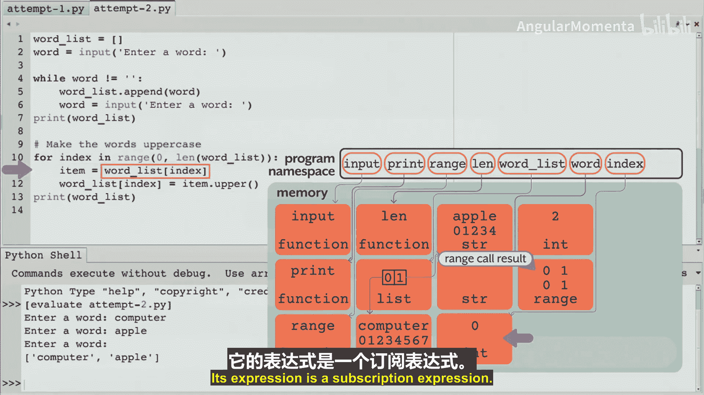

# 【阿尔伯塔大学】问题解决Python编程和电子游戏 ｜ Problem Solving, Python Programming, and Video Games p60 06_15_01_python-repetition-examples-and-range-type -BV1N5rLBWE1c_p60-

This video explores examples of four statements and while statements and introduces another sequence type called range。

Recall the programme from the foresa lesson。 It displayed an opinion about each word in a list。

 depending on the length of the word。In theW statement lesson。

 you looked at a program that allowed you to enter your own words and display an opinion about each one。

Here is a program that inputs an arbitrary number of words， saves them in a list， prints the list。

 and then analyzes the list using a force statement。

This program uses code from both of the previous programs。

 The most important new statement is a call to the sequence method append on line 5。In addition。

 line1 creates an empty list instead of a fixed word list。

 and there is a familiar print call on line 8 that displays the list。I'll run the program。

The programme prompts me to enter a word。It allows me to continue entering words until I enter an empty string。

Then for each word， the programme displays either I like the word。

 or I do not like the word based on the words's length。In the while statement lesson。

 the program bound the same identifier to each input word。

 but each word was lost in the next loop iteration。

Using the sequence method append allows me to save the input words in a list。

It is common when creating a list of objects to start with an empty list and use a pen to add one new element at a time。

Here are two programs， attemptt one and attempt 2。 Each program inputs a list of words using a while statement and prints the list。

 Then each program attempts to replace every word in the list by its uppercase equivalent and prints the modified list。

Both attempts use a force statement， and the string method upper。Which of these programs will work。

 Let's run attempt 1。I'll input the words computer and Apple， then press enter。

Two identical word lists are displayed。 attempttemp one failed to convert the words to uppercase。

Let's run attempt  to。 Again， I'll input the words computer and Apple， then press enter。

This time the word list contains uppercase words， so attempt2 was successful。

Let's apply semantic analysis to the four statements in each program to see why the first attempt didn't capitalize the words。

 but the second attempt did。In attempt 1， when the for statement is interpreted。

 the name space contains prebound identifiers and the identifier's word list and word。

In step 1 of the four statement semantics， the expression in the for statement header is evaluated to obtain a list object。

 In step 2， the list is a sequence， so an error is not reported。In step 3。

 the target identifier item is bound to the element of the list object at index 0。

 the string computer。The four statement suite is evaluated。

The suite contains one assignment statement in which the identifier item is dereenced to obtain the string object computer。

 Then the method called upper is applied to the string object。

 and the uppercase string object computer is returned。

 The identifier item is then rebound to uppercase computer。

Although the target identifier item was rebounded， none of the actual list elements were changed。

Returning to the header of the force statement， item is rebound to the next element in Word list。

 which is Apple。The suite is evaluated again。Like the previous iteration。

 item is rebound to the uppercase version of the word。 it is currently bound to。 So this time。

 item is rebound to uppercase apple。The for statement is done。

Next is a print function call that displays word list。

 None of the words in word list have been capitalized。 This first attempt failed。

Attempt2 uses a new sequence type called range， along with subscription assignment to successfully update a list。

A range is an immutable sequence type。 The simplest kind of range object contains all integers between two values。

 I can use the range function to create a range object。

The range function takes two integer arguments and returns a range object that contains a sequence of integers from the first argument to one less than the second argument。

 Ignore the bracketed third argument。 It is an optional argument。

 which will not be used in this lesson。For example， range of 3，7 yields a sequence that contains 3，4。

5， and 6。Since a range is a sequence， its elements are indexed from 0 to its length minus-1。

And an element can be accessed using subscription。 For example。

 my range of 0 yields the element at index 0， which is 3。

A range object can be used in a force statement to iterate over the indexes of a sequence so that you can red individual elements of that sequence。

I will show you how attempttemp2 uses a range object and subscription assignment to successfully change the elements of Word list。

When the four statement is interpreted， the namespace contains prebound identifiers and the identifier's word list and word。

In step1 of the four statement semantics， the function call expression in the header is evaluated。

First， the identifier range is de referenceenced to obtain the range function object。

 The first argument of the function call is the integer 0。 The second argument is a function call。

 The identifier L is de referenced to get the L function object。

 There is one argument and word list is de referenced to obtain the list object as this argument。

The length of this list object is computed as the int object 2。

 So the range function is applied to 0 and 2， and it returns a range object from 0 to 1。In step 2。

 the range object is a sequence type， so there is no error。In step 3。

 the target identifier index is bound to the zeroth element of the range object， which is0。

 Then this suite is evaluated。The first statement in this suite is an assignment statement and its expression is a subscription expression。

In step 1 of the subscription expression semantics。

 the left expression word list is evaluated by dereencing it to obtain the list object as the primary。

In step2， the bracketed expression index is evaluated by dereencing it to obtain the integer object zero as the index。

In step 3 and step 4， the primary is a sequence and the index is a non negative integer less than the sequence length too。

 so no subscription or index error is reported。In step 5。

 the primary objects' element at index0 is computer， so this is the result object。

To complete the assignment statement semantics， item is bound to this result object。

The second statement of the four suite is an assignment statement whose target is a subscription expression。

In step1， the right expression is an attribute reference where the identifier item is dereenced to obtain the string object computer。

Then the method called upper is applied to this string object。

 and the uppercase string object computer is returned as the result object。In step 2。

 the left expression word list is evaluated by dereencing it to obtain the list object。In step 3。

 the bracketed expression is evaluated by dereencing index to obtain the integer object0。In step 4。

 the primary object is a list which is a mutable sequence， so no subscription error is reported。

In step 5， the index object0 is a non negative integer， which is less than the sequence length2。

 so no indexing error is reported。In step6， the primary objects element at index0 is rebound to the result object uppercase computer。

The interpreter returns to the for header。 The next element of the range object is at index 1。

 which is the integer Ob 1， The identifier index in the for header is bound to one。

 and the suite is evaluated again。This time item is bound to word list of one， which is Apple。

 the uppercase version of Apple is computed， and then Word list of one is rebound to this uppercase string。

The force statement is done。 The last line of the program displays word list。 In this attempt。

 the words and word list have been successfully capitalized。😊。

This video introduced some additional repetition examples；

 you also saw how to use the range function to create a range sequence object from two integers。

