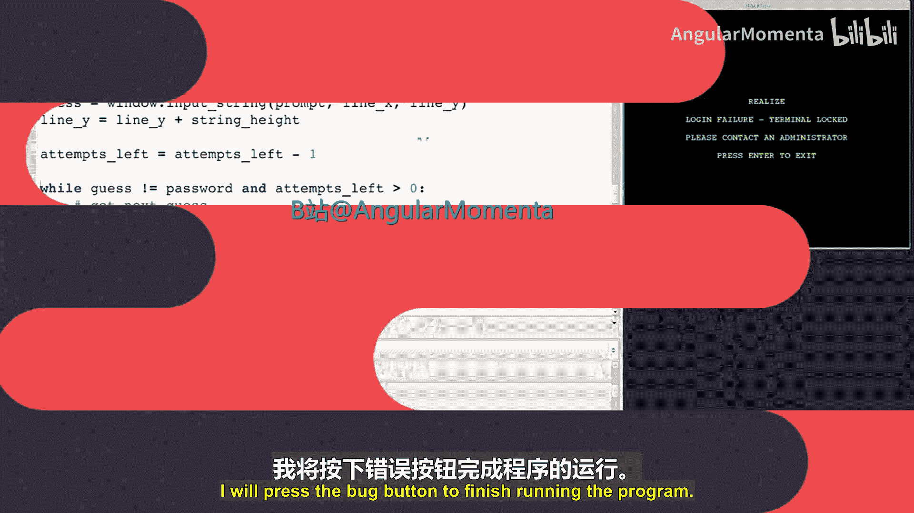
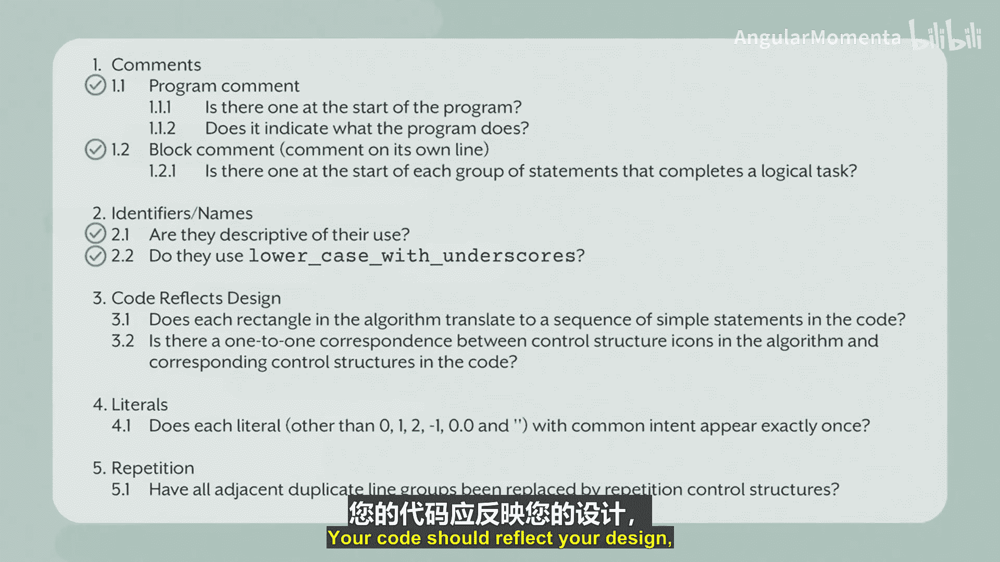
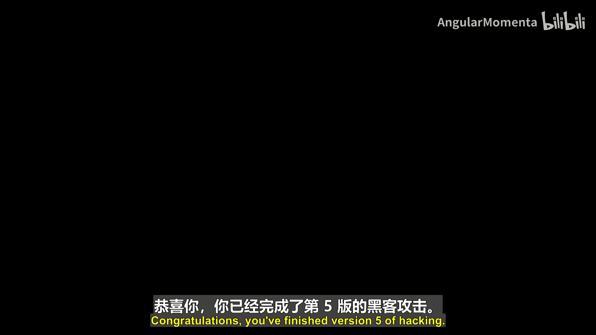

# 【阿尔伯塔大学】问题解决Python编程和电子游戏 ｜ Problem Solving, Python Programming, and Video Games p62 06_17_01_review-code-for-hacking-version-5 -BV1N5rLBWE1c_p62-

🎼。In this code review for hacking version 5， I will trace a while loop using the debugger。

Here is the version 5 code。I'll put a break point next to the Y loop and start tracing by pressing the bug button。

The game stops so I can input my first guess， I'll type an incorrect guess。

The trace stops and the debugger highlights the wild header。

 you can see in the stacked data that attempts left is decremented from 4 to3。

You can also see that guess has been bound to the input string。

The wild condition has two expressions as operas to the and operator。

My guess is not equal to hunting。 So the first operaaround is true。

 The second expression checks if attempts left is greater than 0， which is true。

 The and operator evaluates true and true to obtain true。 Therefore， the wild suite is evaluated。

So when I press the step over button， the next statement that's highlighted is a call to drawstring that uses the x coordinate line X and the Y coordinate string height。

You can see the value of these coordinates in stack data。I'll press the step over button again。

 the debugger highlights the if header。The new value for attempts left has not appeared in the window since no window dot update call was made。

The windowow。 update call was removed from this code to demonstrate a common practice in computer graphics。

When you make multiple drawstring calls that can be displayed at the same time。

 you can follow them with a single update call In this case。

 the window update call is inside the next input string function。

 and you will see this update momentarily。The if header checks if attempts left is equal to one。

 since attempts left is equal to3， the if condition evaluates to false。

 so when I press the step over button again。The debugger skips over the if suite and highlights the next input function call。

 I'll step over again to evaluate the input string call。

The update function inside the input string call displays everything that was drawn since the previous update。

 including the attempts left。Now I will enter another incorrect guess and step over a few more times until the debugger returns to the top of the while statement。

Again， the while condition is checked， you can see from stacked data that the guess is not equal to the password。

 so the first expression in the condition is true。Since the number of attempts left is 2。

 which is greater than 0， the second expression of the condition is also true。

 Since it's true and true is true。 The interpreter will evaluate the wild suite again。

I'm going to press the bug button and enter a third incorrect guess。

 You can see that attempts left is one in stack data。 Now。

 I'll step over the code until the debugger reaches the F statement。Attempts left is equal to one。

 so the if condition evaluates to true， and the if suite is evaluated next。

I'll press the step over button until I reach the last statement of the if。

3 new identifiers have been added to the namespace and are shown in stack data。

 Warning string is the lockout warning。 Warning X and warning Y are X and Y coordinates for this string。

To return to the while header， I'll press the bug button once more and input another incorrect answer。

Attempts left is now equal to zero。Guess is still not equal to hunting， but attempts left is 0。

 which is no longer strictly greater than 0。 Since true and false is false。

 the wild condition evaluates to false， so the statement will not be evaluated again。

I will press the bug button to finish running the program。

We won't add any new software quality tests in this version of hacking。 However。

 you should take this opportunity to ensure that your code passes the software quality tests you have already seen。

 Your code should have program and block comments。Your identifiers should be descriptive and use lowercase letters separated by underscores。

Your code should reflect your design， every algorithm box should translate to a few lines of sequential code and every algorithm control structure should translate to a single code control structure。

Except for the prescribed literal exceptions， every literal with the common intent should appear only once。

 Finally， check to see if you have replaced your adjacent duplicate statement groups with repetition control structures。

Congratulations， you finished version 5 of hacking。

