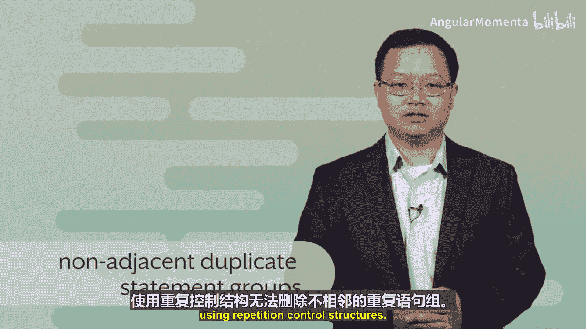

# 【阿尔伯塔大学】问题解决Python编程和电子游戏 ｜ Problem Solving, Python Programming, and Video Games p63 07_01_01_solution-issues-in-hacking-version-5 -BV1N5rLBWE1c_p63-

🎼。Welcome to hacking version 6。 You're almost finished hacking。

 Your previous version is only missing two features。

 embedding to passwords in random symbols and providing hints when the player makes an incorrect guess。

 However， in this version， you won't implement these new features。 Like version 4。

 version 6 only concerns code quality。 We're going to introduce one of the most important language features for improving code quality。

 This version is all about creating your own functions。😊，You have already used a number of functions。

 including built in Python functions and imported functions from various modules。

 now you will create your own user defined functions。

Functions are a very important part of programming。

 They allow you to decompose your code into self contained segments。This makes code easier to read。

 write， modify and reuse since it allows you to focus on one section of related code at a time。

 you can apply all the benefits of using built in and imported functions to using your own functions。

A function call is an example of control abstraction。

 A function call evaluates the statements inside a function and then returns to a calling statement To call a function。

 You don't need to understand the internal details of its code。

 The functions code can be written once and called many times。

 So it is an application of the D R Y principle。Here is the solution for hacking Ver 5。

 Not that there are still sections of duplicate code used to display strings。

This group of four statements is repeated three times in a program with only small differences。

 There is also a duplicate group of two statements for inputting a string that appears twice。

You couldn't remove these duplicates in versions 4 and 5 because they were not adjacent to each other。

 When you have a group of statements that perform the same function but are separated by other lines of unrelated code。

 you have non adjacent duplicate statement groups。 non adjacent duplicate statement groups cannot be removed using repetition control structures。

 So we will replace them with user defined functions。

。User defined functions are another example of solution generalization。

 recall that solution generalization alters a solution so that you may reuse it in many different contexts。

Whoever writes a function is performing solution generalization。

 whoever is calling a function is using control abstraction。

The four lines of code that are used to display a string in version 5 are used three times。

 once for the header， once for the passwords and once for the outcome。

 One of the functions you will create will transform those 12 lines of code into a single five line function that can be used to display any string。

You won't need to create a new description or a functional test plan for version 6。

 The functionality of the game is identical to the previous version。

 You won't need to create a new algorithm either At the algorithm level。

 your solution doesn't change。 You will go straight to editing your code。

