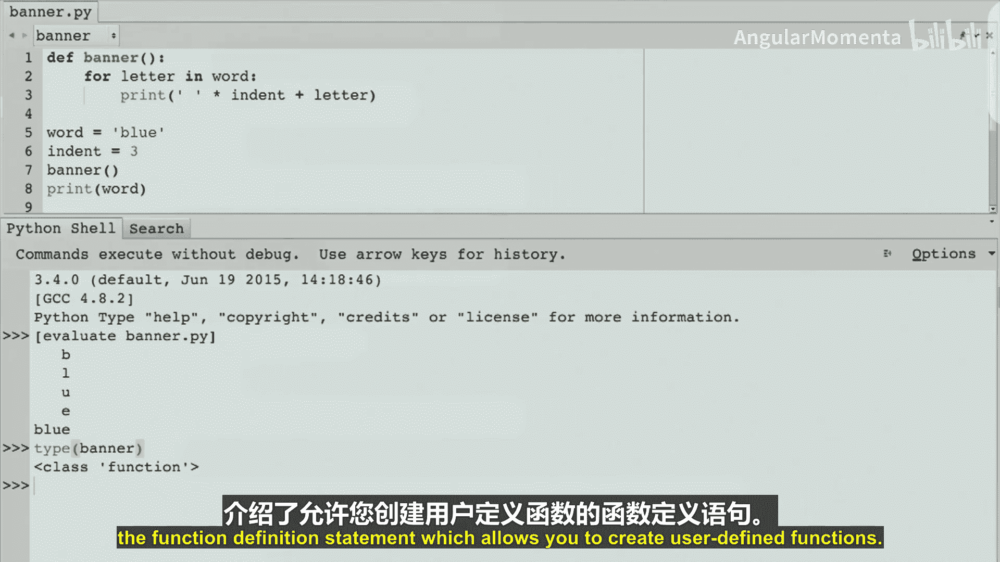

# 【阿尔伯塔大学】问题解决Python编程和电子游戏 ｜ Problem Solving, Python Programming, and Video Games p64 07_02_01_python-function-definitions -BV1N5rLBWE1c_p64-

This video introduces a new kind of statement called function definitionition。

You have used functions from the Python standard Library。

 but there are situations where you want to define your own functions。For example。

 consider a function that prints each individual letter from a word on its own line to create a vertical banner。

There is no function in the Python standard Library that does this。

If you want to use such a function， you must create the function yourself。

You can think of a Python program as consisting of only the statements in a Python file such as Word list dot pi。

 which was used in the previous lesson。When this program is run。

 the interpreter creates a module called underscore underscore main underscore underscore that contains the Python statements in this file。

And evaluates the module。However， the program also uses Python code from the standard library。

 such as the functions's input， print and L， and the method append。

So this program really consists of more than just the statements in this main module。

A complete Python program actually consists of blocks， and there are three kinds of Python blocks。

 modules， functions and classes。Classes will be introduced in a future lesson。

The interpreter always starts evaluating the main module， but other blocks are evaluated as well。

Functions are blocks， and there are two kinds of functions in Python。

 user defined functions and built in functions。A user defined function is a function whose code consists of Python statements。

This is different from the non Python code used to implement built in functions。

Built in functions are written in the language used to implement the Python interpreter。

Most Python interpreters are implemented using the C programming language。

 since it is easier to call the necessary operating system functions using C。

Section 2 of the Python standard Library documentation provides a list of Python built in functions。

However， this list only includes the built in functions that are in a module called built ins。

 which can be used without explicitly importing them。In previous lessons。

 we only referred to functions in this list as built in functions。 However。

 the Python documentation actually defines built in functions as functions not implemented in Python。

We will use this extended definition of built in functions instead of just using the built in functions table。

Most of the modules in the standard library are written in the language used to implement Python。

 so they contain built in functions。A few of these modules are written in Python。

 so they contain user defined functions。The Python type of a built in function or method is built in function or method。

 For example， both L and sleep from the time module are built in functions。

Since sleep is not in the built in function table， we indicated in a previous lesson that it needed to be imported from the time module。

However， since sleep is not implemented in Python， it is actually a built in function based on the extended definition。

As shown by the type of the sleep object。The Python type of a user defined function or method is function。

 For example， the function copy from the module named copy in the standard library is a user defined function。

I will use this program to show you how to write user defined functions using the banner function as an example。

I'll run the program。Each letter in the string blue is displayed on its own line。

 preceded by three spaces。Then the full string is printed normally on a single line。

Since Banner is a user defined function， its type should be function。

 not built in function or method。Function， it is。Function definition is a new kind of compound statement。

 I will add function definition to the compound statement， syntax diagram。

Here is the simplified syntax diagram for function definition。

The header of a function definition consists of the keyword token de， an identifier。

 a left parent end de limititer。An optional parameter list。

A right per endillimiter and a colon delimiter。The identifier is the name of the function。

The header is followed by a suite， which is familiar from previous compound statements。

In this lesson， we will only consider user defined functions with no parameter list。

 so I won't show the syntax diagram for parameter list。

Before I show you the semantics of function definition。

 the semantics of binding and dereencing identifiers must be generalized。

Every Python statement is part of a single block。 For example。

 the statement on line 1 and the statement on lines 5 through 8 are in the main module block。

The statements on lines 2 and 3 are in the banner function block。

 since they are in the suite of the banner function definition。In previous lessons。

 we showed a single program namespace。However， each block has its own namespace。

 A module namespace is called a global namespace。There are several kinds of statements that bind identifiers。

 assignment statements。Import statements。4 statement headers。

Function definitions and other statements you will see in future lessons。

When the interpreter is evaluating a statement， we call the block that contains that statement。

 the local block。And its namespace， the local namespace。

When the interpreter evaluates a statement in the main module。

 its namespace is both the global and local namespace。

Here is the Python rule for binding an identifier in any block。When an identifier is bound。

 bind it in the local namespace， unless the block also contains a global or non local statement that contains that identifier。

For reasons described later in this lesson， we will not use global or non local statements in this course。

 So I will simplify the rule for binding identifiers by removing the last part of the rule。

We also need a rule for dereencing identifiers in multiple blocks using multiple namespaces。

Here are the semantics for identifier expression presented in a previous lesson。

These semantics must be generalized to apply to programs with multiple blocks and namespaces。

It is possible to define a function inside a function。However， in this course。

 no such nested function definitions will be used。This simplifies the semantic's generalization。

Here are the generalized semantics for identifier expression。

Now that the rules for binding and dereencing an identifier apply to multiple blocks。

 here are the simplified semantics for function definition。

Create a function object that contains the statement suite as code。

If the function name is not in the local namespace， add it。

Buying the function name to the function object in the local namespace。

Find a reference to the global namespace in the function namespace。

I will show you how the Python interpreter interprets this program。When the program starts。

 the local block is the main module whose namespace is both the local and global namespace。

The prebound identifier print is bound in this namespace。

The first statement in the main module is a function definition。

 So the interpreter applies function definition semantics。In step 1。

 the interpreter creates a function object that contains the four statement on lines 2 and 3。

The function object contains its own namespace。Since the banner namespace is important in this lesson。

 it is shown explicitly in the diagram。The print function object also has a name space。

 which is not used explicitly in this lesson。 So it is not shown。In step 2。

 the identifier banner is not in the local namespace， so it is added。In step 3。

 the interpreter binds the function name banner to the function object in the local name space。

In step 4， the interpreter binds a reference to the global name space in the banner namespace。

It is important to note that the interpreter does not evaluate the function suite when it is evaluating the function definition。

After the function definition statement， the interpreter evaluates lines 5 and 6 using assignment statement semantics。

In the local namespace， word is bound to the string blue， and indent is bound to the integer 3。

Then the function call to Ban on line 7 is evaluated。Recall the function called semantics。

The identifier banner is dereenced in the local namespace to obtain the banner function object that was just created。

Since there are no arguments， an empty argument object list is created and passed to the banner function。

The function code is evaluated to obtain a result object。

I will describe how the interpreter evaluates the code inside the banner function。

The local block is now banner， and the local namespace is the banner namespace。

 The global namespace is still the main module。The single statement in the function definition suite uses four statement semantics。

In step 1， the identifier word is evaluated。Since the identifier word is not bound in any statement of the local block banner。

 it is dereenced in the global namespace to obtain the string object blue。

Any identifier that is dereenced by Rule 2 is used as a global identifier in the local block。

Word is used as a global identifier， in banner。In step  two， no error is reported。In step 3。

 the identifier letter is bound in the local namespace to the element of the string object blue at index 0。

 which is the string object B。The four suite is evaluated for the first time。

The suite contains a print function call。 Since the identifier print is not bound in the local block banner。

 It is dereenced in the global namespace to obtain the print function object。

Print is used as a global identifier in banner。There is a single argument expression that contains two binary operators。

 star and plus。Since star has higher precedentnce， it is evaluated first。

The left expression is evaluated to obtain a string that contains one blank space。

The star operator on a string object is implemented by the string replication function that concatenates the first opera end string with itself。

 a number of times equal to the second opera end。Since the identifier indent is not bound in the local block banner。

 it is dereenced in the global name space to obtain the integer Ob 3 as the second opera end。

Indentent is used as a global identifier in Banner。

The string replication function is applied to the single blank character string object and the integer 3 to obtain a string object that contains three blank characters。

The plus operator applied to this string object is the concatenation operator function。

The second operaand expression is the identifier letter。

 Since letter is bound in the for header of the banner block。

 It is dereenced in the local namespace banner to obtain the string B。

 and the concatenated object is a string containing three blanks and a B character。

This object is passed to the print function， and it is displayed。

The four suite is evaluated three more times to display the next three output lines。

 and then it is done。Since this is the only statement in the function definition suite。

 the function call is done。Step 5 of the function call semantics indicates that a result object is returned from the function call。

A function call returns the unique object whose type is none type unless a return statement is evaluated during the function call。

Return statements will be discussed in a future lesson。Since no return statement was evaluated。

 the object whose type is none type is returned。Evaluating the function code may result in identifiers being added to the function namespace。

After the function code has been evaluated， all identifiers that were added to the function name space during evaluation are deleted to free some memory。

The last step of the function call semantics is modified to reflect the deletion of the identifiers that were added to the function namespace during the function call。

The identifier letter that was added to the function namespace banner during the function call evaluation is deleted。

The local block is now the main module again， and the local namespace is the main module namespace。

The interpreter then evaluates the statement after the banner function call。

 which displays the string blue， and the program is done。In many other languages。

 identifiers are called variables， and global identifiers are called global variables。

Using global identifiers can cause programming errors that are hard to detect。 In general。

 it is only safe to use global identifiers that are bound to functions， modules and classes。

If I don't use global identifiers for word and indent inside the user defined banner function。

 how can its code refer to the objects blue and3。Recall that you can use function arguments to pass objects into built in functions。

In the next lesson， we'll discuss how to add parameters to user defined functions so you can refer to argument objects instead of using global identifiers。

In this video， I introduce the function definition statement。

 which allows you to create user defined functions。

