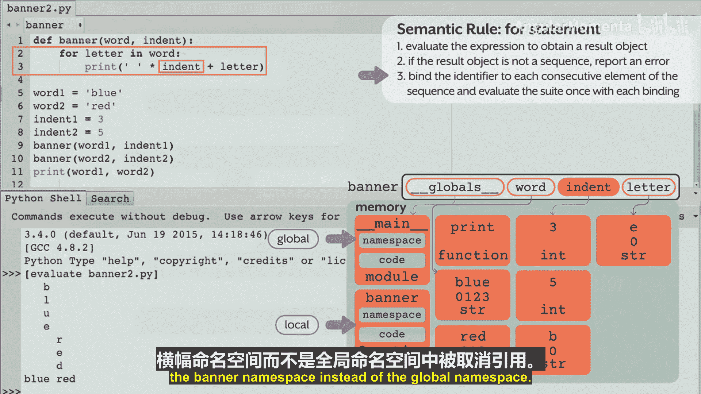

# 【阿尔伯塔大学】问题解决Python编程和电子游戏 ｜ Problem Solving, Python Programming, and Video Games p65 07_03_01_python-function-parameters -BV1N5rLBWE1c_p65-

This video generalizes function definition syntax and semantics to include parameter lists that support function call arguments。

You can call a built in function multiple times each time with different arguments such as print。

 blue and print red。 The same is true for user defined functions。

I will modify the banner program to display banners for two words using arguments and run the program。

It works。 Two banners are displayed， one for blue and one for red。

To include an argument list and a function call， a corresponding parameter list must be supported in function definitions。

 recall the syntax diagram for function definition。

Here is a simplified syntax diagram for parameter list。

The banner function definition has valid syntax。I will show you how the Python interpreter interprets this program。

When the program starts， the local block is the main module whose namespace is both the local and global namespace。

 The prebound identifier print is bound in this namespace。

The first statement in the main module is a function definition。

 so the interpreter applies function definition semantics， just like the previous lesson。

The interpreter creates a function object with its own namespace。

 adds the identifier banner to the local namespace， binds banner to the function object。

 and binds a reference to the global namespace in the banner namespace。

Recall that the interpreter does not evaluate the function suite when it is evaluating the function definition。

After to function definition statement， the interpreter evaluates lines5 through8 using assignment statement semantics。

In the local name space， word 1 is bound to the string blue。 Word 2 is bound to the string red。

 Indent 1 is bound to the integer 3， and indent 2 is bound to the integer 5。

 Then the function called the banner on line 9 is evaluated。

The function call semantics are modified to support arguments and parameters。

 A new step 4 is added before the existing step 4 to ensure that the argument list and parameter list have the same length。

Details are also added to the original step 4， which is the new step 5。In step1。

 the identifier banner is dereferd in a local namespace to obtain the banner function object。

In step 2， since there are two argument expressions。

 they are evaluated to obtain the two argument objects， blue and 3。

 And these two objects are put in a new argument object list。In step 3。

 since the expression object banner is not a method object。

 no special argument is added to the argument object list。In step 4。

 the length of the argument object list is2， and the length of the parameter list is two。

 so no error is reported。In step 5， the parameter word is added to the banner name space and bound to the argument object blue。

 Then the parameter indent is added to the banner name space and bound to the argument object 3。

Each parameter is a local identifier bound during the function call。

 Notice that the parameter identifier's word and indent are different than the identifiers used in the function calls。

 In this example， it is impossible for the parameter names word and indent to match both the identifier names word  one and indent1 in the first function call and to match word2 and indent2 in the second function call。

 The identifier names don't matter since the parameter identifiers are bound to the argument objects in order。

If the parameter identifiers were instead called word2 and indent 2。

 these identifiers would be added to the banner namespace and bound to the blue and three during this first function call。

In step 6， banner's statement suite is evaluated。 The local block is now banner。

 and the local namespace is now banner's namespace。Just like the previous lesson。

 the single statement in the function definition suite uses four statement semantics。In step one。

 the identifier word is evaluated。In this program， the banner function definition statement bound the identifier word as a parameter in banner's namespace。

 So the interpreter de references were to obtain the object blue。In step 2， no error is reported。

In step 3， the identifier letter is bound in the local namespace to the element of the string object blue at index 0。

 which is the string object B。The four suite is evaluated for the first time。

Evaluation of the banner function continues as in the previous lesson。

 except the parameter indent is dereferenced in the banner namespace instead of the global namespace。

The string blue is printed as a banner。The result object is the unique nun type object。

 and step 6 finishes by deleting letter， indent and word from the banner namespace since they were added during the function call。

The interpreter returns to the main program and evaluates the next statement。

 which is another function call to banner。This cause evaluated the same way as the previous call。

 except this time in the banner name space， the parameter word is bound to the argument object red。

 and the parameter indent is bound to the argument object 5。The string red is printed as a banner。

 the same nu type result object is returned， and letter indent and word are again deleted from the banner namespace。

In this video， I generalized the function definition syntax and semantics to include parameter lists that support function call arguments。

