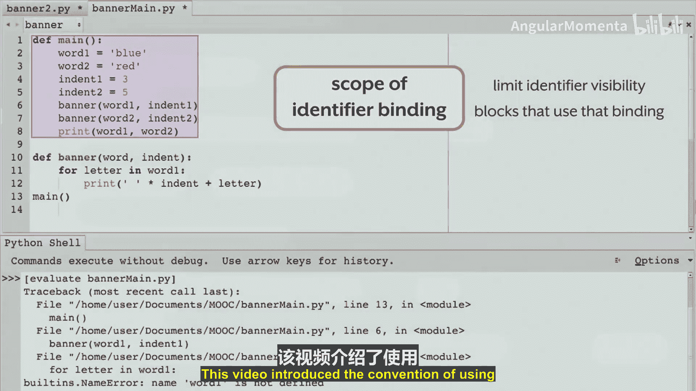
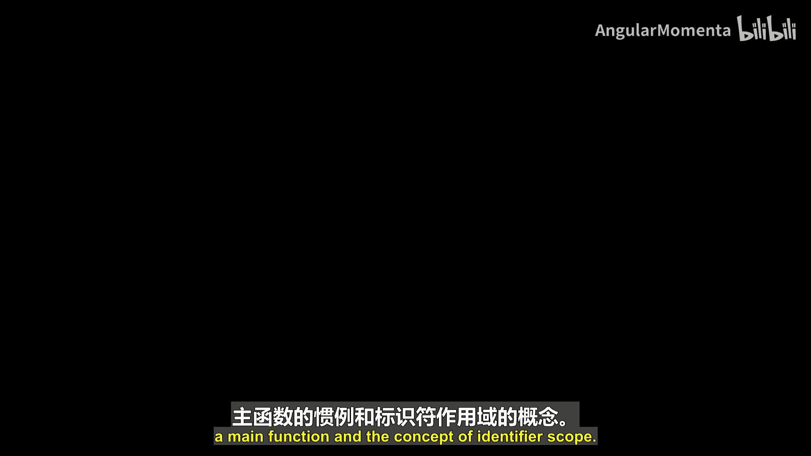

# 【阿尔伯塔大学】问题解决Python编程和电子游戏 ｜ Problem Solving, Python Programming, and Video Games p66 07_04_01_python-main-function-and-identifier-scope -BV1N5rLBWE1c_p66-

。This video introduces the convention of using a main function and the concept of identifier scope。

Recall the program from the function Para lesson。What will happen if I make an error in the function definition by using the identifier word 1 in the four statement header instead of using the identifier word？

I'll run the program。The program displays two banners for blue，1 withindent 3 and one with indent 5。

 I have accidentally used the global identifier word1 in both function calls to banner when the interpreter evaluates the force statement header。

 It de referenceences word 1 instead of word。 Since word 1 is not bound anywhere in the function definition statement。

 It is a global identifier that is de referenceenced in the global namespace to obtain the string object blue during both calls to the banner function。

😊，Many experienced Python programmers use a convention to prevent the accidental use of such global identifiers。

 they introduce another user defined function called Mainine。For example。

 here is a program containing the same accidental use of word1， which uses a main function。

This new main function contains all the statements that were previously in the main module。

 except for the banner function definition。Word 1， Word 2， Indent 1。

 and Indent2 were previously bound in the main module's namespace。

 which means they could be used as global identifiers in banner。

They are now in the main function namespace， so they can no longer be accidentally referenced inside Ban or any other user defined function。

We call this function main， since it contains most of the statements that were in the main module previously。

In general， you should move all the statements from your main module to the main function。

 except for import statements， function definitions and class definitions。

Class definitions will be introduced in a later lesson。

It's important to recognize that the main module and main function are different。

There is still a main module， which only contains the two function definition statements。

 one for main and one for banner。I'll run the program。There is no output。

Remember that a function definition does not evaluate its suite。

 I need a function call to evaluate the main function suite。

I'll add a single function call to main at the top of the main module and run it again。

A na error indicates that main is not defined since it has not yet been bound to the function object。

Like any other identifier， a function name must be bound before it's used。

Since a function definition is used to bind a name to a function object。

 the function definition for main must come before the function call to main。I'll fix this。

 and run it again。A different name error is reported indicating that word 1 is not defined。

 This error reports my accidental use of the identifier word 1 inside banner。

It is a useful error since prevents me from using an identifier that would have been a global identifier if I had not used the main function。

In general， it is better to have the interpreter report in error than to silently let the program compute the wrong answer due to a programmer's mistake。

I will show you why this error was generated。When the program starts。

 the local block is in the main module whose namespace is both the local and global namespace。

The prebound identifier print is bound in this namespace。

The first statement in the main module is a function definition。

 so the interpreter applies function definition semantics， just like the previous lesson。

The interpreter creates a function object with its own namespace。

It adds the identifier main to the local namespace， binds main to the function object。

 and binds a reference to the main module namespace and the main function namespace。

Since the next statement is a function definition for banner。

 the interpreter repeats these function definition semantics for banner。

The last statement in the main module is a function called to main。

 so the interpreter applies the function called semantics。

The identifier main is dereferenced at the local namespace to obtain the main function object。

Since there are no arguments and the main function is not a method。

 an empty argument list is created。The parameter list and argument list both have length 0。

 so no errors reported。There are no parameters to add to the function namespace。

The main function code is evaluated to obtain a result object。

The local block is now the main function， and the local namespace is the main function namespace。

The first four statements of the main function suite are assignment statements。

In the local namespace， the interpreter binds word 1 to the string blue， word 2 to the string red。

 indent 1 to the integer 3， and indent 2 to the integer 5。Next。

 the interpreter evaluates the first function call to banner。In step 1。

 the interpreter evaluates the identifier banner to obtain a function object。

 Since banner is not bound in the main function block。

 It is dereenced in the global namespace to obtain the banner function object。

Banner is used as a global identifier in Maine。In step 2， since there are two argument expressions。

 they are evaluated to obtain the two argument objects， blue and3。

 and these two objects are referenced in a new argument list。In step3。

 since the expression object banner is not a method object。

 no special argument is added to the argument list。In step 4， the length of the argument list is 2。

 and the length of the parameter list is 2。 so no error is reported。In step 5。

 the parameter word is added to the banner namespace and bound to the argument object blue。

 Then the parameter indent is added to the banner namespace and bound to the argument object 3。

In step 6， the function code of banner is evaluated。 The local block is now the banner function。

 and the local namespace is the banner function namespace。

The global namespace is still the main module， not the main function。

The single statement in banner uses four statement semantics， so the expression word 1 is evaluated。

Since the identifier word 1 is not bound in the local block。

It is not de referenceenced in the local name space。

 The interpreter looks for word  one in the global namespace and does not find it。

 So an error is reported。Moving the identifier word1 from the global namespace to the namespace of the main function has prevented an accidental reference to a global identifier。

Programming languages use a concept called scopepe to limit the visibility of identifiers。

The scope of an identifier binding refers to where in the code the binding can be used。

 Since Python code is divided into blocks。 The scope is all the blocks where dereverencing the identifier will use that binding。

For example， the scope of the word one binding in the main function namespace of this program is only the main function block。

Its scope does not include the banner function block。

 since no other binding of word 1 exists in the program。

 a reference to word one in the banner function block generates a name error。

The scope of the word one binding in the main module namespace of the previous program is both the main module block and the banner function block。

The reference to word1 in the banner function block uses the semantic rule for identifiers to accidentally access a global identifier。

In this course， we will use a main function to remove all the identifiers from the global namespace。

 except for imported identifiers and user defined function names。

Identifier scoping is an example of encapsulation。Encapsulation is a technique for restricting access to the implementation of a component so that the implementation of that component is independent of how it's used by other components。

Consider this scenario。 I am a new developer working on a very large code base。

 I want to add new functionality， but there are already thousands of identifiers currently in use。

 without limited scope， If I rebind one of these identifiers in my function。

 it could have disastrous effects on the other functions and modules that use this identifier。

I would need to meticulously check every existing function and module to make sure I didn't use the same identifier that someone else used in their code。

Wouldn't that be unpleasant in error prone。Because scope limits the visibility of identifiers。

 I can use any identifiers I want in my functions without disrupting the same identifiers in other functions。

Every identifier binding I move from the main module to the main function reduces the scope of that identifier binding。

 so it cannot be accidentally accessed in a user defined function。

This video introduced the convention of using a main function and the concept of identifier scope。

