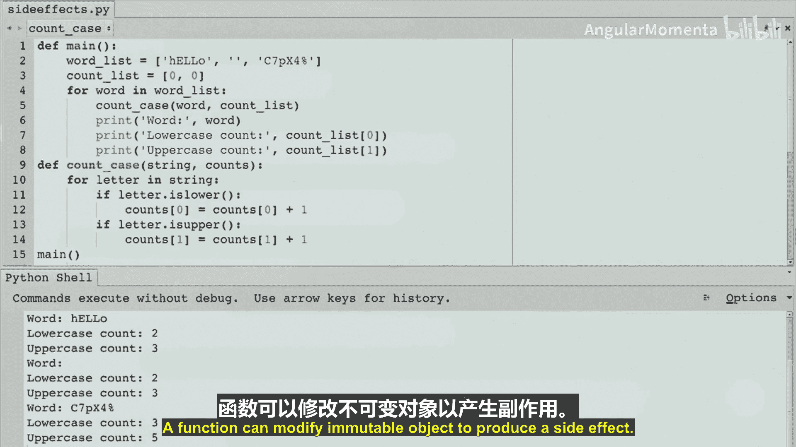

# 【阿尔伯塔大学】问题解决Python编程和电子游戏 ｜ Problem Solving, Python Programming, and Video Games p68 07_06_01_python-side-effects -BV1N5rLBWE1c_p68-

。This video introduces side effects， a way to modify an object inside a function so that the modification can be used outside the function。

Besides using a return statement to return result object。

 a function can also modify existing objects as long as they are mutable。

Such objects can be passed as arguments or accessed using global identifiers。However。

 using global identifiers to modify mutable objects is not usually a good idea。

This program uses the function count case to modify an existing list object that is passed as an argument。

In the main function， the count case function is applied to each word in a list of words。

After each called count case， the word is printed， as well as the total lower and uppercase letter counts for all of the words so far。

I'll run the program。The count case function has two arguments， a string and a list。

 It iterates over the string elements and counts each lowercase and uppercase letter by incrementing a value in the argument list。

No return statement is needed in count case since the function modifies the list argument。

When count list is printed in the main function， it reflects the changes made to the list by the count case function。

I will apply semantic analysis to this program。As usual when the program starts。

 the local block is the main module， whose namespace is both the local and global namespace。

 the prebound identifiers are bound in this namespace。The function object main is created。

 The name main is added to the local namespace and bound to the object。

A reference to the global namespace is added to the function namespace。

 These semantics are repeated for count case。Next， the identifier of the main function call is evaluated to obtain the main function object。

 an empty argument list is created and passed to the main function object。

 which then evaluates its code。Local block and local namespace are updated。

The first two statements of the main function are assignment statements that create two new lists。

The first list contains three string objects with various characters。In the local namespace。

 word list is bound to this first list。The second list is a two element list where both elements are 0。

 Count list is bound to the second list。Next， the four statement is evaluated。 First。

 the identifier word is added to the main functions namespace and bound to the element in the word list at index 0。

Then the count case function is evaluated in step 1， in the global namespace。

 the count case identifier is de referenceferd to obtain the count case function object。In step2。

 the argument list is evaluated to obtain two argument objects， the string hello。

 and the two element list object that counts character cases。In step 3， count case is not a method。

 so the argument list is not modified。In step 4， the length of the argument。

 object list and parameter list are both two， so no error is reported。In step 5。

 the parameters string and counts are added to count cases namespace and bound to the argument objects hello and the two element list。

In step6， count Ca's statement suite is evaluated。The local block and name space are now count case。

In count case， the four statement is evaluated。 The identifier letter is added to countcase' namespace and bound to the string element whose index is 0。

 So letter is bound to the lowercase string H。Next。

 the first if statement is evaluated since letter is bound to the lower K string H。

 when the is lower method is called， the method returns true。

 and the if statement suite is evaluated。Subscription is used to access the list element at index 0。

 add one to it to obtain the result object 1， and rebind the zero index to this result object。

This binding is in the namespace of the list， not the function。

 so it is accessible anywhere the bindings of the list are accessible。

Changing this list element in the count case function is a side effect in the namespace of the main function。

 count list is bound to the list object in the local namespace of the count case function。

 counts is bound to the same list object。When the count case code modifies the list object using the counts reference。

 it is modifying the same object that count list is bound to in the main function namespace。

A side effect occurs when a subsequent binding to an object is used to modify that object。

 and the change is observed when the original binding is used as a reference。In this case。

 each element in a list has its own binding， but these bindings are inside the list object and are accessible anywhere the entire list object is accessible。

In the second if statement， since H is not an uppercase letter， the suite is skipped。

The four statement header is evaluated again。 The target identifier letter is rebound to the next element in the string。

 which is the uppercase letter E。The first， if statement header is evaluated。

 E is not a lower case letter， so is lower returns false， and the suite is not evaluated。

The second if statement is evaluated， since E is an upper case letter。

 the is' upper function returns true， and the suite is evaluated。

Subscription is used to access the list element at index 1。

 Add one to it to obtain the result object 1 and red the one index to this result object。

The force statement suite is evaluated again for each remaining letter in the argument string。

Then the function is finished， so the interpreter deletes the identifiers， string， counts and letter。

 It then returns the nun type object to the main function， which ignores it。

The local block and namespace are updated to refer to the main function once again。

The word and the two elements in the count list are printed。

 The local identifier count list is used to reference the list that was changed in the count case function。

 The modifications made by the count case function are successfully printed。In the main function。

 the Four statement suite is evaluated again for each of the remaining words in the word list。

Each time the count case function is called， it causes a side effect on the two element list。

Then the main function is finished so the identifier's word list， count list。

 and word are deleted from its namespace。The program is done。

This video introduced a second way that a function can affect objects in a program instead of using a return statement which passes an object back to the calling block。

 a function can modify a mutable object to produce a side effect。

