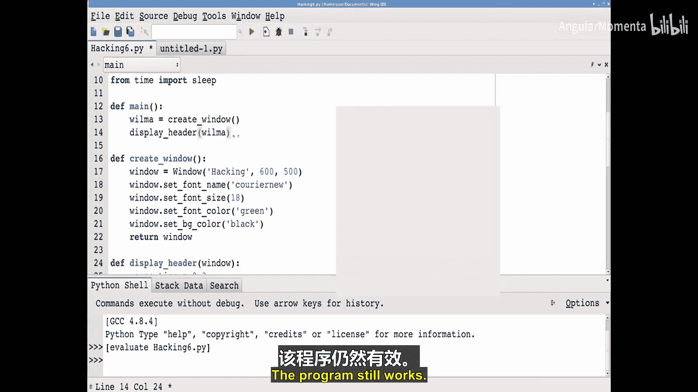
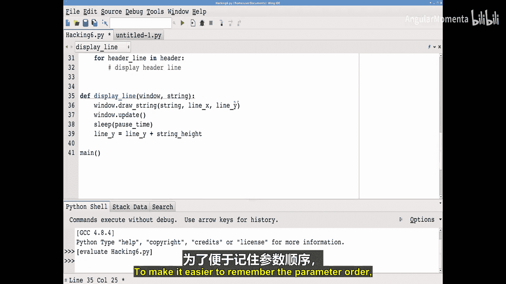
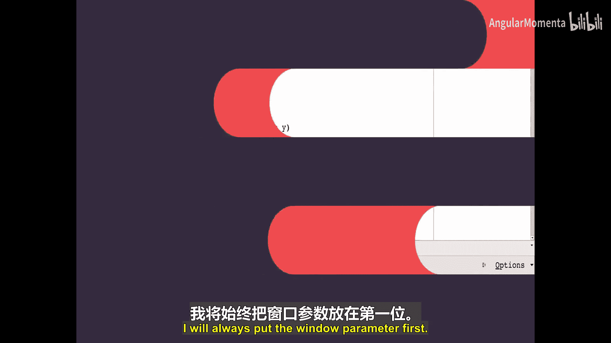

# 【阿尔伯塔大学】问题解决Python编程和电子游戏 ｜ Problem Solving, Python Programming, and Video Games p69 07_07_01_program-hacking-version-6 -BV1N5rLBWE1c_p69-

You're ready to program hacking version 6。 This version is all about using functions to improve your code quality。

When you previously added a new control structure to improve your code quality。

 it required you to modify the structure of your solution at the algorithm level。

Functions also act as control structures since they determine when blocks of code are performed。

However， implementing functions in hacking version 6 does not require you to modify your algorithm。

 Your complete version 5 design is still relevant in version 6。

Creating functions is very similar to decomposing your algorithm into panels。

 which you've been doing all along。 Almost every panel in your algorithm will become a function in your code。

 The title of the panel will be the name of the corresponding function。

There will also be two functions that are not represented by panels in the algorithm。

Functions are used to create clear， readable code。 They divide code into small segments so that each segment can be individually written and tested。

 They also consolidate statement groups with similar functionality。

I'll start with the first rectangle in the main program panel， createate windowow。

Create window will become a function in my version 6 code。

 I'll replace the Cate window comment with the function header def C window。

 Then I'll indent all the statements that belong to the suite of this function underneath the header。

😊，I will introduce a main function into hacking to limit the accidental use of global identifiers。

The main panel of my algorithm will become the main function in my program。

I need a call to create window in the suite of the main function。

 so I'll create the main function now。Above the Create window function。

 I'll write a new function header， Deaf Ma。Inside this main function。

 I'll add a call to create window。Now that I have written two functions， I should test them。

 I'll run the program， but I get a name error for window in the code below my functions。

The code in the main module doesn't have access to the window binding inside of the Cate window function。

However， I still need to test my new functions to do this， I could just delete the rest of this code。

 but I'll paste it into a new document。 Instead， I need to use most of this code later。

Every time I write a new function， I need to test that function。

This process is known as unit testing。Every small unit of code should be individually tested to ensure it works before it is used in the full program。

In this course， we will generally treat each function as a unit and test each function as it is written。

To test createre windowow， I only need to add a call to Ma at the bottom of the program。

 since Ma already includes a call to create window。This time， when I run my program。

 I don't get any errors。 However， since I've removed the code that closes the window。

 the window doesn't close any more。 I'll deal with that later。Instead。

 I'll move on to the next function。The next step after createate window is display header。

 so I'll write that function next。I'll start by writing D display header in the suite。

 I'll paste the old version 5 code that displays the header。

Then I'll add a call to display header in Maine and run the program again to test my new function。

A name error reports that window is not defined since it is not bound in display header。

There are two aspects to this problem。 First， the scope of the identifier window is restricted to the create window function。

I need to return the window object so it is accessible outside of Create window。Second。

 the window object has to be accessed inside another function， display header。

I will add a window parameter to display header so that I can pass the window object as an argument。

I'll add a return statement to createate window the returnsturn window。

I'll bind a new identifier called windowdow to the return object of the Cate windowow function call in Maine。

I can then pass that window object into display header as an argument。

I'll also add a parameter called window to the display header function definition。

I'll run my program again， and it works。A window opens and the header is displayed。

Although I have used the same identifier window in the main。

 createate window and display header functions， I can use any name in each of these separate blocks。

I will illustrate this by changing the name in Maine to Wilma。The program still works。

I'll change it back since Wilma is not a very descriptive identifier for a window。

The next step is to display the password list。 Notice that display header and display password list both use those four familiar lines of code。

 a call to drawstring， a call to update the window。

 a pause and an assignment statement to update line Y。

We've said before that functions consolidate code with similar functionality。

 If I'm going to use those four lines of code over and over again。

 I should write a function that contains those lines。

Then I can call the function whenever I want to use that code。As always。

 I'll start with the function header by writing De display line underneath the last function definition。

I'll cut and paste the four lines that display a string from display header into the display line suite。

I want this function to be general enough to display a header， password or outcome line。

This is an example of solution generalization。It should be able to display any string I pass as an argument。

 I'll replace header line in the drawstring call with the identifier string and then add string as a parameter in the function header。

I will also add a window parameter so that I can draw and update the window。

To make it easier to remember the parameter order， I will always put the window parameter first。

A location is also required to display each string。

 This function must change the Y coordinate of the location after displaying the current string。

To change the argument object in the function， I will use the side effect on a mutable argument object。

 I will use a list containing two coordinate integers， as an argument。

I'll add the identifier location to the parameter list of display line。

I will replace line X and line Y in the drawstring call with location of0 and location of 1。

I will replace line Y in the update assignment with location of one as well。

The identifier's pause time and string height are bound in display header。

 but are only used in display line。 I will move these assignment statements to display line。

 where they are needed。To complete the function， I must add a block comment at the top of the function that describes both the function behavior and what each parameter is for。

 including its type。Now I can use my display line function in display header， display password list。

 and display outcome。I will update the code in display header to use this function。

When adding a function call that does everything described in a comment。

 you should replace the comment by the function call。 For example。

 I will replace the redundant comment display headerline by the function call display line。

I need three arguments in the right order。 I will use window as the window argument and header line for the string argument。

The last argument must be the location， which is a list containing the X and Y coordinates for display。

I haven't created a location list yet in the program。

If an object is needed in more than one function， it must be created in a block that can pass the object as an argument to all of the functions where it is needed。

I should create the location list in the main function since it is used in three different functions called in main display header。

 display password list and get guesses。It is also used in other functions called by each of these three functions。

I will pass this location list to display header。Finally。

 I will modify display header to include a location parameter and remove the line X and line Y assignment statements。

This function is done。Now it's your turn， you must create the following functions and call them in the main function。

Display password list， get guesses， and end game。Inside get guesses。

 you must call prompt for guess and check warning functions。Inside End game。

 you must call display outcome and prompt for end functions。

You must also create a function definition for each function you call。 However。

 prompt for guess and prompt for end are similar enough that you should make a single function called prompt user and call it instead。

The function prompt user will eliminate a duplicate statement group Cating prompt user is similar to creating display line。

You will discover that the identifier attempts left is used in more than one of the user defined functions。

 You must decide where to bind it and how to make it available everywhere that it is needed。

Every time you create a new function you should test it。

 don't forget to include a descriptive comment for all of the functions you write。

 including the functions I wrote。

