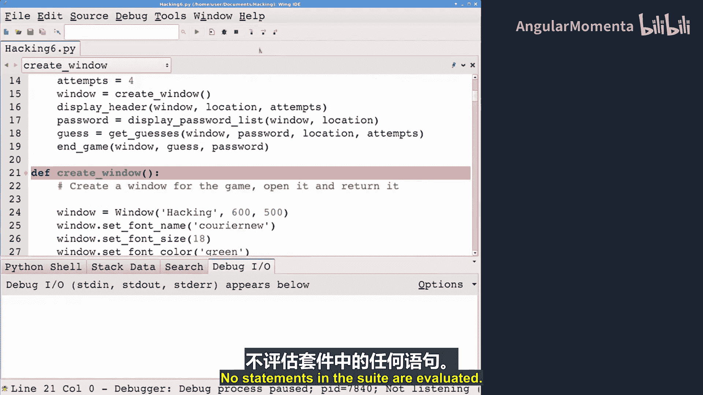
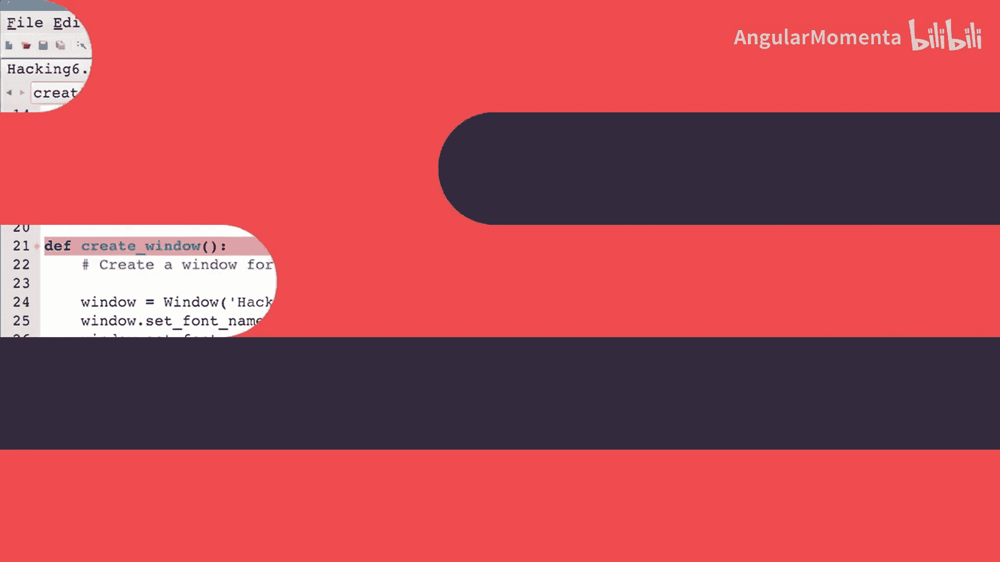
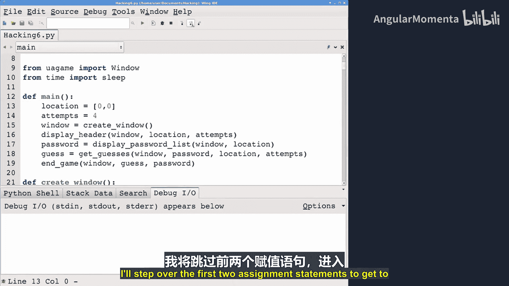
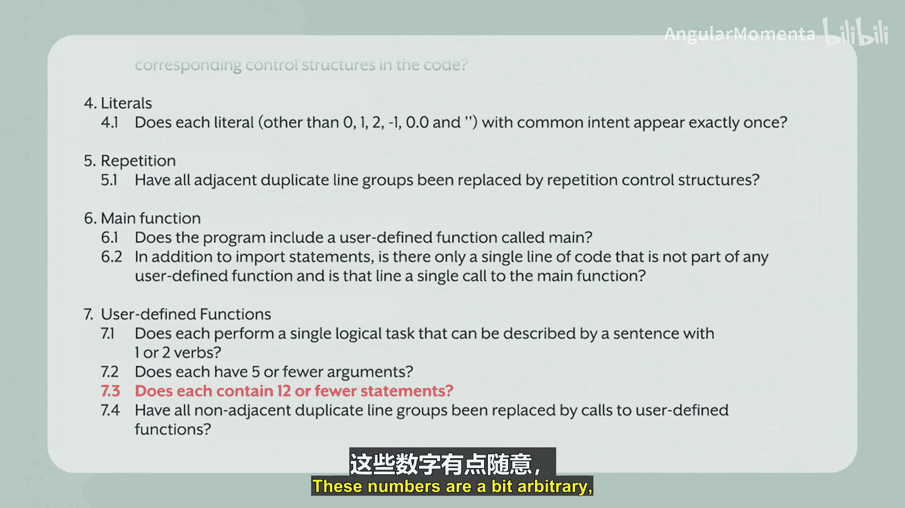

# 【阿尔伯塔大学】问题解决Python编程和电子游戏 ｜ Problem Solving, Python Programming, and Video Games p70 07_08_01_review-code-for-hacking-version-6 -BV1N5rLBWE1c_p70-

🎼。Let's reflect on hacking version 6 for this reflection。

 I'll show you how to trace user defined functions。Here's the solution for hacking version 6。

 it begins with the program comment which hasn't changed since version 5 Next are the two import statements we've been using since version 2。

The first change is the definition of the main function。In the programming demonstration。

 we said that almost every panel in the algorithm must be translated into a function and here they are。

Let's compare the main function definition with the algorithm。

 The first two assignment statements aren't in the algorithm since they are simple assignment statements。

 However， the next five statements all correspond to rectangles in the algorithm。

 since each is a function call。 That's pretty handy。Let's trace， to start。

 I'll press the step into button to begin the trace。The trace starts at the import statements。

 which I will step over when I press the step in2 button next。

 the entire function definition is evaluated by adding the function name to the program's namespace in one step。

No statements in the suite are evaluated， therefore， the next function definition is highlighted。

I'll place a break point next to the main function call at the very bottom of the program。Next。

 I'll press the bug button to reach the main function call。I'll press the step over button now。

 the debugger evaluates the entire main function and all of the functions it calls in one step。

 so I can't trace individual function calls。If there had been another statement after the main function call。

 stepping over Ma would have played the entire game and then highlighted that additional statement。

 For example， I will stop the trace， add a statement after main and press the bug button again。

After entering hunting in the game window， the programme displays the correct outcome。

 closes the window and exits main。 The debugger then highlights the statement I just added。😊。

I'll stop the trace and press the bug button again。 The main function call is highlighted。

 recall in versions1 and two of hacking we used the step over button so that we could ignore the code that was inside the built in and imported functions This time we want to examine the code inside the main function so I'll press the step in button to examine its statements。

The first assignment statement in Ma is highlighted。

 I'll step over the first two assignment statements to get to the first function call in main called createreate window。

Before I step into this function， notice that stack data has two identifiers， attempts and location。

 recall the functions or blocks and have their own namespaces。

 Since we are inside the definition of the main function。

 Locals represents the functions's namespace。When I press the step in two button。

 the first statement of create window is highlighted In stack data， Lo and attempts no longer appear。

 This is because location and attempts are not in the namespace of create window。

 They are in the namespace of the main function。The first four statements in Create window are familiar from previous versions。

 so I'll step over them until the return statement is highlighted。

Stack data now shows the window identifier in the namespace of createreate window。Now。

 I'll press the Step intoto button。The return statement is still highlighted， and in stacked data。

 I also see that the return value of the function is a window。

Notice that return value and the window object have the same memory address。

 so they are the same window object。I'll press the step over button again。

 this time the display header function call is highlighted。Take a look at stacked data now。

 since the assignment statement added window to the main functionss namespace。

 windowdow appears in locals windowow was bound to the return object of the Cate window function。

Window in the main function refers to the same object as the window in createre window。

 since they have the same address。Before I step into this display header function。

 notice that attempts is bound to four and note the addresses of location and window objects。

I'll step into the display header function。 Take a look at stacked data。

 Even though no statements have been evaluated in this function。

 there are three identifiers in locals， attempts， location and window。

Since display header has three parameters when the function is called。

 each parameter is added to the name space and bound to its corresponding argument in order。

 Notice that attempts is 4 and the memory addresses of the other two objects are the same。

I'll step over the header assignment statement， in stack data。

 header has been added to locals since header has been bound in the local namespace。Next。

 I'll expand to the location list， notice that the0 and1 indexes are bound to the zero before the call to display line。

Now I'll step into the force statement and then into the display line function call。

In the display line function definition， the pause time assignment statement is highlighted。

Notice in stack data that the window， location and string parameters have been added to the local namespace。

Also notice that the last statement in this function changes the value of location of one to the string height。

I will press the step out button to complete the evaluation of this function。

Evaluation returns to the calling function display header。

 and the header of the force statement is highlighted。Looking at stack data。

 you can see the index1 of location has been rebound to the string height。When I step out again。

 evaluation returns to the calling function main， and the password assignment statement is highlighted。

Notice that the location of 1 is bound to 57， since the fourth statement evaluated display line two more times when I press the step out button。

The changes to location in display line are side effects。

Let's stop tracing and introduce the new software quality tests for hacking version 6。

The first new set of tests is a new section of comment tests for user defined functions。

In addition to placing comments at the start of the program and above logical code blocks。

 you must add a comment to each user defined function except for me。

You don't need a comment for the main function since it is described by the program comment and it doesn't have any parameters。

Each function comment must be at the start of your function。

 describe what the function does using one or two verbs。

 be indented one level from the function definition， and describe each function parameter。

Each function parameter should use a one line comment to describe its role in type。

The second new set of tests forms a main function section。The two new main function tests are。

 the program includes a user definedfined function called Main， and in addition to import statements。

 there is only a single line of code that is not part of any user defineded function。

 and that line is a single call to the main function。

You may see Python programs elsewhere that don't include a main function， however， in this course。

 every program you write will include a main function definition and a single call to that function。

This will reduce errors caused by accidentally accessing global identifier vis。

In the previous five versions， all the identifiers you used were global identifiers， from now on。

 you will use local identifiers in user defined functions。

Having many local namespaces limits the scope of identifiers。

 this allows multiple programmers to work more independently since any identifier can be used locally inside a function。

The third and final test set is a new section titled User Deffined Funs。

Each of your functions should be simple enough that you don't need to write an essay to describe it。

A good way to test this is to check whether it performs one logical task that can be described by a sentence with one or two verbs。

 The second test is also designed to ensure that your functions are simple。

 Each function should contain more no more than five arguments， and no more than 12 statements。

 These numbers are a bit arbitrary， but they' are a good choice for this course。

Check that your code follows both the new and previous software quality tests。 Congratulations。

 you've finished version 6 of hacking。 Only one more version left。😊。

