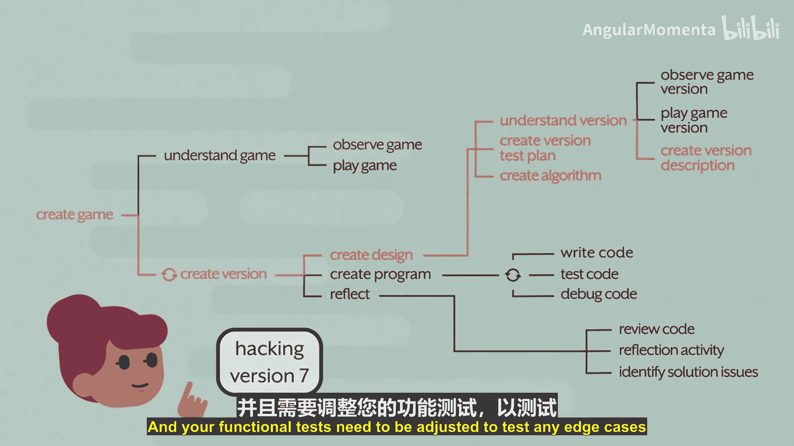

# 【阿尔伯塔大学】问题解决Python编程和电子游戏 ｜ Problem Solving, Python Programming, and Video Games p71 08_01_01_solution-issues-in-hacking-version-6 -BV1N5rLBWE1c_p71-

🎼。Before getting started with hacking Ver 7， let's look at how far you've come。

You started with a simple text based game and turned it into a graphical one。

 You modified your design and code to include multiple guesses， selection。

 repetition and user defined functions。😊，To do this。

 you learn to use many different Python expressions and seven different Python statements。

 including four control structures， if， for， while， and function definition。

You have also learned three problem solving strategies， problem decomposition， algorithms。

 and abstraction。You will use all of these techniques in the next game and any future projects you create。

But before starting the next game， you must complete the final version of hacking。

The remaining solution issues for hacking are about missing features。

It's difficult to make a progress in a password guessing game if you aren't given feedback about how close your guesses are to the secret password。

Additionally， a good way to make your game more interesting is to add graphical elements that add atmosphere。

In this final version of hacking， you will practice the skills you have learned so far。

 You will add the final features for this game， which are hint messages for incorrect guesses and embed all the password strings in random symbolic characters。

😊，You will also make a new description， functional test plan。

 and algorithm in your upcoming activities， your description must be adjusted to account for the two new features you will see when you observe the game and your functional tests need to be adjusted to test any edge cases created by these changes。

