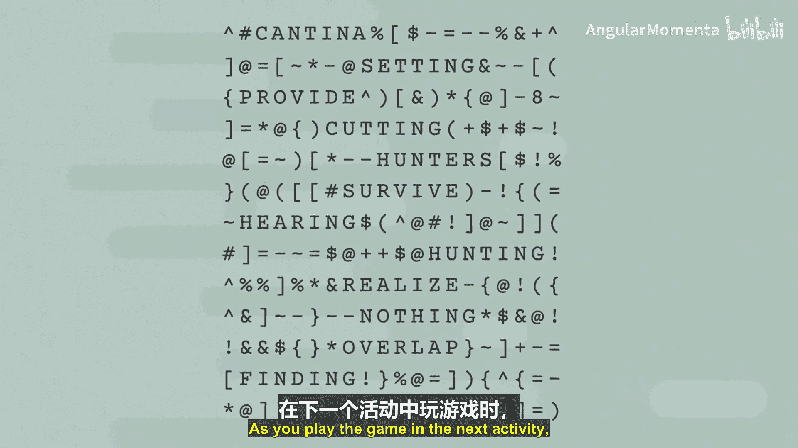

# 【阿尔伯塔大学】问题解决Python编程和电子游戏 ｜ Problem Solving, Python Programming, and Video Games p72 08_02_01_observe-hacking-version-7 -BV1N5rLBWE1c_p72-

In this video， you will observe the final version of hacking。 Remember。

 you've already observed this version of the game。 It was the very first game you saw at the beginning of the course。

😊，Let's take a look at it one more time。To start， notice the symbolic characters in the password list that weren't there in any previous version。

I'll input the incorrect answer。 finding The second new feature in this version is the addition of a hint message in the top right corner。

It indicates that my guess is incorrect and displays how many letters of my guess match the letters of the secret password。

Finding has four correct letters in matching positions with hunting。Next。

 I'll try hunting in lowercase letters， which gives me zero out of seven matching letters。

This is a good visual confirmation of one of the tests from the previous version。Finally。

 for my last incorrect answer， I'll try puttingdding。

 This gives me five of7 matching letters and also results in the lockout warning in the bottom right of the window。

😊，Inputting hunting brings me to the familiar successs Oute screen。

As you play the game in the next activity， pay attention to the symbolic characters used in the password list。

 Notice which symbols are used， whether the same symbols are selected for each line each time you run the program and where the symbols are placed。

 For example， are there the same number of symbols selected for each password and does the number of symbols before and after the password change。

