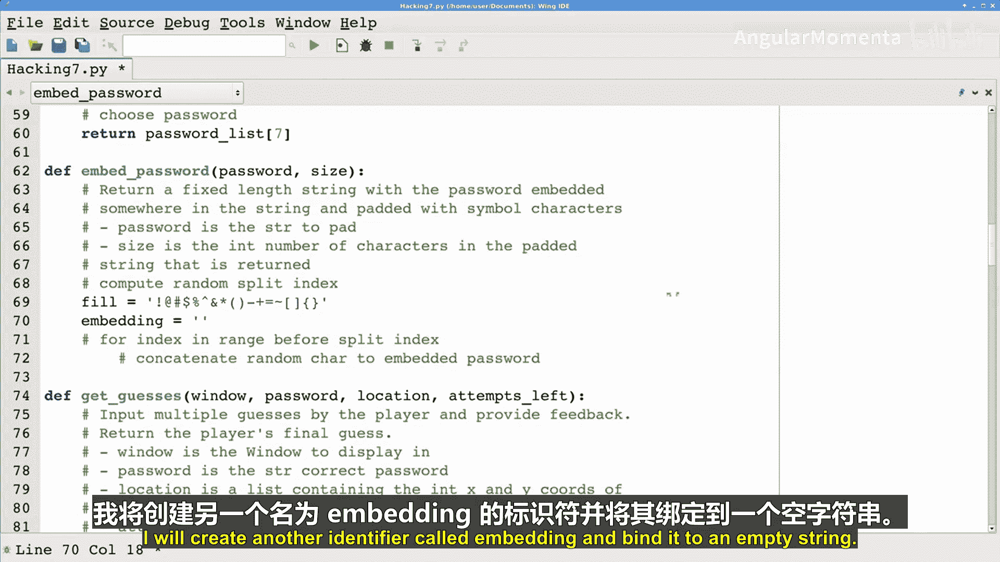

# 【阿尔伯塔大学】问题解决Python编程和电子游戏 ｜ Problem Solving, Python Programming, and Video Games p74 08_04_01_program-hacking-version-7 -BV1N5rLBWE1c_p74-

Programming the final version of hacking gives you an opportunity to create more function definitions。

You must modify display password and get guesses。 You will also write two new functions。

 embed password and display hint。I will start writing embed password for you beginning with the function header。

I'll replace the comment embed password with the lineDeaf embed password。

I'll also add the function comment for you。I already know I need a password to embed。

 so I will add password to the parameter list。I'm also going to put size in the parameter list。

 which will require me to pass in the desired length of the embedded password string。

By passing this into the function， instead of defining it inside the function。

 I can easily change how much padding is added to each embedded password。

I'll add a line for each parameter to the function comment。

Inside the function suite under the Compute randomand split index comment。

 I'll create the identifier fill。A bind it to a string that contains all possible random symbols used to pad the password。

I've used the name Phil， because this string will be used to fill in the symbols around the password。

I will create another identifier called embedding and bind it to an empty string。

This will hold the embedded password string as I create it。

Computing the split index is not as easy as just choosing a random integer between 0 and 20。

If I did this， it could result in creating an embeddedbe string with a length greater than 20。

At most， I want the number of random symbols before the password to be the total length of an embedded string minus the number of letters in the password。

I'll use the builtt in function L to compute the password size。

Then using the Rant function from the random module。

 I'll compute a split index between0 and size minus the password size inclusive。

 which means the endpoints are included。Now I can replace the first four icon comment with a four statement that adds the first sequence of random symbols to the embedding。

From my algorithm， I know that the loop header should be4 index in range0 to split index。

Inside the for loop， I will use another function from the random module。

The function choice takes a sequence argument and returns a random element from that sequence。

I can use this to select a symbol from the fill string and concatenate it to the embedding string。

I will remove the redundant concatenate random char comment。

I must add another import statement to be able to use those two functions from the random module。

I will leave the rest of hacking version 7 to you finish the embed password function。

 update the display password list function and write the code to display hints。

