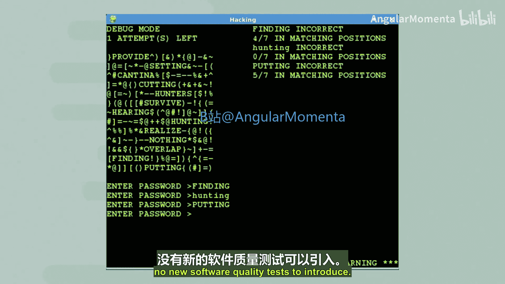
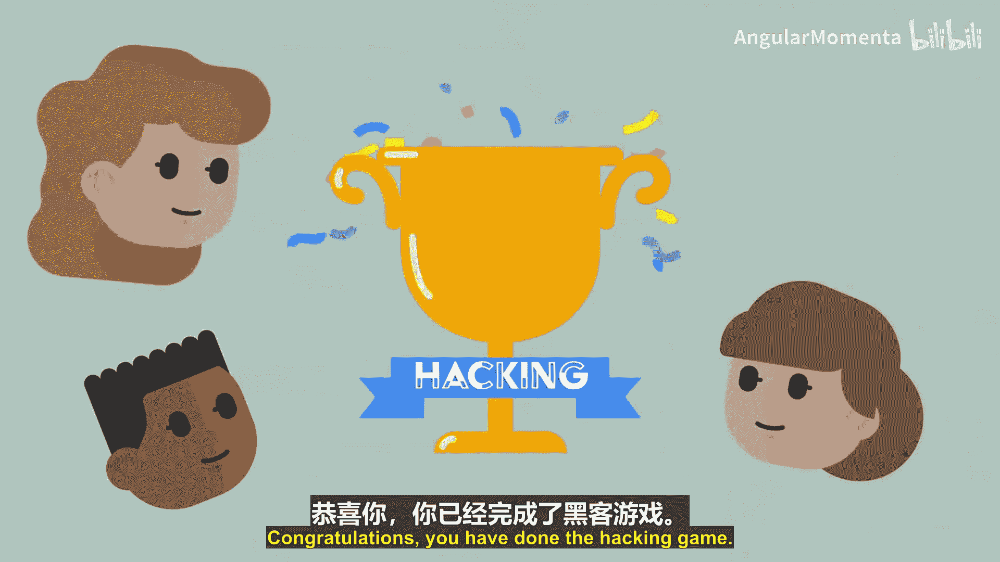

# 【阿尔伯塔大学】问题解决Python编程和电子游戏 ｜ Problem Solving, Python Programming, and Video Games p75 08_05_01_identify-solution-issues-in-hacking-version-7 -BV1N5rLBWE1c_p75-

🎼。You finished hacking。I won't trace the version 7 code and there are no new software quality tests to introduce。

But you should still make sure your code passes the previous software quality tests。

Since this is the last version of hacking， there's only one thing left to do。

 let's identify any solution issues or solution improvements that could be made。

In terms of solution issues， there aren't really any。

 you have successfully added all the features required for the complete hacking game。

Your functional test plan completely tests the game behavior。

 and your code has met the software quality standards。

But your game can still be improved。 Consider this Hacking isn't all that replayable。

 If you know what the correct answer is after playing at once。

Hacking gameplay could be improved by randomly choosing a password from the password list as the correct password。

In addition， you could create a large list of passwords and randomly choose 13 from that list to be used in the game。

Then every game would have a random selection of words and a random， correct password。

It would make testing more difficult， but it would also make the game much more fun to play。

You could also increase the difficulty of the game。

 You could choose how many guesses players get based on their skill in previous games。

 A player who consistently guessed the password in three guesses would have the total attempts reduced from 4。

A player who doesn't win often or at all with four guesses， could be given more attempts。

Another way to make the game more challenging is to erase some of the characters of the passwords in the password list so that the player needs to guess what the missing letters are。

You could try implementing any of these improvements or think of other ones。Congratulations。

 you are done the hacking game。

