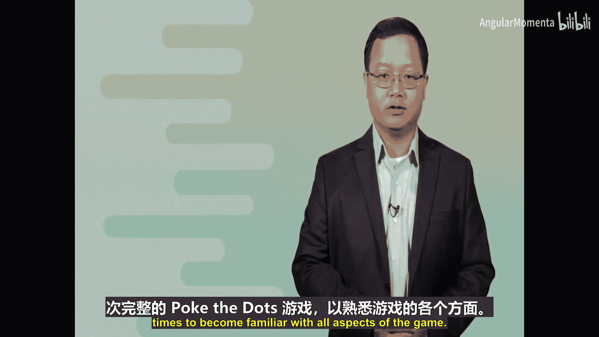

# 【阿尔伯塔大学】问题解决Python编程和电子游戏 ｜ Problem Solving, Python Programming, and Video Games p76 09_01_01_introduction-to-poke-the-dots -BV1N5rLBWE1c_p76-

Welcome to the next game You have finished hacking and you're back to the first task in the game creation process。

 It's been a while since you've seen the create game task。

The next game you will be making is called poke the dots。 As you create poke the dots。

 you will learn to handle multiple player actions and animate graphical objects to do this。

 You will learn new programming concepts such as classes and user defined methods Before you start your first version of poke the dots。

 The complete feature set for the final game must be decomposed into version feature sets。😊。

Recall that we use the problem solving technique called feature selection to create these feature subsets。

Like in hacking， I will provide the Po dots version feature sets for you。

 We previously talked about two considerations for creating diversion feature sets for a game。

 The first is balance feature sets。 Since all versions should take roughly the same amount of effort to implement。

 the second consideration is feature dependency。Features that depend on other features must be implemented later on。

 For example， in hacking， displaying hint messages was one of the last features that you implemented。

It required you to have already implemented the features that prompt a user for a guess and compare that guess to the correct answer。

You needed to learn if statements， four statements and multiple UA game functions to write the code for the hint messages。

Trying to learn and implement all those features at once would have been far too much effort for one version。

 Being aware of dependencies and the complexities of your features allows you to plan your versions in a way that keeps the time and effort of making those versions manageable。

The first version of Poke de dots will focus on a new technique called event handling。

 There are many categories of events in a game。 These include mouse clicks and key presses。

 Event handling allows you to recognize these events and react to them， if necessary。

To handle events you will be using the Gs library PI game recall that UA game is based on the PI game library。

 you will continue to use UA game but you will also need to use some capabilities from P game directly。

In the next few lessons， you will observe and play the complete Poke de dots game。

 You will also observe， play， describe and create a test plan for Poke de dots version 1。

You're back to the understand game task and the game creation process。 These two subtasks。

 observe game and play game are the first two steps in using experiential decomposition to understand the full game。

First， let's take a look at the complete Poke de dots game。When the window opens。

 there are two dots moving on the screen。 When the dots hit the edge of the screen， they bounce。

In the top left corner of the screen is a scoreboard that increases for every second that the game is running。

When the dots collide， the gay adss。Unlike hacking， I won't press enter to end a game。

 instead I'll press the close icon to close the window。I'll start the game again。 This time。

 the dots start in different places on the screen。 I'll restart the game a couple of times to confirm that the dots start in different places each time。

The next thing I'll do is click the left mouse button。When I do this。

 the dots disappear from the screen and reappear in a random location。

 They do this every time I click the mouse button。Finally， notice the speed of the dots。

 the red dot and the blue dot move differently。 The red dot moves faster in a vertical direction。

 and the blue dot moves faster in the horizontal direction。

You should now play the complete Pokeda dots game yourself several times to become familiar with all aspects of the game。

