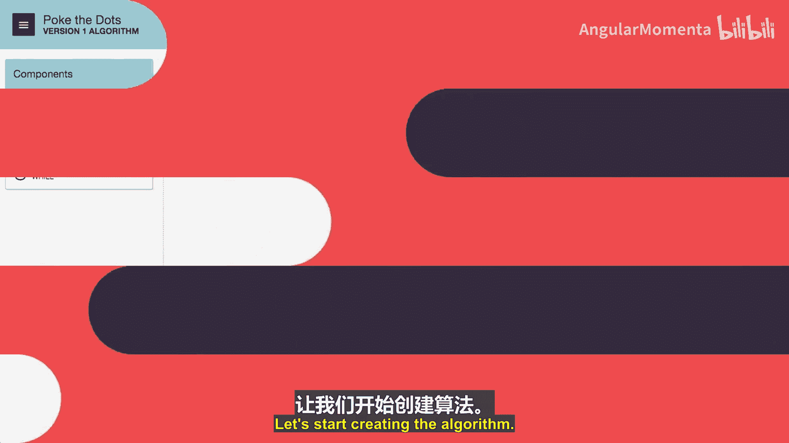
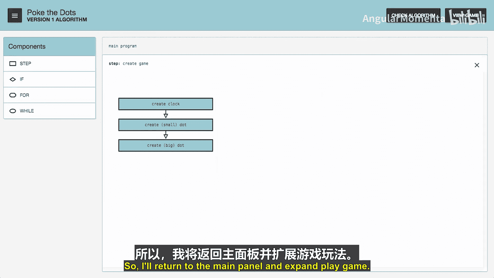
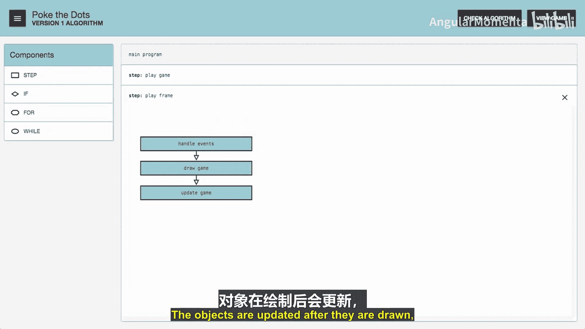
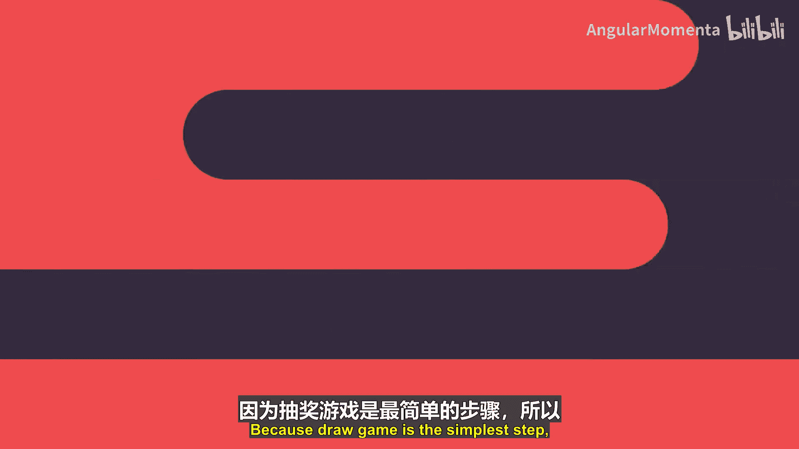

# 【阿尔伯塔大学】问题解决Python编程和电子游戏 ｜ Problem Solving, Python Programming, and Video Games p78 09_03_01_create-algorithm-for-poke-the-dots-version-1 -BV1N5rLBWE1c_p78-

🎼。Welcome to the first algorithm demonstration for Polke the dots。

 This demonstration will be a little different from the ones you've seen previously。

 since I will be going through the entire algorithm， and there will be no activity afterwards。

Now that you've created your description and functional test plan。

 let's talk about the two main differences between poke the dots and hacking。First of all。

 in hacking， there was no continuous motion of objects in the game window。

 As soon as something was displayed in the window， it remained there until the screen was cleared for the end results。

In poke the dots。The dots move continuously within the window until they collide with each other。

Like movies， games use the rapid transition of multiple still images to simulate movement。To do this。

 a program needs to draw its changing objects fast enough that the human eye doesn't detect that it is looking at still images。

The second main difference is that in hacking， changes to the game screen happened either right after the game starts or after waiting for player input。

In poke the dots， the game must update based on both player actions such as mouse clicks and game conditions such as dots hitting an edge of the window and the time changing。

Waiting for prompted player input before updating the window is different than responding to unprompted player actions that occur whenever the player feels like it。

In the first case， the prompt determines when the player is allowed to act。

 and the program just waits for the specific action。In the second case。

 the program must continuously check for player actions while still animating the game objects。

Both continuous animation and handling player actions will be addressed by a new concept called a frame loop。

A frame loop is a control structure in a program that updates the game objects and redraws the game window contents repeatedly to simulate motion。

A frame is one still image that contains all the objects that should be displayed。

Each time through the frame loop， the program must also check whether the player has taken any actions and respond appropriately。

Since pokeke the dots will run at 90 frames per second for every second of game time。

 there will be 90 still images drawn to the window。

Let's start creating the algorithm。First， I'll add a createate window step like we did in hacking。

Second， I'll add a create Game step， which will create all the objects the game needs。Third。

 I'll play the game， which will contain the frame loop。Finally。

 I will close the window as we did in hacking。Every game you create can use these same four steps。

 Different games can be created by varying the substep of create game and play game。

This is an example of the using templates problem solving technique。

 We can use these four solution steps as a foundation for any game we create。

Notice that two of these four steps are reused from hacking。

 so we have already used hacking as a partial template for poke the dots。I'll expand create Game。

By creating a new panel。First， I'll add a step to create the clock。

The clock is responsible for the speed or frame rate of the game。In future versions。

 it will also be used to update the scoreboard。Since this game has two dots。

 I will add a step to create a small dot and a big dot。

You will create the dot attributes such as location， color， size， and velocity。

When you write the code for creating a dot。There are only three objects needed for version 1。

 so I'll return to the main panel and expand play game。

Play game is where I'll put the frame loop。I want the window to remain open until the close icon is clicked。

Since clicking the close icon is a condition， I will use a while。From the Conition list。

 I'll choose not playerer has selected clothes。Each time the wild step is performed。

 the game should create and display one frame。Therefore。

 I'll pick the words play and frame and expand this step into its own panel。In play frame。

 I will add three steps。 The first is handle events。Which keeps track of any player actions。

The second is draw game which draws the current frame。The last is Update game。

 which updates all the game objects for the next frame。The objects are updated after they are drawn。

 so their initial position is shown。

Because draw game is the simplest step。 I'm going to expand it first and come back to handle events and update game later。

In the draw game panel， I'm going to add three steps。

 The first two steps are draw small dot and draw big dot。

The parentheses around small and big indicate that they are qualifying adjectives for the same noun dot。

They denote different calls to the same function。 However。

 I still need a step in the algorithm to deal with each dot。

The final step of the draw game will be updatedate display。

This step updates the window to display all objects that were just drawn。In hacking。

 we updated the display after each string was drawn in poke。

 we can draw all the objects and then update the display once per frame。 This is more efficient。

All right， we're almost halfway done。I'll return to the PlayF panel and expand handle events into its own panel。

Every graphics library has a function that returns a sequence of events。

The sequence includes all events that occurred since the last time the function was called。

We will call this function once per frame and then use definite repetition to handle all the new events in the sequence。

In Hand Even， I'll add a four icon from the list of targets。

 I'll choose event and from the list of sequences， I'll choose event List。In the four step。

 I will add the words handle and one event， as I will need to handle each event in the list separately。

I'll expand， handle one event using its own panel。This version of Poke the dots only handles one category of event。

 which is clicking the close icon on the window。Let's call this category of event， a close event。

To check for one category of event， I'll drag an if icon into the Handle One event panel。

From the condition list， I'll choose event category equals close。In the true box， I'll add the words。

 Remember playerer has selected clothes。I won't add anything to the false box or any more steps to handle one event。

Player has selected clothes is a Boolean that controls the while loop。

For each frame of poke the dots， as long as player has selected clothes is false。

The game plays the next frame。All'll return to the PlayF panel and expand updatedate game。First。

 I'll add in two new boxes that move the small dot and the big dot。

Notice again that small and big are in parentheses， just like draw dot。In your program。

 you will only have one function that moves the dots。

 but the algorithm needs an explicit step for each dot。

The final step in update game controls the frame rate。If the frame rate is not controlled。

 the game will run as fast as a computer's processing speed will allow。

 which will be different speeds for different machines。

I'll expand the move small dot step into its own panel。

 I will only expand move small dot and not move big dot since there will be a single function that implements both algorithm steps。

 And I don't want to repeat myself。Either move small dot or move big dot could be expanded。

When this situation arises， each algorithm solution will pick one instance to expand。

For poke the dots， we will expand the algorithm steps for the small dot。

A circle is made of a large number of pixels to simulate a smooth curve on the screen。

It would be ridiculous to represent a circle as a list of its pixels。Instead。

 we can represent a circle using two objects， its center point and its radius。

The radius can be a single integer， but the center point must be a sequence containing two integer coordinates。

This representation requires less space to store using this representation when the circle moves。

 its radius stays the same， and only its center changes。

Changing two integers is much faster than changing a large number of pixels on its circumference。

In this panel， I will add a for loop。For the target， I'll choose index and for the sequence。

 I'll choose sequence0 to 1。0 and 1 are the indexes of the X and Y coordinates of the center。

 respectively。Zero and1 are not the actual X and Y coordinates。Therefore。

 the algorithm step in the for loop is Upd center at indexdex。

I'll expand this step into its own panel。Each frame， a dot moves in both the X and Y direction。

It moves its velocity at index0 in the x direction and its velocity at indexd 1 in the Y direction。

A positive velocity means that the dot is moving to the right or down。

 Since each velocity component is added to the corresponding coordinate of the dots center。

A negative velocity means that the dot is moving to the left or up。

 since adding a negative velocity makes it smaller。

I need to check if the dot moves outside the window， so I'll add an if icon。

Its condition is dot edge outside of window。To bounce the dot from the window edge。

 I will negate its velocity at the index whose location I am updating。Here are three examples。

If a dot is moving only to the right at positive two pixels per frame and hits the right edge。

 its velocity at index 0， which is its velocity in the next direction， is negative。

 so it becomes negative two pixels per frame。If a dot is moving only to the left at negative1 pixels per frame and hits the left edge。

 its velocity at index 0， which is its velocity in the X direction， is negative。

 so it becomes positive1 pixels per frame。If a dot is moving only down at positive three pixels per frame and hits the bottom edge。

 its velocity at index 1， which is its velocity in the y direction， is negated。

 so it becomes negative three pixels per frame。And that's it。The algorithm is done。

Make sure to watch the next few programming language videos before you complete version 1 of Poke the dots。

