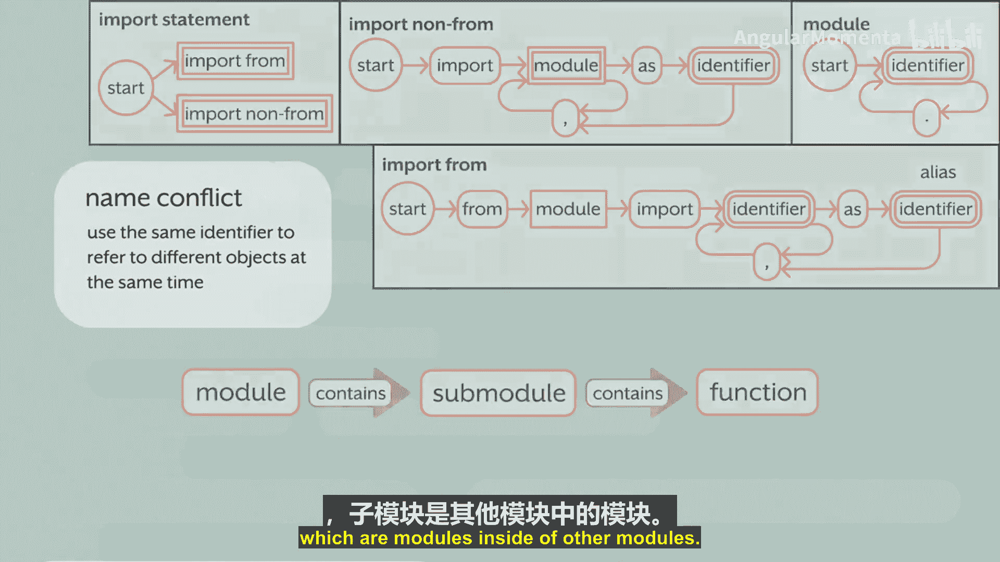

# 【阿尔伯塔大学】问题解决Python编程和电子游戏 ｜ Problem Solving, Python Programming, and Video Games p79 09_04_01_python-import-statement-variations -BV1N5rLBWE1c_p79-

This video introduces a new variation of the import statement that can be used to resolve name conflicts and import objects from submods。

 which are modules inside of other modules。A name conflict occurs when you try to use the same identifier to refer to different objects at the same time。

For example， here is a program that uses the identifier sleep to refer to different sleep modes such as ReM and non ReM。

 where REM stands for rapidpi eye movement。I want to have a pause between printing the sleep mode and the dreams output。

 I will import the sleep function from the time module and put a call to this sleep function after the first print function call。

The Python interpreter reports a type error， indicating that sleep is not a callable object。

 What happened？When the program starts， the main module namespace contains the identifier's input and print。

 each bound to a function object。When the import statement is evaluated。

 the identifier sleep is added to the namespace and bound to the sleep function object from the time module。

Next， the input function returns a Rem string object。

 and the assignment statement binds the sleep identifier to this object。

The print function call displays this string object。

The next statement is a function call whose function name is sleep。

The interpreter dereences the sleep identifier to obtain a string object， which is not a function。

 so the function call fails。When the assignment statement rebound， the identifier sleep。

 the reference to the sleep function was lost。 This is a name conflict。

Python resolves name conflicts using the most recent binding rule。

 whichever binding occurred most recently is the binding that is used to dereference an identifier。

For example， I will move the import statement so that it occurs later in the program。This time。

The identifier sleep is added to the name space and bound to the result object of the input function call。

 which is ReM。Then print sleep function call。Then the print sleep function call displays ReM。

 Then the import statement rebines sleep to the sleep function from the time module。

The function call to sleep works as intended。When the condition of the if statement is evaluated。

 the identifier's sleep is dereferd to obtain the sleep function object。

 which is not equal to the string ReM， even though the user input the REM string。

There is still a name conflict， and the program output is incorrect。

You can resolve a name conflict by selecting a different identifier to bind to one of the conflicting objects。

 I could bind a different identifier to the input string。

 such as sleep mode and keep the identifier sleep for the imported sleep function。

I need to change sleep to sleep mode everywhere I want to refer to the string that was entered by the user。

In this case， sleep mode may be more descriptive identifiedent for the input string。However。

 in a program called sleeple that is about the topic of sleep。

 using the name sleep as the name of the pause function is not very descriptive。

Python provides the versatility to resolve conflicts due to imported names using different variations of the import statement。

These variations allow you to use the most appropriate local name in your program to represent each imported object you are not constrained by the names used in other modules。

Here is a generalization of our previous import statement that adds an optional as clause to provide an alternate local name for each imported name。

 This local name is often called an alias。I will go back to using sleep instead of sleep mode to refer to the input string。

 I will use this new variation of the imported statement to change the imported local name from sleep to pause。

 which is more descriptive in this program。The program output is correct。

Here are the generalized semantics of the import statement。When the program starts。

 the main module namespace contains the identifier's input and print。

 each bound to a function object。When the import statement is evaluated。

 the identifier pause is added to the namespace and bound to the sleep function object from the T module。

Next， the import function returns a REMstring object。

 and the assignment statement binds the sleep identifier to this object。

The print function call displays this string object。

The next statement is a function call whose function name is pause。

The interpreter derefers the P identifier to obtain a function object。

 so the program continues as intended。The name conflict has been eliminated。

Another variation of the import statement does not use the keyword from Here is a new syntax diagram for the import statement that supports both the from variation that you have already seen and the new non from variation。

Here is the from variation you have already seen。Here is a syntax diagram for the new non from variation。

If this new variation is used， then when an identifier from an imported module is used。

 it must be used as an attribute of that module。For example。

 here is a version of the sleep program that uses this variation。And the program output is correct。

Here are the semantics of the non from variation of the import statement。When the program starts。

 the main module namespace contains the identifier's input and print。

 each bound to a function object。When the import statement is evaluated。

 the identifier time is added to the namespace and bound to the time module object。

None of the identifiers in the time module are bound in the main module's namespace。

 just the name of the module itself。Next， the input function returns a RE string object。

 and the assignment statement binds the sleep identifier to this object。

The print function call displays this string object。

The next statement is a function call whose function name is time dot sleeple。

This is an attribute reference。An attribute reference is necessary because only the module name is in the main module's namespace。

The name of the sleep function is not。Recall the syntax and semantics of attribute reference from the method calls lesson。

 First， the interpreter evaluates the expression time to obtain an object。In this case。

 it is the time module object。 Second， the interpreter checks if the attribute sleep is in the namespace of the time module object。

 Since sleep is a function defined in the time module， sleep is in time namespace。

 so the sleep function object is obtained。The interpreter applies this function to the argument list。

 which is a single integer object1， and the sleep function pauses for one second。

The program continues， as it intended。The name conflict has been eliminated。In Python。

 modules can be defined inside of other modules。 A module inside another module is called a submodule。

To import objects from a submodule， I will generalize the syntax diagram for module itself。

Previously， a module name was assumed to be a single identifier。

 so we used this syntax diagram for module。To access objects from a submodule。

 I can use this generalized syntax for module as a sequence of identifiers separated by dots。

For example， the standard library contains a module called OS。

 which provides access to operating system functions and other objects inside the OS module is a submodule called path that contains a function called Is fileile。

The I file function returns true if its string argument is the name of a file that exists in the folder that Python is run from。

 and false otherwise。I can use this generalized syntax for module to access this function。

i will call the is file function on the string sleep dot pi and。

The function returns true since the file that my programming is in certainly exists。

I will call the is file function on the string sns do pi and。

The function returns false since theres no file called snob Z pi in my Python program folder。

In this video， I generalize the import statement so it can be used to resolve name conflicts and to import objects from submods。

 which are modules inside of other modules。

