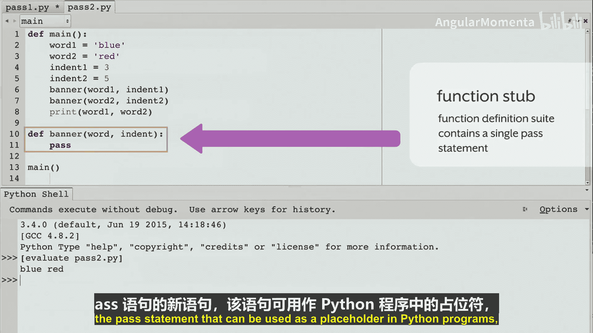
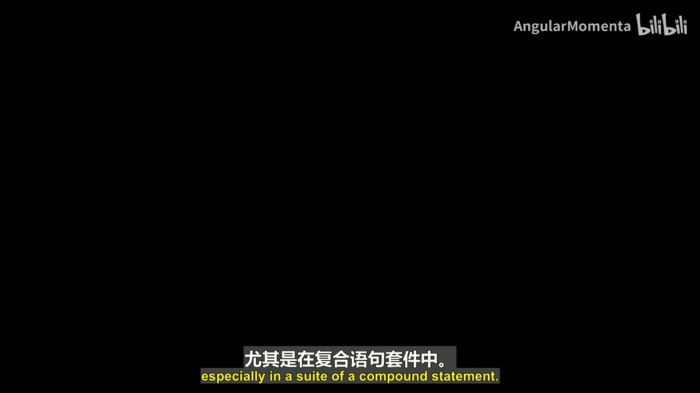

# 【阿尔伯塔大学】问题解决Python编程和电子游戏 ｜ Problem Solving, Python Programming, and Video Games p80 09_05_01_python-pass-statement -BV1N5rLBWE1c_p80-

。This video introduces a new statement called a pass statement。

 which serves as a placeholder in a Python program。When I am writing code。

 I often write partial statements that I want to complete later。

 consider this program where I have not decided yet what string to output if blue is input。

This program is syntactically invalid since every LF clause must contain a suite。

 and every suite must contain at least one statement。A comment is not a statement。

I could add an expression statement with a print call as a placeholder。However。

 Python provides a pass statement to prevent such missing statement syntax errors。

I can either use a comment with the past statement to remind me to return to this statement later。

 or I can leave it out。Here is the syntax diagram for the pass statement。

A pass statement consists of the keyword pass。And here are the semantics。Do nothing。

When the past statement was evaluated， nothing happened， which is correct。

 although a past statement can be used anywhere in a program that any other kind of statement can be used。

 it is most often used in the suite of a compound statement to prevent a syntax error。

If you are writing a program with functions and you want to test the program before you have finished writing all the functions。

You can use function stubs that consist of function definitions whose suites are single pass statements。

For example， here is the banner program you saw in the previous lesson with a stub for the banner function。

This allows me to test the main function before writing the code for the banner function。

This video introduced a new statement called a pass statement that can be used as a placeholder in Python programs。

Especially in a suite of a compound statement。

