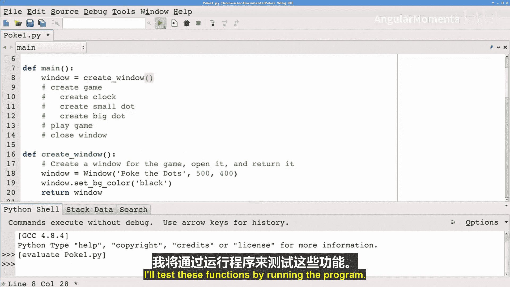
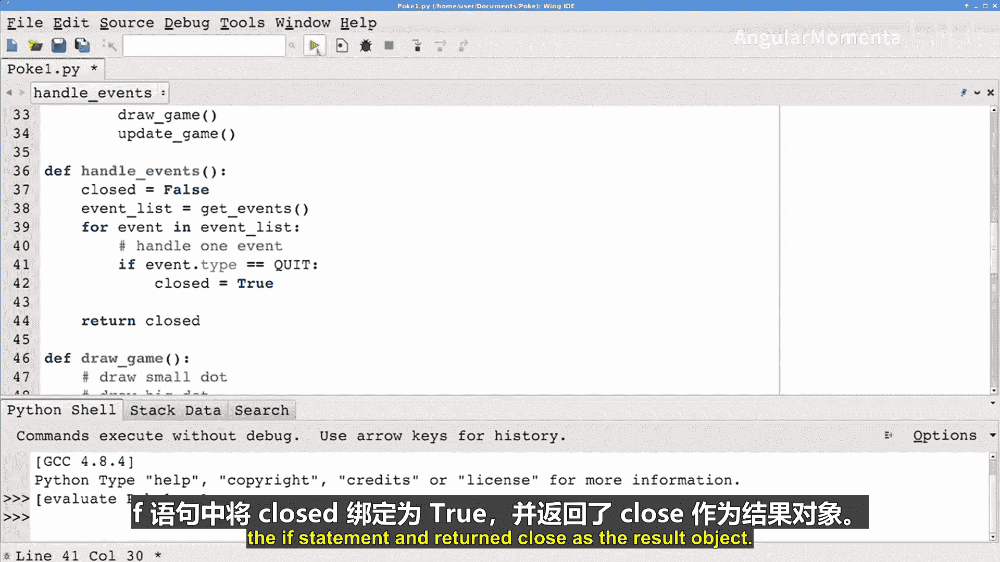
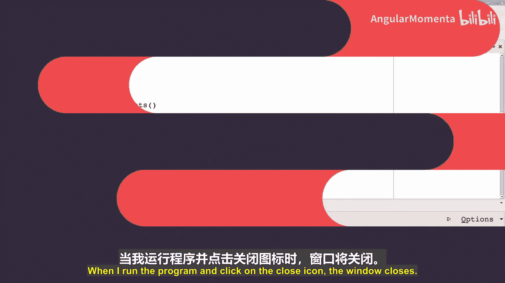
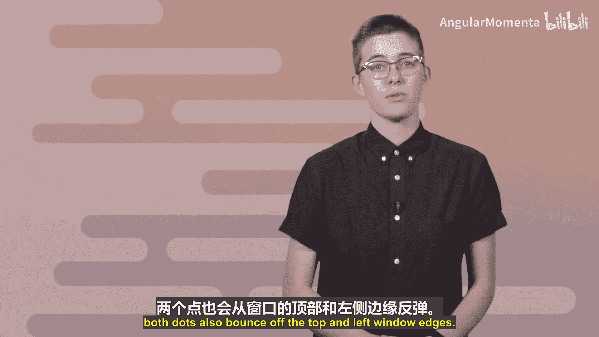

# 【阿尔伯塔大学】问题解决Python编程和电子游戏 ｜ Problem Solving, Python Programming, and Video Games p81 09_06_01_program-poke-the-dots-version-1 -BV1N5rLBWE1c_p81-

🎼。To start programming poke the dots version 1， you must create a program comment and add comments for all the algorithm steps。

 This is the same process you use when programming hacking。

 but you're starting with an empty document for the first time in seven versions。

 Add your comments and don't forget to save the document。

The first thing I will do is write a header for each function de comment in each function suite。

 I will use a pass statement until I'm ready to add more code。

 I'll add a call to Ma at the bottom of the program， and run it。😊。

The program runs with no errors and nothing is displayed， just as expected。

Some of the algorithm step comments are familiar from hacking， for example。

 you've previously created a function to open a window。

 I'll start writing the Cate window function for pokeke the dots。This time。

 the title is Poke the dots， and the dimensions are 500 by 400 pixels。

Since there is no text in version 1， I don't need to set attributes for the font yet。

 but I will set the background color， even though the default is black。

Now I'll add code to the main function suite， I'll delete the pass statement and use createreate windowow to make a window object。

 I'll test these functions by running the program。

The window opens so far， so good。

。The next step in the main function is to create the game by creating the game objects In our algorithm。

 we use to clock to control the frame rate In pi game。 The clock class manages the frame rate。

 This class is defined in the time sub module of the pi game module。😊，To create a clock。

 first I must import clock from Pga。 time Now I'll create the object in main by using the name of the class clock as a function call。

I'll create the big dot by creating objects for the big dots color， radius， center and velocity。

 The color and velocity are from the version description。 The big dot is blue。

 and it moves twice as fast in the horizontal direction as the vertical direction。

The other two attributes， radius and center are estimated from observing the game。

 You can estimate the values for the small dot yourself。

The last two comments in main are play game and close window。

 I'll add function calls for each of these， a normal function call for play game and a method call for close window。

Of course， when I run the program， nothing new happens except that the window closes。

The only statement in the play game function is a pass statement。

 so nothing happens when this function is called。Let's change that。

 I'll write the code for play game next in poke the dots。

 the window stays open until the player has clicked the close window icon。

Pyga represents each player action as an event， and clicking the close icon is represented by a close event。

I will use a Boolean called Close selected to keep track of whether a close event has occurred。

I'll bind the identifier to false， since Piga does not create a close event until the player takes the appropriate action。

The handle events function handles all of the events the pgan creates。

 I will make a return true when a close event has occurred。 so I know when to close the window。

Therefore， I will rebind close selected to the return object of handle events。

The frame loop for the game should run as long as close selected is false。

 so the while header is while not close selected。I'll replace the comments for Dr game and update game in the wild suite with their respective function calls。

All right。 handle events now， since handle events must return whether the player has clicked the close icon or not。

 I must keep track of whether this close event has occurred。

I will use a local identifier called closed and bind it to false。

 I will rebind it to true only after a close event has occurred and return closed as the result object。

I need access to the events I want this function to handle the P game function get in the P game Even module returns a list of events that have occurred since the last time the function was called。

I will import it so I can use it in my Hand events function。However。

 the name get is not very descriptive。 I can't tell what this function gets just by looking at the name。

 I will import this function using the alias get events。 Now。

 I call get events in my handle events function and bind the identifier event list to the result。

Because get eventst returns a sequence of events， I need an event loop to iterate over the sequence。

 I will use a four statement。In this version， I'll only handle close events。

Every event has an attribute called type， which does not refer to its actual object type。 Instead。

 it is bound to an object that represents the category of the event， such as mouse click。

 key press or close。In Pi game， a close event is represented by the identifier quit。

I'll import quit from Pi game。Now， I'll use an if statement to check if the category of the current event being handled by the event loop is quit。

 I have already bound closed to true inside the if statement and returned close as the result object。

When I run the program and click on the Close icon， the window closes。

Let's write drawaw game next， as discussed in the algorithm video。

 both draw small dot and drawaw Big dot will use a single function to draw each dot。

 since I only created the big dot I will only call draw dot for the Big dot。

The last step in draw game is a call to update the window， I'll add that function call。Now。

 I'll write draw dot。 The header will be de draw dot since it will be used to draw any dot。

 Pin contains a useful function to draw a circle。 It is called circle， and it is in the draw module。

Circle isn't a very descriptive name though， so I'll use an alias and import it as draw circle。

Let's look at the documentation for this function。It has four required arguments， a surface， a color。

 a position， and a radius。The surface is where the circle is drawn。

Every window has a surface that can be obtained by calling the UA game window method called Gi Surface。

I'll bind the identifier surface to this surface object。Therefore。

 I must add window to the parameter list in the function header。

The next parameter for draw circle is color。Piga uses a specific color type to represent colors。

 I already have a string for the name of the color I want to draw。

 but I can't pass the name string into the draw circle function。

I will import the color type from Pi game the same way I imported window from UA game。

Now I can use the color function to create a color object by using the name string as the argument。

Remember that the draw dot function must be generic enough to draw any dot。

 so I need to use arguments for its color string， center and radius。

 I will add corresponding parameters to the draw dot parameter list， color string， center and radius。

I can now call Dr circle using the surface and color objects I just created。

 as well as center and radius。Now I will return to draw game and add arguments to draw dot window。

 the big dots color string， center and radius。 This means I must add window， big color。

 big center and big radius as parameters of draw game。Since draw game is called in play game。

 I will add these parameters there as well。 Finally。

 I will pass all these objects as arguments in the calls to play game and draw game that I have already made。

😊，I'll run the program。A blue dot is displayed， but it doesn't move。

 The game needs to be updated for the dot to move。I will replace the pass statement in update game by statements that move the dot and control the frame rate。

 I will use a single function called move dot to move each dot。

 Since I have only created the big dot。 I will make a single call for now。😊。

Now we'll write the moveve dot function。The first comment is the Four statement placeholder to create a sequence from0 to 1。

 I'll use the range function。Recall that the range function creates a sequence from the first argument to one less than the second argument。

 so I must use the arguments 0 and 2 to update center at coordinate。

 I'll use subscription to access both center and velocity at the current index。

 which is the four statement target。I will add the center and velocity as parameters so they can be used inside this function。

The dot must bounce when it hits a window edge。 If I want the dot to bounce when its center touches the right window edge。

 I could check if the dot's X coordinate equals window width。However。

 the dot actually bounces when its edge touches the right window edge。

 this is true when the dot's x coordinate plus its radius equals the window width。

Since a dot can move multiple pixels in a frame， it is possible for the dot to move past a window edge instead of just touching it。

 Therefore， I will check if the dot's X coordinate plus radius is greater than or equal to the window width to perform a bound from the right edge。

I will call the get width method on the window to obtain its width。

 but to do this I need to add window as a parameter。I will also add radius as a parameter。

 I will use the same parameter order as the other functions， so it is easier for me to remember。

Recall that a positive velocity means that the dot is moving to the right or down。

 and a negative velocity means that the dot is moving to the left or up。

 I will bounce the dot by negating its velocity。Since Movedot has four parameters。

 I will go back to update game and add the four corresponding arguments to Movedot， window。

 Big center， big radius， and big velocity。Now I'll add these arguments as parameters to update gain。

Now I will add the arguments of update game in Play game。

Although play game has some of these arguments as parameters， it is missing big velocity。

 I will add this parameter to play game and add the corresponding argument to the play game function call in Maine。

😊，I will run the program to see if it works。The blue dot moves and it bounces。 However。

 it moves too fast， has a tail， and it moves too far downwards before bouncing。

The bounce condition is checked for both X and y directions， since it is inside the four statement。

 which is evaluated for both indexes 0， which is x and1， which is y。 However。

 the condition in the y direction should use the window height instead of the window width。

The dot moves too far downwards because the condition for bouncing in the y direction is that its y coordinate plus radius is greater than or equal to the window width instead of the window height。

To check the width for index 0 and height for index 1， I will put width and height in a size list。

 I will run the program again。 The dot now bounces correctly off the bottom edge。

 I will leave the left and top edges to you。 You will only need to modify the if condition by adding an ore and one comparison operation。

This comparison will check the left edge when index is0 and the top edge when index is 1。

To change the speed of the dot， I need to control the frame rate。

 I will return to the update game function and replace the frame rate comment by a statement in Pi game。

 the frame rate is controlled by the clock I created in the main function。

This means I must add a clock parameter to update game Now I can use the Pi game clock method tick to set the frame rate。

This method takes a frame rate as an argument and prevents the game from running any faster than the specified number of frames per second。

 Without this method call， your game will run as fast as your computer allows。

 which we've seen is too fast。I'll add an assignment statement to bind frame rate to 90。

 and then I'll callclock dot tick with the argument frame rate。Now I'll run the program。

The game speed is much better。 You will experiment with different frame rates during the reflection。

Okay。Why does the dot have a tail， Every time I call draw game。

 It redraws the big dot in its updated position。 Since I never clear the screen。

 the dots are drawn one on top of another。 Since the dot moves such a tiny amount in each frame。

 it gives the appearance of drawing a tail in the window。To fix this。

 I need to erase the previous dot before I draw the new one。

 I'll add a call to clear window at the beginning of the draw game function and run the program again。

Everything works except bouncing from the top and left edge， but you'll fix this yourself。

The tail problem is present at the algorithm level as well。

 I'm going to change the algorithm so it is consistent with the program。

 The draw game panel has three steps。 Draw small dot， Draw big dot and update display。

Before I draw anything I need to clear the window， so I'll add a clear window step before the first draw step。

Not every error you make while programming can be fixed by simply changing a line of code。

 Some issues are deeper and may have roots in earlier iterations of the game creation process。

 like the algorithm。The unexpected tail on the dot is a great example of this kind of issue。

 I had to run the program to recognize the issue before I could fix the code。

I didn't foresee the problem while I was creating my algorithm。

 I needed to use the graphics library to realize the problem even existed。

That's why we use an iterative process to create our games。

 The iteration of coding and then fixing the algorithm inside a single version is not explicitly shown in the game creation process diagram。

 but it happens。😊，Now it's your turn to program， add the small dot and change the code so that both dots also bounce off the top and left window edges。

