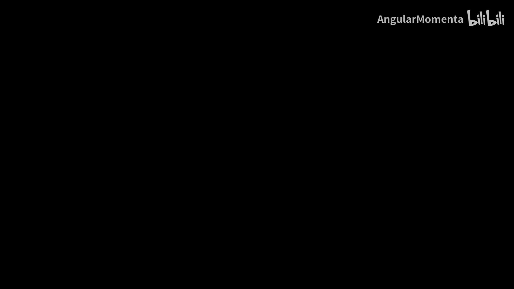
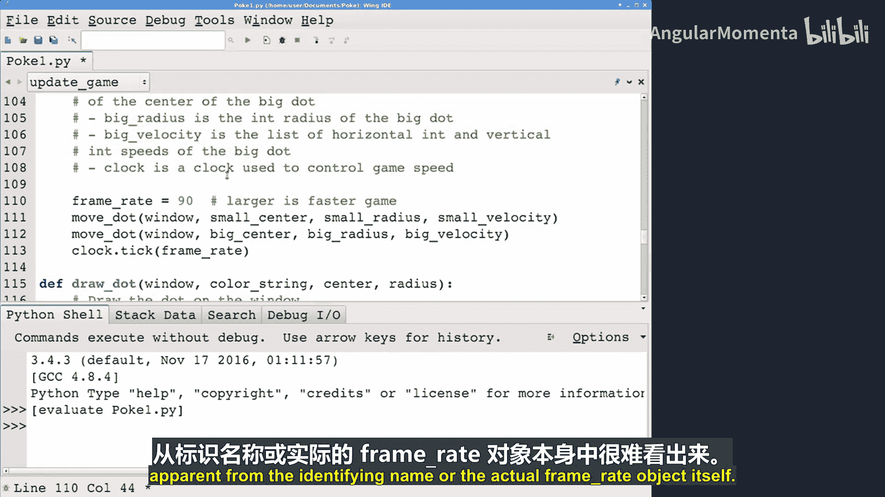
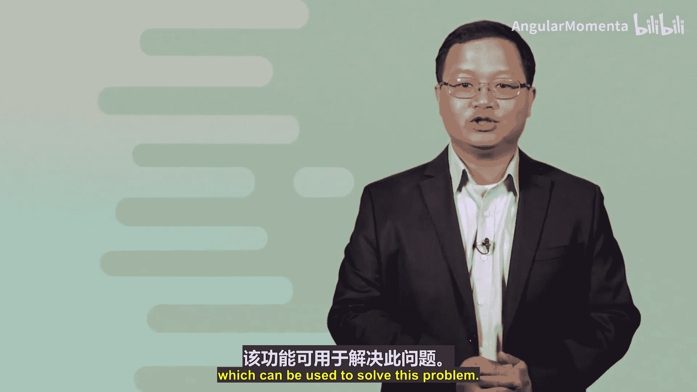

# 【阿尔伯塔大学】问题解决Python编程和电子游戏 ｜ Problem Solving, Python Programming, and Video Games p82 09_07_01_review-code-for-poke-the-dots-version-1 -BV1N5rLBWE1c_p82-

🎼。Welcome to the first reflection for Poka Dots。I'll start tracing Diversion 1 code by pressing the step intoto button and then stepping over the import statements。

Recall that import statements add identifiers to the local namespace of the current block。

Only some imported identifiers are shown in the locals section of the stack data panel。 However。

 you can see how many identifiers are in locals by looking at its length。

After I step over to statement that imports quit and color from Pi game。

 the identifier quit is visible in the stack data， bound to the integer 12。

 and the identifier color is not visible。When importing identifiers that are bound to objects that are simple to represent。

 such as strings and integers， the bindings will be added to the appropriate namespace in stacked data。

Identifiers that are bound to more complicated objects， such as functions and modules。

 will not explicitly appear， which is why you have not seen any of these bindings in stack data before now。

I'll step over all the function definitions until I reach a call to the main function。

 When I step into the main function call， the local name space now belongs to the main function。

The length of locals is zero since nothing has been bound in the main functions's namespace。

I'll step over all the statements in the main function until I reached a call to the play game function。

10 new bindings have been added to the main functions's namespace。Don't forget。

 you can expand objects that contain many elements， such as lists to view those elements。

 For example， I can expand the small center list to see its two elements。Right now。

 the X coordinate of the small dots center， which is the first element of the small center list。

 is bound to 50， and the Y coordinate， which is the second element in the list， is bound to 75。

I'll press the step into button to step into the play game function call。

 The local namespace is now the namespace of the play game function。

 The name space contains a binding for each of the 10 parameters of the function。

 So there are 10 bindings here as well。I will step over to statements and play game until I reached a call to handle events and step into it。

This time， the local name space is empty because handle events has no parameters。

I'll step over to statements and handle events until event list is added to the local namespace。

The call to get events retrieves all events that have occurred since the previous call to get events。

 When I expand event list in the stack data panel， you can see the events currently in the event list。

In this version of Poke the dots， all of these events， except quit events are ignored。

 Examining the event list doesn't give much useful information about the events。

 but it does let me see the events。That are occurring。

I'll press the step Out button to return to Play game。When I step over to call to draw a game。

 the dots appear in the game window。I'll step into update game。

 The first statement and update game is the frame rate assignment statement with the frame rate set to 90 at most 90 frames are drawn each second。

 The dots will move 90 pixels times the velocity in each direction， each second。 For example。

 if the x component of velocity is 2， the dot will move 180 pixels in the X direction each second。

A higher frame rate means that more frames are drawn per second。

 and hence the dots move more pixels per second， which results in a faster game。Conversely。

 a lower frame rate results in a slower game。I'll stop the trace to experiment with the frame rate。

If I change the rate to 1，000 and run the program。The speed of the game is much faster。

If I changed the rate to5 and run the program again。The game is incredibly slow。

 Choosing a reasonable frame rate as part of creating a playable game。😊。

I return the frame rate to 90。To remember that a higher number is a faster game and that a lower number is a slower game。

 I will add a new type of comment called an inline comment。

Inline comments are used to provide clarifying information that can't be easily inferred from context。

 For example， it isn't helpful to add a comment for incrementing of values。

 Since looking at the addition operation in a code makes it clear that addition is happening。

 However， the meaning of the frame rate value is not obvious。

 While the identifier frame rate lets you know that the integer 90 is the frame rate for the game。

 it doesn't tell you what 90 frames per second means。The comment says larger is a faster game。

The in line comment summarizes the way the frame rate works。

 since it isn't easily apparent from the identifier name or the actual frame rate object itself。

Let's take a closer look at the code that moves the dots。

 I'll place a break point next to the first statement in the move dot function suite and press the bug button。

The first call to move dot is for the small dot。 When I expand center in the stack data panel。

 I can see the original center of the small dot， the x coordinate 50， and the Y coordinate 75。

O' press the step over button to progress through this for statement。

 The first iteration of the four loop increments the X coordinate by one。

The second iteration increments the Y coordinate by 2。

This function is called every frame for each dot。I'll remove this break point and place a new breakpoint inside the if statement suite of the handle events function。

I'll press the bug button。The game starts and plays normally。

I'll press the close icon to generate aqui event。The game stops。

 but the window isn't closed yet In stack data。 The event list only has one element。

 I can see that the address of the event is the same as the address of the single element in the event list。

I'll stop the trace。The final piece of code I want to show you is the draw circle function from Pi game。

In the programming demonstration， you saw in the documentation that this function requires four arguments。

There is a fifth parameter for the draw circle function that is called a default parameter。

 A default parameter has a default value that is used by the function。

 If no argument is used when the function is called。 Furthermore。

 excluding an argument for that parameter does not result in an error。

The default parameter for the draw circle function specifies the width of the circle。

If a width is used， a ring with that width is drawn。 The default value for the width is 0。

 which results in a filled circle instead of a ring。

I'll add a 5 to the end of the argument list in the call to draw circle and then run the program。

 There go。We now have poked the rings， instead of poke the dots。

I'll change my code back to PoD dots and check the software quality test for this version。

All the old tests still apply。Make sure your code is properly commented and uses all the guidelines we have already developed for identifiers。

 literals， repetition， and the main function。Now let's take a look at the user defined function tests。

 while each function performs a single logical task that's easy to describe in a single sentence。

And none of them have more than 12 statements。 Several of our functions have more than five arguments。

This makes the code harder to read and write a long list of parameters increases the likelihood of argument order errors。

Such errors occur when arguments are passed in an incorrect order。

 resulting in reported errors or incorrect program behavior。 However。

 in this version of Poke de dots， using more than five arguments is unavoidable unless you use global identifiers。

 but global identifiers fails a main function software quality test。 So this is not an option。

There's nothing you can do to fix this software quality failure with the programming features covered so far。

In the next version， you will be introduced to a new language feature called a class which can be used to solve this problem。

