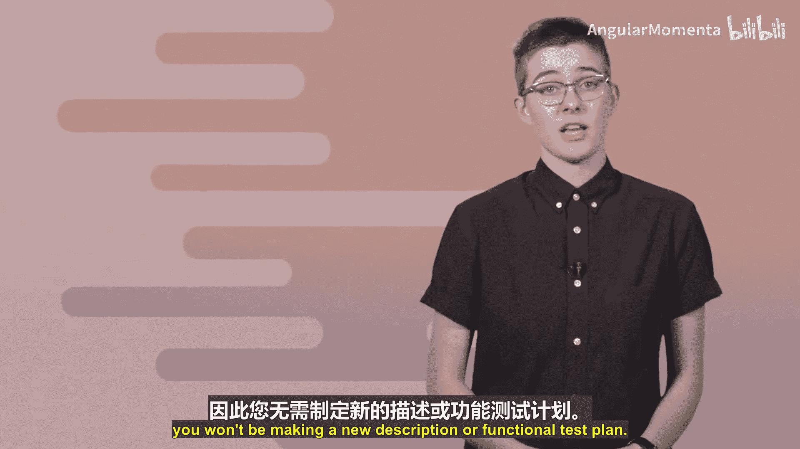

# 【阿尔伯塔大学】问题解决Python编程和电子游戏 ｜ Problem Solving, Python Programming, and Video Games p83 09_08_01_solution-issues-in-poke-the-dots-version-1 -BV1N5rLBWE1c_p83-

🎼。In this video， I'll identify the solution issues and improvements for pokeke the dots version2。

Just as you did in two of the seven versions of hacking。

 this version of poke the dots will focus on code quality rather than new features。

Let's take a look at the code for pokeke the dots version 1。

Several functions require 7 to 10 parameters。 This is inconvenient。

 and the code fails one of the software quality tests。

User defined function should have no more than five parameters。So what can you do？

It's time to learn about user defined classes。You have used classes throughout this course。

 recall that class and type are synonymous， and you've used many types such as int， list。

 window and color。When you call T on a specific Python object。

 the function returns a message that tells you the class of the object。

You have also learned about methods which are associated with classes。 For example。

 you have seen that there are methods to convert a string to upper or lowercase to check if the characters in the string are digits or letters and many more。

In Poke the dots version2， you will begin the process of learning to create your own classes。

User defined classes are another example of encapsulation you have previously used encapsulation to limit identifier scope。

This kind of encapsulation is called name encapsulation since it manages the names in a program。

The next type of encapsulation is called data encapsulation。

Data encapsulation is a method of grouping objects together to create a new single object。

For example， a list is a group of objects that can be operated on as a group。A list can be printed。

 iterated over and passed as a single argument。 The line and print functions and the append method each operate on a list object as a single group。

Creating user defined classes is another example of solution generalization since a new object type can be reused as a solution for many different problems。

Since this version is about improving the quality of your code。

 you won't be making a new description or functional test plan in the next lesson you'll modify your algorithm to use classes。

