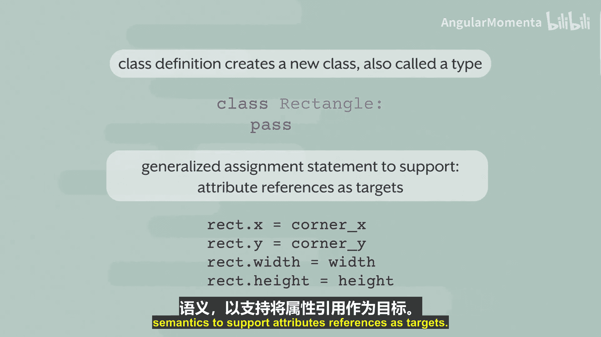

# 【阿尔伯塔大学】问题解决Python编程和电子游戏 ｜ Problem Solving, Python Programming, and Video Games p85 09_10_01_python-class-definition -BV1N5rLBWE1c_p85-

This video introduces a new statement called a class definition that creates a new Python class。

 also called a type。It also generalizes assignment statements syntax and semantics to support attribute references as targets。

A user defined class or type allows us to group several objects into a single object。

A Python class definition statement creates a new user defined class。

Consider this program that checks to see if two rectangles intersect or overlap。

The formula used to check for intersection is not the main point of this lesson。

 but you might want to figure out how it works yourself。I'll run the program。

The program reports that the first rectangle whose top left corner is at the 0。

510 with width 15 and height 20， does overlap the second rectangle whose top left corner is at the 0。

105 with width 20 and height 15。Even though I think of this program as computing whether two rectangle objects intersect。

There are no explicit rectangle objects in the program。Instead。

 the program uses eight integer objects to describe two implicit rectangles。

This obscures both the intent and implementation code of the program。For example。

 the argument list to the rectangle's intersect function is so long that it is easy to make typos when calling the function and when defining it as well。

The program would be much easier to read， write， and modify if there were actually two explicit rectangle objects。

I have used a class definition statement to create a rectangle type and have rewritten the program to use this type。

Running this program also displays overlap。I used four attributes for each rectangle object， X， Y。

 width and height。Where x and Y are integer coordinates of the top left corner of the rectangle。

Here is a simplified syntax diagram for a class definition statement。

The identifier is called the class name。Here is the simplified semantic rule for class definition。

Evaluate the class suite using a new local namespace and the global namespace。

Create a class object and use the new local namespace as the namespace of the class object。

If the class name is not in the original local namespace， add it。

Bine the class name in the original local namespace to the new class object。

I will use the rectangle program to show you how the class definition semantics work。

And to highlight the difference between new local namespace and original local namespace。

When the program starts， the local block is the main module whose namespace is both the local and global namespace。

The prebound identifier print is bound in this namespace。

The first statement in the main module is a function definition。

 So the interpreter applies function definition semantics。

It creates a function object with its own namespace。

It adds the identifier main to the local namespace。Bines main to the function object。

And binds a reference to the main module namespace in the main function， namespace。

Since the next two statements are also function definitions for create rectangle and rectangles intersect。

The interpreter repeats these function definition semantics for each of these functions。

The next statement is a class definition， so the interpreter applies class definition semantics。

In step1， the interpreter creates a new empty namespace as the local namespace。

It uses this local namespace and the current global namespace to evaluate the suite。

Recall that the suite in a function definition is not evaluated when the function definition is evaluated。

Instead， the suite of a function definition is only evaluated when the function is called。However。

The semantics for class definition prescribes that the suite of a class definition is evaluated when the class definition is evaluated。

Since the suite only contains a past statement and the past statement does nothing。

 the suite is done。In step 2， a new class object is created， and its namespace is the new。

 empty local namespace。In step 3， the class name rectangle is added to the original local namespace。

 the namespace of the main module。In step 4， rectangle is bound in this original local namespace。

 main module to the new class object。The last statement in the main module is a function call to main。

 so the interpreter applies the function call semantics。

The identifier main is dereenced in the local namespace to obtain the main function object。

The main function code is evaluated to obtain a result object。

The local block is now the main function， and the local namespace is the main function namespace。

The first statement is an assignment statement whose expression is a function call to create rectangle。

Familiar function call semantics are used to find the function object。

 createate rectangle in the global namespace。Evaluate the four argument expressions 5，10，15 and 20。

And put them in an argument list。The interpreter then adds the parameters corner X， corner Y。

 width and height to create rectangles namespace。Bins each parameter to its corresponding argument。

And evaluates createre rectangles code。The local block is now the create rectangle function。

 and the local name space is the create rectangle function namespace。

The first statement of Cate rectangle is an assignment statement whose expression is a function call to a function whose name is rectangle。

When function called semantics are applied， the identifier rectangle is used in the global namespace to find the rectangle object。

 which is a class。In Python， classes are a kind of function。So far。

 you have seen several kinds of functions。Built in functions like L。

 user defined functions like createate rectangle and built in methods like lowerer。

A class is another kind of function that returns a new object whose type is that class。For example。

 a call to int with no arguments creates the int object 0。

And a call to STR with no arguments creates the empty string object。

A call to rectangle with no arguments also creates a rectangle object。

But it doesn't have a very nice looking human readable form。

Most Python documentation uses the term callable instead of function to describe classes and methods。

However， whether we say that a class is a function or a callable。

 it is evaluated like a function call， and it creates a new object whose type is that class。

The assignment statement in createreate rectangle binds the identifier rec to the new rectangle object that is created by that rectangle call。

The second statement is an assignment statement where the target Re dot x is an attribute reference。

In the Method calls lesson， you saw the syntax and semantics of an attribute reference used as an expression such asHello dot lower。

In the alternate forms of the import statement lesson。

 you used attribute references to access a function in a module。

 time dot sleep and a module in a module， O dot path。However。

You have not seen an attribute reference used as the target of an assignment statement in this course。

The current syntax diagrams for assignment support a target that is either an identifier or a subscription expression。

Here is a generalized syntax diagram for the target in an assignment statement that also supports an attribute reference。

As a target。And the existing syntax diagram for attribute reference。Finally。

 here is the semantic rule for assignment when the target is an attribute reference。

Evaluate the assignment statement expression to obtain a result object。

Evaluate the attribute reference expression to obtain the base object。

If the identifier is not in the namespace of the base object， add it。

Bind the identifier in the namespace of the base object to the result object。

I'll apply this semantic rule to the second assignment statement in createre rectangle。In step1。

 the expression corner X is evaluated to obtain the result object integer 5。In step 2。

 the expression wreck is evaluated to obtain the base object， which is a rectangle。In step 3。

 the identifier X is not in the namespace of the base object， which is an empty rectangle object。

 so x is added to this namespace。In step 4， the identifier X in the namespace of the rectangle object is bound to the result object integer 5。

A new attribute called X has been added to the rectangle object。

 and this new attribute has been bound to the int Ob 5。

 Python lets a programmer create new attributes anywhere in the code that the object containing the attribute can be referenced。

The next three assignment statements are interpreted similarly。Notice that the parameter names。

 width and height happen to be the same as the attributes， width and height。 But this doesn't matter。

 The other two attributes X and Y are not the same as the parameters， corner X and corner Y。

 which were used to access the argument objects。The return statement returns the rectangle object to the calling function main。

 which adds the identifier rec1 to its namespace and binds rec1 to this rectangle object。

The next assignment statement in function mean is interpreted similarly so that the identifier rec 2 is bound to a second rectangle object。

The next statement in the main function is an if statement whose condition calls the function rectangles intersect。

The identifier rectangles intersect is dereenced in the global namespace。

 Its two argument expressions are evaluated to obtain the two rectangle objects。

 and they are put into an argument list。The interpreter then adds the parameters R1 and R2 to the rectangle intersex namespace。

Bins them to the argument rectangles and evaluates the rectangle's intersect code。

The local block is now the rectangle intersect function。

 and the local name space is the rectangle's intersect function namespace。

This function contains a single return statement with a complex expression。

Each attribute reference such as R1 do x is evaluated using the semantic rule for attribute reference from the Meod calls lesson。

In step1， the expression R1 is evaluated in the local name space to obtain the first rectangle object。

In step 2， the attribute X is in the name space of this rectangle object。

 so it is de referenceferenced to obtain the integer object 5。Similarly。

 when the attribute reference r2 dot width is evaluated。

 the expression R2 is evaluated in the local name space to obtain the second rectangle object。

The attribute width is in the namespace of this rectangle object。

 so it is de referenceferd to obtain the integer object 20。

Evaluation of the expression in the return statement results in the Boolean object true。

So true is returned to the calling function mean， and the string overlap is displayed。

A class definition is used to define a new Python type。

Attributes in the namespace of objects of this type refer to component objects。

A rectangle object has four component integer objects。

 two that represent X and Y coordinates and two that represent the width and height of the rectangle。

Programs that create explicit composite object types are easier to read， write。

 and modify than programs that use many simpler objects to implicitly represent composite objects。

You have already seen that a sequence can be used to reference multiple objects。

I could use lists in the program instead of creating a rectangle type。

Here is a program with the same functionality that uses lists。Although the list program is shorter。

 the numerical indexes in the rectangle's intersect function are much harder to understand than the attribute names X。

 Y， width and height。In fact， it took me five tries to successfully translate the different components from the pre recectangle program to indexes before I got it right。

In the end， I made a chart to increase my confidence that the translation was correct。

If I wanted to add more functions to this program that operate on rectangles。

 I would need to keep the chart to remember which index represents which component。

In a program where more functions are written that operate on composite objects。

 the increased clarity of using attributes rather than lists becomes even more apparent。

This video introduced a new statement called a class definition that creates a new Python class or type。

It also generalized assignment statements， syntax and semantics to support attribute references as targets。

