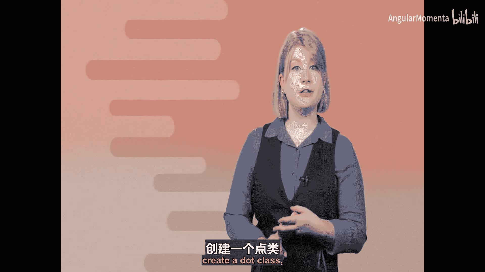

# 【阿尔伯塔大学】问题解决Python编程和电子游戏 ｜ Problem Solving, Python Programming, and Video Games p86 09_11_01_program-poke-the-dots-version-2 -BV1N5rLBWE1c_p86-

Time to code。To start programming the second version of pokeke the dots。

 I will start with the game class definition Benath the function definitions from version 1。

 I'll start with the class definition header， which is class game In the class。

 I will add a pass statement。Like each function， each class also needs a descriptive comment。

 an object of type game will be used to represent the complete game， so I will add the comment。

 an object in this class represents a complete game。

I will also add one comment for each attribute In each comment。

 I will translate one algorithm attribute to a valid Python identifier。In version 1。

 each step in the Create game panel was translated to a number of assignment statements within the main function。

In this version， the assignment statements will be removed， instead。

 one game object and two dot objects will be created。

I will write a new function called Create Game to create a game object and assign its attributes。

 you will create the two dot objects inside of C Game。Inside the new Create game function。

 I will create a game object by using the name of the game class as a function call and binding the identifier game to this new game object。

The first attribute of my game object should be the window。

 so I will add window as a parameter to the function definition。

Now I combine the attribute window of the game object to the argument object。

A new attribute calledWdow has been added to the game object。

 and this new attribute has been bound to a window object。

Recall that Python lets a programmer create new attributes anywhere in the code that the object containing the attributes can be referenced。

Recall that the parameter name doesn't matter。 If I use a parameter called Fred instead of window。

 I need to bind in game dot window to Fred's object。However， Fred is not a descriptive name。

 so I will change the parameter back to window。I'll also bind to the attribute referenceG。

clo selected toF。The two dots are attributes of the game object。

 but they require their own attributes， so you will use a separate function to create the dots。

You can create a single create dot function and call it twice to create both dots。

 This is similar to calling a single draw function twice to draw both dots。

I will bind to the attribute reference game dot small dot to the result of a call to createate dot。

You must add appropriate arguments to create dot。The Cate game function should return the game object。

 so I will add a return statement。Now， I will go back to domainma and remove the old assignment statements that create the dots and clock since they will be replaced by a call to the Create game function。

I'll add the call and pass window as an argument。I'll also bind a new identifier game to the result of create game。

Now I can pass the single game object into the play game function instead of passing the unwieldy collection of arguments that represent each aspect of the game individually。

You will finish the Cate game function as part of the next activity。

 but you can already see that passing a single object with many attributes is much easier than passing so many individual objects。

I'll modify the play game function definition next。

 the first thing I'll do is replace the extended parameter list with the single parameter game。

Since the game object is now passed as a parameter。

 I no longer need the local identifier close selected。

 instead I can use the close selected attribute of the game object。Similarly。

 the Hand events function no longer needs to return an updated value for close selected。 Instead。

 I can red the close selected attribute of the game object as a side effect of handle events。

The close selected attribute is accessible anywhere， the game object is accessible。

I'll also add game as a parameter to the Hand Evens function definition。

Now I will remove the lines that bind and rebind closed since I have access to the close selected attribute from the game object。

When the event type is quit， I simply rebindG。 close selected to true。

Finish the version to program yourself。 You will need to finish binding the game attributes。

 create a dot class and bind the dot attributes。 Then you can use those attributes in your other functions。

 For example， when you call moveve dot in update game。

 you'll be able to pass game dot small dot as an argument instead of the collection of components for the small dot。

Inside of the Move dot function， you can use the dot attributes instead of the previous individual argument objects used in version 1。

As you gain programming experience， you'll see how convenient classes are。

