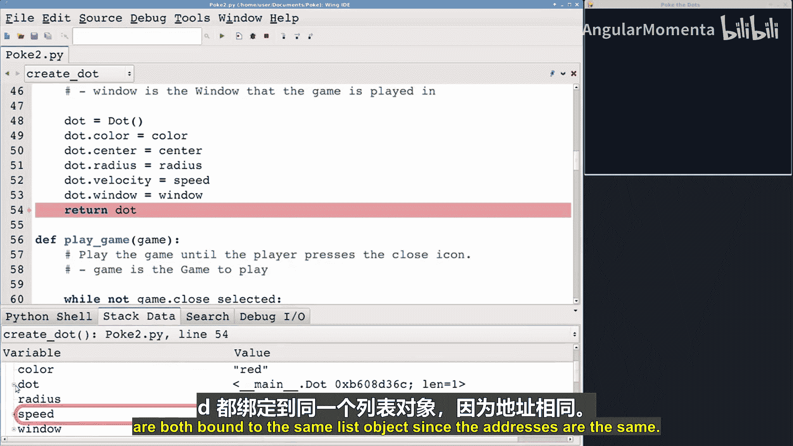
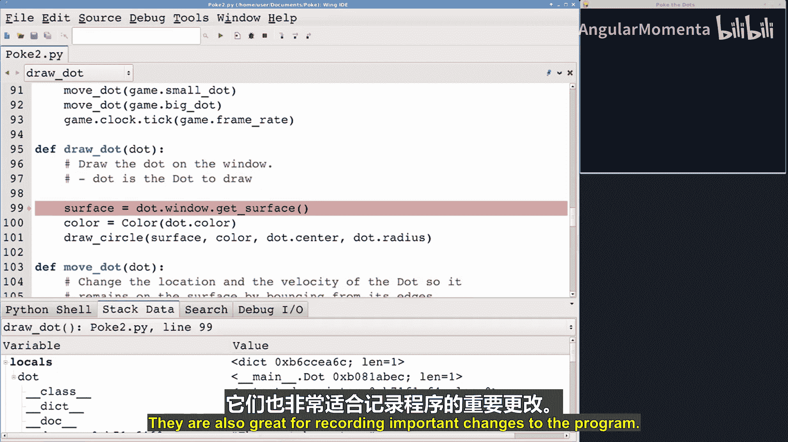
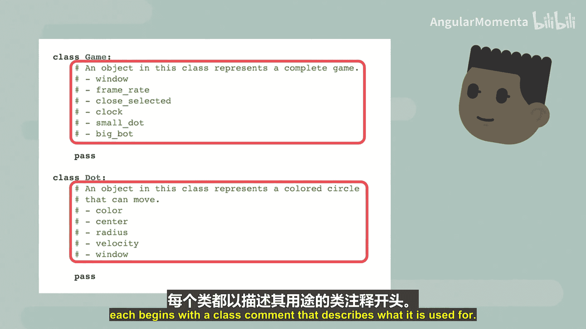

# 【阿尔伯塔大学】问题解决Python编程和电子游戏 ｜ Problem Solving, Python Programming, and Video Games p87 09_12_01_review-code-for-poke-the-dots-version-2 -BV1N5rLBWE1c_p87-

🎼。Welcome to the reflection for Poke the Dots version2。Here's the code for version 2。

With the new game and dot classes， we've passed the failed software quality test from version 1。

 Check out Play game and update game。 Now， they're down from 7 and8 parameters respectively to one each fantastic。

Now， let's look inside the game and dot objects to see the attributes to do this。

 I'll add a break point next to the first statement of createre game。I'll press the bug button。

The highlighted statement has a function call to the game class that creates a new game object。

 I'll press the step in button。The debugger does not show me Python code for the game function since I have not provided any yet。

 recall from the class definition lesson that every class object is also a function object。

In a future version， you will see how to add code to a function object that is also a class。However。

 since the game function was evaluated， a new game object was created。

 The assignment statement bound the identifier game to this new object。

You can see several attributes that start with double underscores。 I these attributes。

None of the game attributes listed in the game class comment， such as window and Small dot。

 are in the game object yet。These attributes will be added to the game object when we bind them to the objects。

When I press the step over button， stack data shows that a window attribute has been added to the game object and bound to the window object we passed into the function。

This happens for the next three assignment statements as well。

The game object now has three new attributes， clock， close selected， and frame rate。

The current highlighted statement creates a new dot and binds an attribute reference of the game to it。

I'll presss the step In2 button to access the Create dot function。

Create dot starts with five parameters in the local namespace。

The first assignment statement creates a dot。When I step over this statement。

 dot is added to locals and bound to the new dot object。

I'll step over the next five statements to add attributes to the new dot。In locals。

 you can see that all five attributes have been added to the dot and bound to the five argument objects。

 For example， the attribute velocity and the parameter speed are both bound to the same list object。

 since the addresses are the same。

With the small dot created， I'll return it to the Create game function。In Sta data。

 you can see that small dot has been added as an attribute to the game object。

I'll step over the big dot statement and check stacked out again。

You can see that the big dot has been added as an attribute of game as well。Finally。

 I'll step out to return the game object to the main function。As you can see in stacked data。

 the main function references two objects in the local's namespace， the window and the game。

I'll step into play game。You can see the game object argument in the local namespace of play game expandingand the game object。

 you can see the attributes added in C game， for example， game dot close selected is false。

At this point in the program， we have set many game and dot attributes。

 but have not used any of them。The wild statement is the first time we use an attribute that was set previously。

It would be silly to set an attribute and never use it。

Attributes can also be used to record that an object has changed in handle events。

 the close selected attribute of game is rebound after the close event occurs。

 So the while statement can recognize this change and stop the program。

The center and velocity attributes are also used to record important program changes in the dot objects。

In contrast， the window attribute of game is used in several places， but never changed。

I'll scroll down to draw a game and place a break point next to the first draw dot function call。

 then I'll press the Bu button to skip there。The game object has been passed into the draw game function。

 so you can see it in the local namespace。The highlighted draw dot function uses another attribute reference to access the small dot attribute of game to pass to the draw dot function。

Stepping in to draw dot， you can see that the dot and not the game has been added to the local namespace。

 The current highlighted statement is another attribute reference that references the window attribute of the dot object that was bound previously。

😊，It uses the associatedso get surface method from the window class and binds a local identifier to it。

Pretty neat。Attribute references are great for passing multiple objects around functions without needing multiple different argument objects for your functions。

They are also great for recording important changes to the program。

And that's it for the trace。

Let's take a look at the new software quality tests for user defined classes。

The comments section has some new tests for user defined classes every class you make should have a comment that indicates what the class is used for。

In identifiers and names， user defined class names should use capitalized words；

 this is a Python style convention。Finally， there is a new category of tests for user defined classes。

The single test asks whether your class represents a group of objects that is used in two or more tasks and forms a single conceptual object。

Let's check if the new classes， dot and game pass the new tests。

Each class has a name that starts with the capital letter and each begins with a class comment that describes what it is used for。

A game represents a group of six objects that comprise the entire Poke the dots game。

 It is used in multiple functions， such as main， play game and handle events。😊。

A dot represents a circular object in the window that has a color， center， radius and velocity。

 There are multiple dots that are used in multiple functions such as updateate game， draw dot。

 and move dot。You should edit your code to ensure that these tests are satisfied。

Other tests will be added to the Use Defed classeses section in futureture lessons。

And that's it for version 2。 Congratulations。 In the next version。

 you'll be adding more functionality to make your game more interesting。😊。

