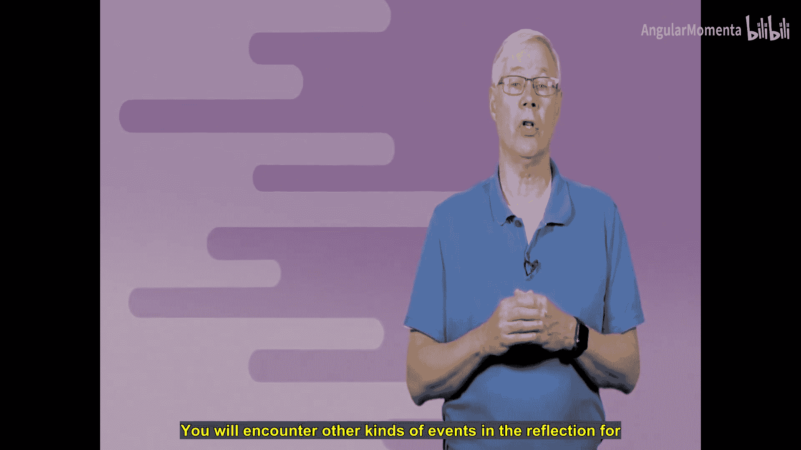

# 【阿尔伯塔大学】问题解决Python编程和电子游戏 ｜ Problem Solving, Python Programming, and Video Games p88 10_01_01_solution-issues-in-poke-the-dots-version-2 -BV1N5rLBWE1c_p88-

To get started on poke the dots version 3， let's take a look at the solution issues for version 2。

You used classes to improve the quality of your code。

 but the game still lacks most of the features that make it playable。

The player can't interact with the game except to close the window， and the score is not displayed。

In version 3， you're going to change both of these things。

Recall that an event is something that happens in a game。 It can be the result of a player action。

 or it can be caused by some process in the computer。In the previous version。

 you only handled a close event that occurred when the player pressed the close icon。In this version。

 you'll make the game more interactive by handling one more player activated event。A mouse click。

In poke the dots， you will only handle clothes and mouse click events。

Piga has support for a number of other events， including key presses。

Handling other events is similar to handling most clicks。

You will encounter other kinds of events in the reflection for this version of Poke the dots。

