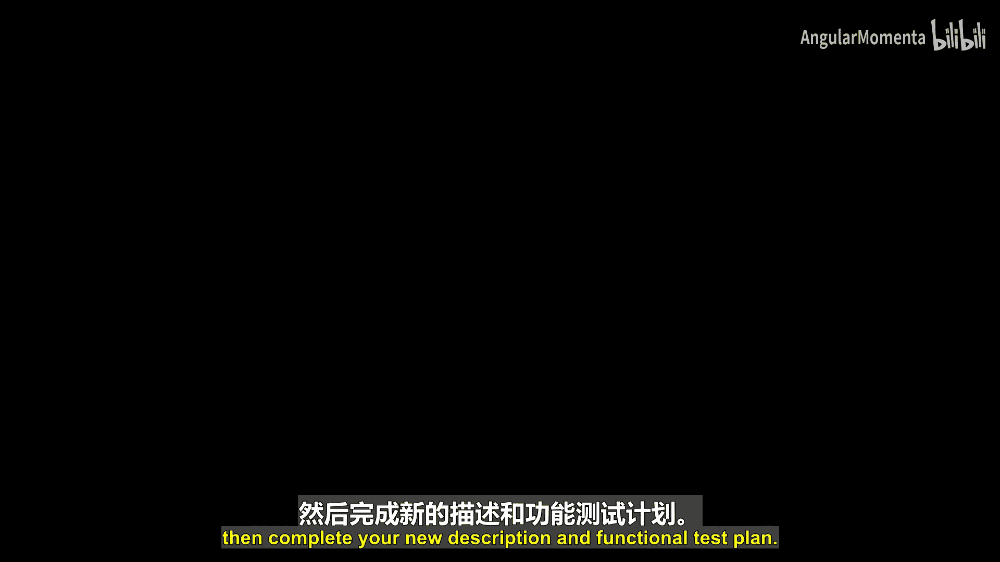

# 【阿尔伯塔大学】问题解决Python编程和电子游戏 ｜ Problem Solving, Python Programming, and Video Games p89 10_02_01_observe-poke-the-dots-version-3 -BV1N5rLBWE1c_p89-

Let's take a look at Poke the Dots version 3。Similar to the first and second versions。

 the dots move and bounce when they hit the edges。The game does not stop when the dots collide。

In the third version， the scoreboard appears in the corner。

 displaying the seconds since the game has started。When I press the left mouse button。

 the dots disappear and reappear in different locations in the window， they teleport。

I'll press the mouse button a few more times。 Each time they both teleport to new random locations。

And of course， pressing the close button on the window closes the window。

Play this version to familiarize yourself with the changes。

 Then complete your new description and functional test plan。

