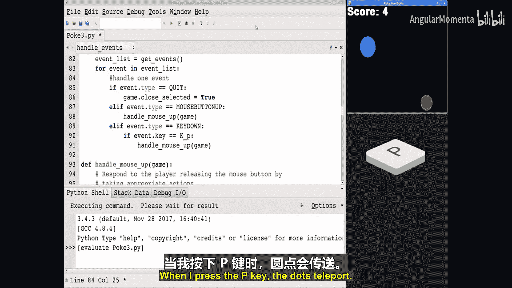
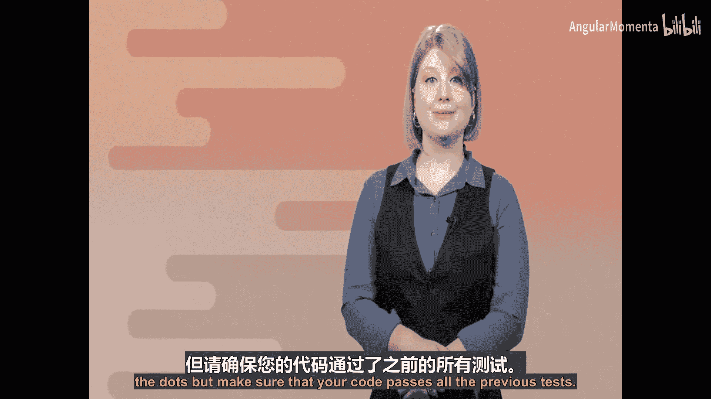

# 【阿尔伯塔大学】问题解决Python编程和电子游戏 ｜ Problem Solving, Python Programming, and Video Games p92 10_05_01_review-code-for-poke-the-dots-version-3 -BV1N5rLBWE1c_p92-

Welcome to the reflection for Poke the Dots version 3。

I want to show you how easy it is to handle additional categories of events now that we have a solid event handling template。

Although the final version of Poke the dots will not handle key presses。

 I will show you an example of how to handle key press events so you can include them in your projects。

In this example， anytime I press the P key， the dots will teleport the same way they do when the mouse is clicked。

We need one pie game identifier for each new event category。

 I will import the key down event category from the Pi game module。

Keydown is an event category that is generated whenever a key on the keyboard is pressed。

Below the LF suite for the mouse button up event， I'll add a new clause LF event type equals key down。

This time， I will compare the type attribute of the event to the imported key down category。

To react to this event， I'll add another call to the handle mouse out function。

 I could instead create a new function called handle key down and copy the two randomized dot function calls from handle mouse up into it。

 However， since I want the effect of both events to be the same。

 I might as well use a single function for both event handlers。😊，I'll play the game。

When I press the P key， the dots teleport， fantastic。What happens when I press the pu key？

The dots still teleport， not so fantastic， since I only wanted the P key to effect the dots。😊。

A key down event is generated whenever any key is pressed。

 but this program should only respond to a single key。

Recall that each event has a type attribute that represents its category such as mouse button up or Keydown。

 Each event category also has other attributes that represent properties of that event。

Here is the documentation for the attributes for each kind of event。For example。

 the position of the cursor is represented by the pause attribute of mouseuse button Up event。

Pause is bound to a topple containing the X and Y coordinates of the mouse cursor when the event occurred。

The key attribute of a key down event represents the key that generated the event。

I must compare event dot key to a key value， the values for each attribute must be imported from Pi game。

Here is the documentation for the key attribute values in Piga。

 the P key is labeled as an uppercase K with an underscore and a lowercase P I'll import that attribute value which represents either a lowercase or uppercase P。

Within the LF suite， I'll add an if statement whose clause is if event key equals KP。

 I'll move the call to the Handle Mouse up function inside the if suite。I'll play the game again。

When I press the peaky。The dots teleport， but when I press a different key， the dots don't teleport。

To inspect the key attribute， I'll place a breakpoint next to the if clause within the key down event。

 then I'll press the bug button and press the P key。

 which stops the debugger next to if event key equals KP。In stack data。

 I'll expand the event object in locals noticeice that the key attribute of the event is the integer 112。

 which is the same value as the KP identifier imported into globals。

Also notice that the Uniode attribute of the event is P。

 so I can easily see what key has been pressed， pretty cool。

I'll press the Bu button again and this time press the Q key。 Now。

 stack data shows an event with key attribute 113 and Uniode attribute Q， which is not equal to KP。

 so the dots should not teleport。I'll press the bug button again and the dots continue to move without teleporting。

I'll stop the trace。I could have combined the if clause with the LF clauses as LF event type equals key down and event key equals KP。

However， having a single LF clause for the entire keydown event category containing multiple if clauses allows me to perform different actions for different keys。

In general， you should have a single LF clause for each event type that contains multiple if clauses to check different attribute values。

As you can see， it's straightforward to add more event categories to the event loop by adding more LF clauses。

 one for each event category。There are no new software quality tests for this version of Poke the dots。

 but make sure that your code passes all the previous tests。

Congrats， you're done poke the dots version3。