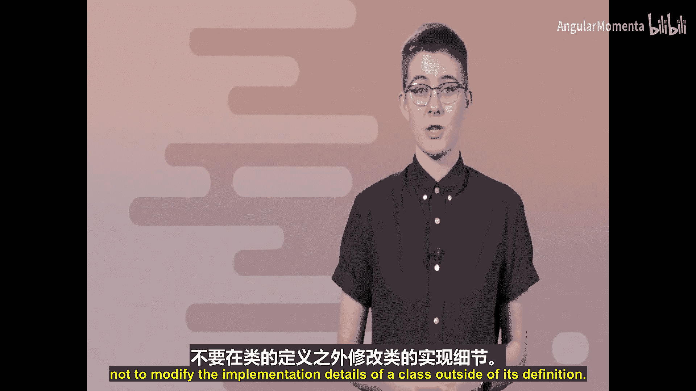
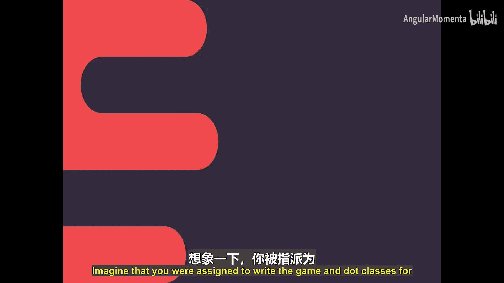

# 【阿尔伯塔大学】问题解决Python编程和电子游戏 ｜ Problem Solving, Python Programming, and Video Games p93 11_01_01_solution-issues-in-poke-the-dots-version-3 -BV1N5rLBWE1c_p93-

Welcome to poke the dots version 4。 Let's start by looking at the solution issues for version 3。

 The most obvious issue is that the game doesn't end when the dots collide。

 but you'll leave that for another version。 Verion 4 will focus on improving the quality of your code。

Adding classes in version 2 allowed the code to pass the software quality test that states function should have no more than five arguments In version 3。

 we discuss how classes are form of data encapsulation because they group component objects together to be used as one entity。

 however， encapsulation also prescribes that the internal details of an encapsulated object should be hidden。

Therefore， we should not access the attributes of any object outside its class definition。

The implementation of data encapsulation for the game and dot classes isn't complete because the attributes of these classes are bound and accessed outside the class definitions。

To fix this， you must add code to the currently empty game and doc class definitions to bind the attributes inside these definitions。

Yeah。Some attributes such as the title and size of a window or the color and center of a dot vary between different windows and dots that are created。

 Consider the window function， which has arguments that pass the title and size objects so they can be used to create an appropriate window object。

If you add arguments to the game and dot functions。

 these arguments can be used to bind attributes when the objects are created。

Other attributes can also be bound when an object is created。

 but don't need to be passed as arguments， an example is the game's frame rate。

 since every game object in the program uses the same fixed frame rate。

 we don't need to pass it as an argument when the game object is created。

If an attribute needs to be changed during the program， such as the font size of a window。

 encapsulation prohibits the attribute from being rebounded outside the class definition。Therefore。

 a method should be used to change the attribute， specifically。

 the set font size method is used to change the font size of a window。

Methods are functions defined inside of a class， methods let you modify and return information about an object without directly accessing attributes outside the class definition。

Methods and classes encapsulate behaviors as well as data Be encapsulation refers to grouping all the behaviors or actions that can be applied to an object。

 the same way data encapsulation groups all the information about an object。For example。

 think of the STR class， it has various methods the checkwe string is upper or lowercase。

 contains digits or letters and so on。These methods make up the behavior of a string object since the methods determine what you can do with a string in a program。

Encapsulating both data and behaviors within a class definition uses a concept called information hiding Information hiding is a design technique that limits access to details about data and code。

Using a class tells programmers yourself included， not to modify the implementation details of a class outside of its definition。

Imagine that you were assigned to write the game and dot classes for poke the dots while another programmer worked on the rest of the code。

You would write a play method for game and draw methods for both classes。

 Then the other programmer would be able to call the game's play method in the program's main function。

The play method in the game class would call the appropriate methods from both classes。

If you were asked to update the game to be poke the stars instead of poke the dots。

 you would need to change your classes； you could change the dot class to a star class by modifying internal details of that class such as the attributes in the draw method。

 you could also change the game class to call the methods in the new star class instead of the dot class。

The other programmer would not need to make any changes。

 since the call to the play method in the game class would still work。

 This is because that programmer's code did not use any internal details from either class。

 using encapsulation and information hiding allows you to use a class without having to change the external code if the information inside the class changes。

Python does not strictly enforce the do not touch convention for code inside of a class definition。

 Other languages have stronger mechanisms for enforcing information hiding。

 such as a series of keywords that you can use to indicate which information should be private。

 Python uses convention rather than language features and trusts programmers to follow the conventions。

Version 4 of pokeke the dots focuses on code quality by adding methods to user or defined classes。

 so the functionality of this version doesn't change。

 You don't need to make a new description or functional test plan。

 Your next activity is modifying your algorithm to add methods。

