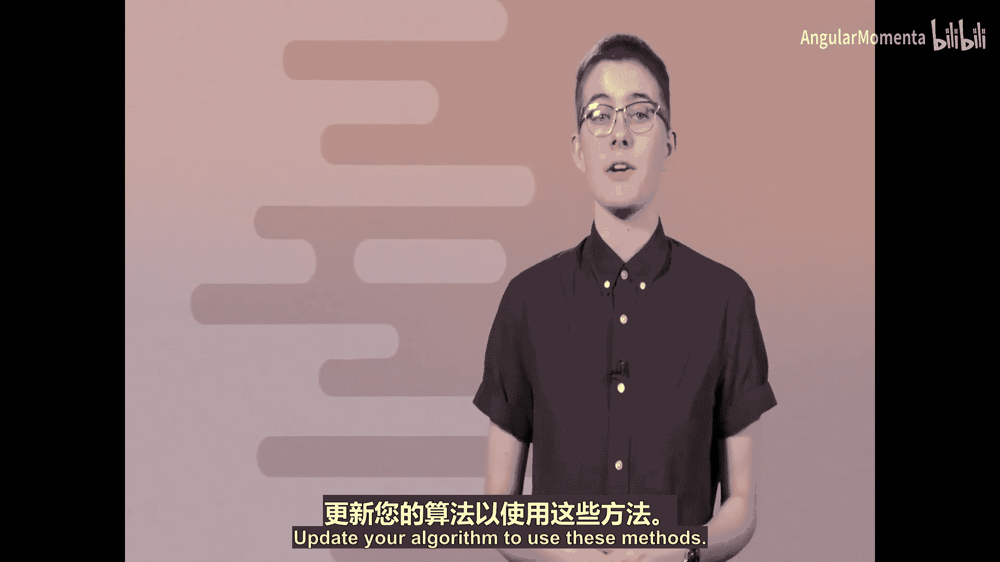

# 【阿尔伯塔大学】问题解决Python编程和电子游戏 ｜ Problem Solving, Python Programming, and Video Games p94 11_02_01_create-algorithm-for-poke-the-dots-version-4 -BV1N5rLBWE1c_p94-

You will now add methods to your Po the dots algorithm。

 let's revisit the person class that we made in the algorithm  builder in an earlier lesson。

When adding a class， there are two options in the shape palette。

 we previously ignored methods and only used attributes。

 but now I will add a method to the person class。 The first method I will add will be called initialize。

Methods just have an action phrase instead of an action and an object like normal steps。

 when you apply a method from the person class， it will always be applied to a person object therefore。

 no object is selected from the vocabulary。In this case。

 the action phrase is initialized to select just an action phrase。

 I will choose the blank option in the object menu。Yeah。

The initialized method will contain all the steps that must happen to create and bind an object's attributes。

 recall that the person class has three attributes， name。

 birth date and height to create a person object， these attributes must be bound。

 Finding the name and height of a person are too trivial to deserve their own steps。

 Since they are a literal string and integer。However。

 binding the birth date is more complicated since a birth date includes three components， a year。

 a month and a day， so I will add a create birth date step to the initialized method。

If there were any other complicated steps needed to create a person object。

 I would also add them here。Create birth E is just a step that will become a block of code in the initialized method Create birth E is not a method。

A person's age will change as time passes， so I will create another method to compute the person's age。

 I will add a method and select get age as the action phrase。In a normal step。

 the format is action object。 If this was a normal step。

 get would be the action and age would be the object。 However， for methods。

 the object is the special argument that the method is applied to。 Therefore。

 person is the object that the get age action phrase is applied to。

Just as I did to the initialized method， I will expand the get age method and add two steps to it。

 I'll add the normal steps， get current date and subtract birth date from current date。

I will return to the main program panel。 I'll add a step。

 Notice that I now have a choice between adding a normal step and adding a method from an existing class。

 I'll add a normal step called create person。We need a step to create a new object before we can apply any method to it；

 therefore we will always use a step called createreate class name to create an object。

 and the initialized method will be applied to this new object。

Since initialized must always be applied， there is no use repeating myself by expanding create class name for every class I create and explicitly calling the initialized method。

 Instead， we will use a convention on our algorithms that create class name always calls a method called initialize on that class in the algorithm builder for every class I create。

 The create class name step will implicitly use the initialized method on the newly created object automatically。

😊，I don't need to repeat myself by expanding create class name and adding a call to the initialized method for every class I create。

 Therefore， I won't expand create person into its own panel that contains a call to the method initialize。

Instead， Cate person will create a new person object and call the initialized method on it automatically。

For the second step in the main panel， I will add a method from the list。

 I'll choose the person get age method。 Now， my algorithm creates a new person and computes their age。

Let's look at the poke。 the dots algorithm。 Notice that the C window step is in the main panel。

 However， when we implemented C window， we included the name of the game。

 Poke the dots and the window size。 Therefore， create window is not really independent of the game we are creating。

 The game should encapsulate all of the information about the game。

 including the window requirements。Now that you know more about encapsulation。

 this issue is important。I will recreate the functionality of Cate window inside the game class to improve encapsulation。

First， I will add an initialized method to the game class。

 Now I will add a create window step to the initialized method and delete the C window step from main。

I need to make one other change to the main panel since I am creating the window in the game class。

 I also want to close it in the game class。 Therefore。

 I will delete close window from the main panel In the next activity。

 you will add close window to the end of the play method in the game class when you create the play method。

😊，Most of the functionality that is currently encompassed by user defineded functions must be recreated with user defined methods inside your existing game and dot classes。

Finish the initialized method in the game class and create one for the dot class。

 createate the appropriate game and dot methods。 updatedate your algorithm to use these methods。

