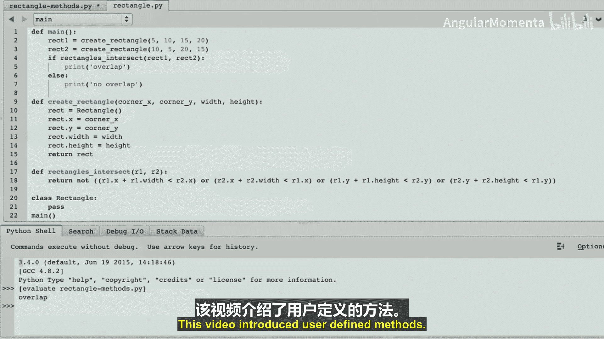

# 【阿尔伯塔大学】问题解决Python编程和电子游戏 ｜ Problem Solving, Python Programming, and Video Games p95 11_03_01_python-user-defined-methods-and-self -BV1N5rLBWE1c_p95-

🎼，This video introduces user defined methods。A function that is defined inside a class is called a method。

Every method must be applied to an object whose type is the class， where the method is defined。

Recall from the method calls lesson that the method lower is defined in the string class。

 so it can be applied to a string object。To return a similar string object。

 but with all upper case letters converted to lower case letters。Recall the string method find。

 returns the index of a string where the first occurrence of a substring starts。In this case。

 the first occurrence of the substr ON is at index 3 of the string Edmonton。

The object that the method is applied to is a special argument， in addition to its normal arguments。

The special argument of the method lower is R2D2。The special argument of the method find is Edmonton。

But find also has an ordinary argument， O。A user defined method is created by placing a function definition inside the suite of the class that defines it。

One extra parameter is added to the start of the function definition。

 and this parameter is bound to the special argument。When the method is called。

Consider the program from the class definition lesson that checks to see if two rectangles intersect or overlap。

Each rectangle object has four attributes， X， Y， width and height。

 where X and Y are integer coordinates of the top left corner of the rectangle。

Here is a new version of the program where the Cate rectangle and rectangle's intersect functions have been replaced by the methods。

 underscore， underscore， in it， underscore， underscore， and intersects respectively。

I will explain why I have used underscores later。I will use this new rectangle program to show you how user defined methods are defined。

When the program starts， the local block is the main module。

 whose namespace is both the local and global namespace。

Although the prebound identifier print is bound in this namespace。

 I'll leave it out to simplify the diagram。The first statement in the main module is a function definition。

 so the interpreter applies function definition semantics。

It creates a function object with its own namespace。

It adds the identifier main to the local namespace and binds main to the function object。

It then binds a reference to the main module namespace in the main function namespace。

But I'll leave this global reference out to simplify the diagram。

The next statement in the main module is a class definition。

 so the interpreter applies class definition semantics。In step 1。

 the interpreter creates a new empty namespace as the local name space and uses the current global name space to evaluate the suite。

The suite consists of two function definition statements。

 So function definition semantics are used to evaluate each function definition。

Notice that the function names are added to the local namespace。

 which is the new local namespace that will be used by the class。Once again。

 I won't add a global reference to simplify the diagram。

Returning to step two of the semantics for class definition， a new class object is created。

And its namespace is the new local namespace。So when a function definition appears inside a class。

 the function name is added to the namespace of the class object。

This is what makes a function a method。Any function whose name is bound inside the name space of a class object is created as a method object instead of a normal function object。

So both in knit and intersects are method objects， since they are defined in the rectangle class。

In step 3， the class name rectangle is added to the original local namespace。

 the namespace of the main module。In step 4， rectangle is bound in the original local namespace to the new class object。

The last statement in the main module is a function call to main。

 so the interpreter applies the function call semantics。

The identifier main is dereenced in the local namespace to obtain the main function object。

The main function code is evaluated to obtain a result object。

The local block is now the main function， and the local namespace is the main function namespace。

The first statement is an assignment statement whose expression is a function called to rectangle。

 which is a class object。In step one of the function call semantics。

 the identifier rectangle is dereferenced in the global namespace to obtain a class object。

Since every class object is a function， no semantic error occurs。In step 2。

 the four argument expressions，5，10，15 and 20 are evaluated and put in an argument list。In step 3。

 rectangle is not a method object， so no special argument is added to the argument object list。

In step 4， the argument list length is4。 The function object is the rectangle class instead of a normal function。

How many parameters does a class object have when it is used as a function？

I must generalize the function call semantics to support calls to functions。

 which are class objects by adding a new step  three。If the function object is a class。

 create a new object whose type is that class。Then apply its a knit method to the new object and return the new object as the result object。

I will now back up and apply this new step 3。The rectangle object is a class object。

 so a new rectangle object is created， and it' a knit method is applied to the new rectangle。

In step 4， since the definition of a knit is inside the rectangle class。

 the init function object is a method。Because an it is being applied to the new rectangle。

 the new rectangle is added to the argument list of an it。In step 5， the argument list length is 5。

 and the parameter list length is 5， so no error is reported。In step 6。

 the interpreter adds the parameters special corner X， corner， Y。

 width and height to in its namespace binds each parameter to its corresponding argument。

And evaluates in its code。The local block is now the init method。

 and the local namespace is the init methods namespace。

Each of the four statements in a knit adds an attribute to the rectangle object and binds the attribute to an argument object。

There is no return statement in an it。 So you might think that the nun object is returned by the rectangle class function。

 In fact， in it does return the nun object。However。

 step3 of the revised function called semantics indicates。

That the created rectangle object is returned as the result object of the call to the rectangle class function。

The identifier rec 1 is bound to this rectangle object。

The next assignment statement in the main function is interpreted similarly。

 so the identifier rec 2 is bound to a second rectangle object。

The next statement in the main function is an if statement whose condition matches the syntax of a function call。

 So function call semantics are applied。In step1， the function expression is the attribute reference rec 1 dot intersectex。

The interpreter applies the semantic rule for attribute reference。

The interpreter D references rec 1 to obtain the first rectangle object and looks for the attribute intersects in the namespace of this first rectangle。

Interssex is not in the namespace of the first rectangle， so an attribute error should be reported。

However， no error is reported。When the class definition was evaluated。

 its method names were added to the namespace of the class。

The names were not added to the namespace of any object from that class。In fact。

 no objects from that class even existed when the class definition was evaluated and the class was created。

Method names are put in the Class' namespace and are shared with all of its objects。

An object uses the shared method names from its class。When an attribute is not found in an object。

 the interpreter searches for that attribute in its class。

I will generalize our simplified semantics of attribute reference， to reflect this。

If the attribute is in the name space of the object， return the object it is bound to。Otherwise。

 if the attribute is in the namespace of the object's class， return the object it is bound to。

Since the interpreter does not find the method name intersects in the namespace of the rectangle object。

It searches in the namespace of the rectangle class and dereferences it to obtain the intersex method object。

Normal function call semantics continue。 So the argument list is created by evaluating rec 2 to obtain a one element argument object list。

 and the special argument is added to the start of this argument list。

Interssex parameters are added to its namespace and bound to the two argument objects。

The intersex method is evaluated and returns true。 So the if statement suite is evaluated and displays overlap in the shell。

The main function ends， and so does the program。This program uses special as the name of the parameter that is bound to the special object。

Any name can be used for the initial parameter of a method。However。

 Python has a convention that self is used as the initial parameter name。

 All change the name to self in the program to follow this convention。

The previous rectangle program did not have an underscore underscore in it underscore_ method in the class definition。

So step three of the function called semantics doesn't make sense。

If the class definition does not contain an underscore， underscore in it。

 underscore underscore method， Python applies a default in it method that doesn't do anything。

The underscores must be used so that Python can find your init method。

This video introduced user defined methods。

