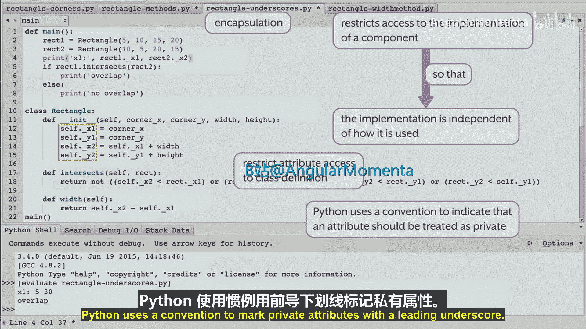

# 【阿尔伯塔大学】问题解决Python编程和电子游戏 ｜ Problem Solving, Python Programming, and Video Games p96 11_04_01_python-private-attributes -BV1N5rLBWE1c_p96-

This video introduces private attributes。Recall that encapsulation is a technique for restricting access to the implementation of a component so that that implementation of that component is independent of how it is used by other components。

Consider the rectangle class that was presented in the user defineded method lesson。

If an attribute is accessed outside of the class definition that defines it。

 then problems can occur if the implementation of the class is changed。For example。

 I will change the program to access the width attribute outside of the rectangle class。

And run the program。It works fine。However， if I change the rectangle class so that the width is no longer an attribute。

Then， the program fails。I have reimplemented the program to use attributes x1 and Y1 as the coordinates of the upper left corner and attributes x2 and Y2 as coordinates of the lower right corner。

Since the program uses the width attribute outside of the class。

 the program fails if the width attribute is replaced by different attributes。

This violates encapsulation， since the implementation of the rectangle class is no longer independent of how it is used by other components。

If you want to provide access to the width of a rectangle。

 you can create a width method in the rectangle class。Now， the program runs。

 even though there is no width attribute。If access to attributes is restricted to the class in which they are defined。

 then objects can be used independently of the implementation of an object's class。Therefore。

 encapsulation is achieved。Many programming languages have features that can be used to prevent access to attributes outside of the class where they are defined。

For example， Java and C++ both use the keyword private so that an error is generated when an attribute is accessed outside of its class definition。

In fact， in C++， all attributes default to private unless a different keyword。

 such as public is used to specify that the attribute is not private。

The exact syntax used in Java and C++ is not important；

 What is important is that there are language features in Java and C++ that allow you to limit the scope of attributes to enforce attribute andcapsulation。

Python does not have a keyword that prevents an attribute from being accessed outside of a class definition。

 instead， Python has a convention。Any attribute that starts with a single underscore should be treated as private。

It should not be used outside of the class definition that defines it。Therefore。

 I will change the attribute names in the rectangle class to indicate that they are intended to be private。

However， this is just a convention， attributes with a single leading underscore can still be accessed outside the class definition。

Python has another mechanism called properties that can be used to make it more difficult to access attributes outside a class definition。

 but we won't discuss properties in this course。This video introduced private attributes。

 Python uses a convention to mark private attributes with a leading underscore。

