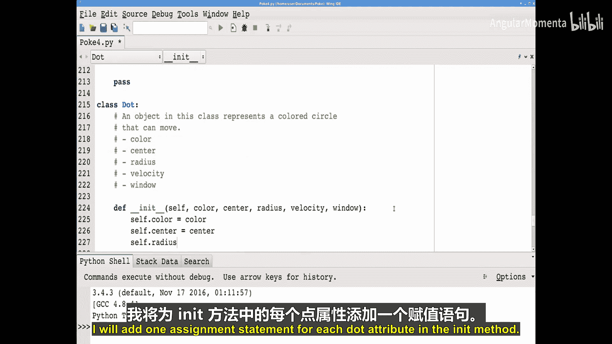
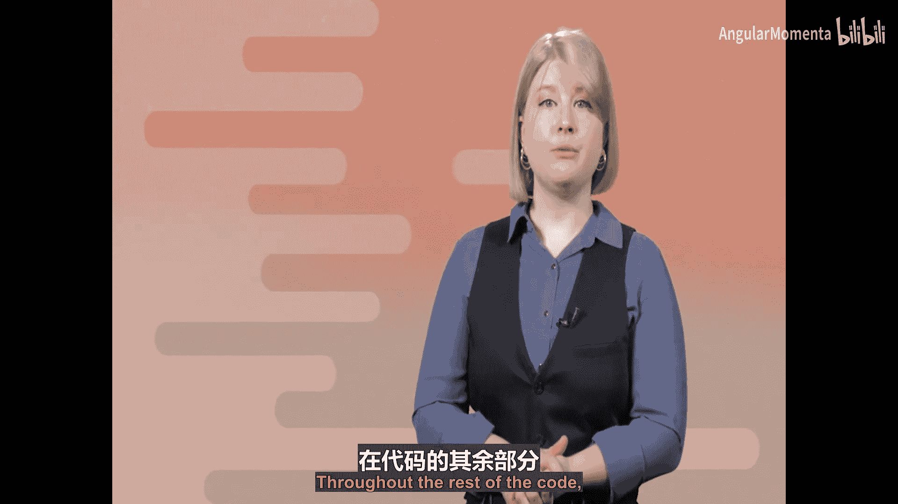

# 【阿尔伯塔大学】问题解决Python编程和电子游戏 ｜ Problem Solving, Python Programming, and Video Games p97 11_05_01_program-poke-the-dots-version-4 -BV1N5rLBWE1c_p97-

Programming poke the dots versionion 4 will be similar to programming hacking version 6 when you added function definitions。

In this version， you will restructure your existing code to use methods。

Each initialized panel in the algorithm builder will become an aI method in your code。

I will create the init method for dot。I'll writeDe， underscore， underscore， init。

 underscore underscore for the method header。Since in it is a method。

 and every method definition requires a parameter to bind to the special argument when the method is called。

 I'll add self to in its parameter list。Self must always be the first parameter in a methods's definition。

 regardless of whether there are other parameters。The dot class requires five additional argument objects to create a dot。

 so I'll add corresponding parameters for those arguments as well。 They are color， center， radius。

 velocity and window。Next， I'll initialize those attributes in the in method。

In the Create dot function from version 3， we bound each attribute reference to an argument object。

The init method will replace the Cate dot function so that all steps needed to initialize a dot object are performed as soon as the dot is created。

In the Create dot function， the local identifier dot was bound to a dot object whose attributes were then bound。

In the init method， self is bound to the new dot object whose attributes must be bound。 Therefore。

 I will use the parameter self rather than the local identifier dot。

I will add one assignment statement for each dot attribute in the AnneE method。

In the Create game function， I'll replace the Create dot function calls with the calls to the dot class function。

 I'll use the same arguments。Now I'll delete the C dot function definition。And run the program。

The program still works。Next， I'll add another method to the dot class。

 note that the draw dot function only has one parameter dot as an argument。

I'll copy the three statements in the draw dot function suite and delete the function definition。

Now I'll add the method header de draw to the dot class。

The draw dot function required a dot as a parameter。 however， draw is a method。

 so its special argument will be the dot I want to draw。 Therefore。

 self is the only parameter I need。Next， I'll paste the three statements I copied from draw dot into the draw method and change all the dot references to self。

Now， I will replace the function calls to draw dot and draw game with method calls to the draw method。

I'll play the game again。And it works great。Now， I'll start writing the initialized method in the game class。

 First， I'll create the method header。Since the window will be created inside the game class in this version。

 I don't need a window parameter。I'll create a window by modifying code from the old Create window function。

The other four statements in Cre window adjust the type， size， and color of the window font。

I will make a method to do this。First， I will create the header De adjust window。Now。

 I will paste the four statements from Create window into the Adjust window method。

Since the window is now an attribute of the game object。

 I must use self dot window instead of a local identifier window。

Adjusting the window is one of the steps that should be taken when a game object is created。

 so I will add a call to adjust window in the init method。

Since a just window is being called In the game class definition， its special argument will be self。

Now I will delete the Create window function and the call to it in the main program。

I will replace the call to createreate game by a call to the game class function that does not use a window argument。

Finally， I will run the program， but it crashes at the first line of play game since there is no closed selected attribute。

 I will copy all of the attribute binding statements from create game into a knit。

 Change the object reference from game to self and run the program again。😊，It still doesn't work。

Python reports that the name window is not defined To fix this。

 I must change window to self dot window in the initialized method and run it again。This time。

 it works until I try to close the window。To fix this， you must move windowow。

t close from main to the play method after you write the play method。Now。

 I'll show you how to adjust your code to adhere to the Python convention for per attributes。

In the dot class， I'll add single underscores to each attribute in the init method as well。

 I'll add an underscore to the adjustjust window method call in the init method of the game class and to the start of the adjust window definition。

 since it should only be called inside the game class。

I want this method to be just as private as the attributes。

Methods that start with a single underscore should be treated as private， just as attributes are。

When I play the game this time。The interpreter reports an attribute error when it tries to access the window attribute of a dot since this attribute has been renamed_ window。

Throughout the rest of the code， the attributes of dot have been accessed from outside of the class；

 this is a good example of why we want our classes to be encapsulated。

By changing the names of the attributes in the initialized method。

 I have broken the functionality of the code。Now it's your turn。

 modify your program so that all attributes use a leading underscore and so that you no longer access attributes outside their class definitions。

You must also replace all functions except for main by methods and update the code in main。

