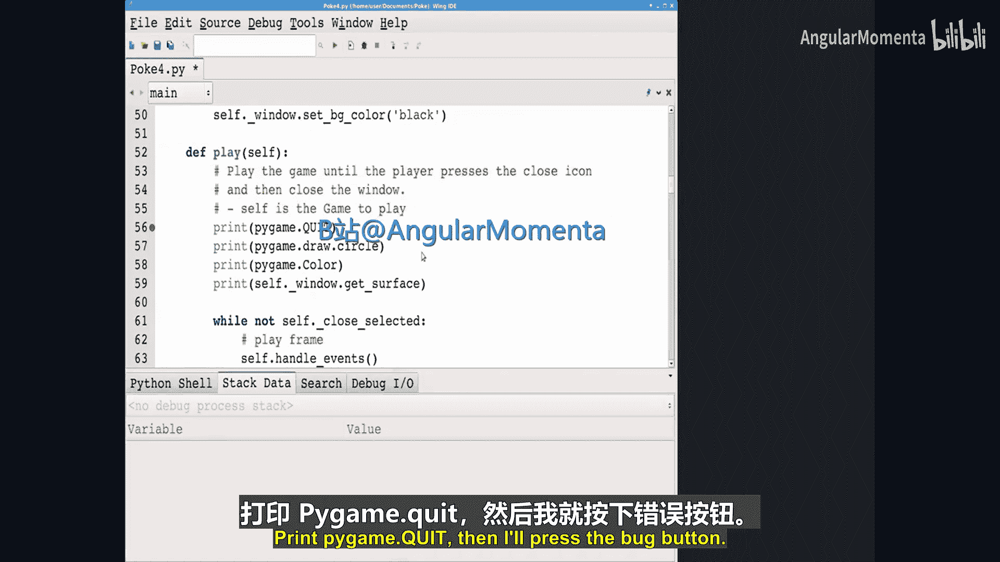
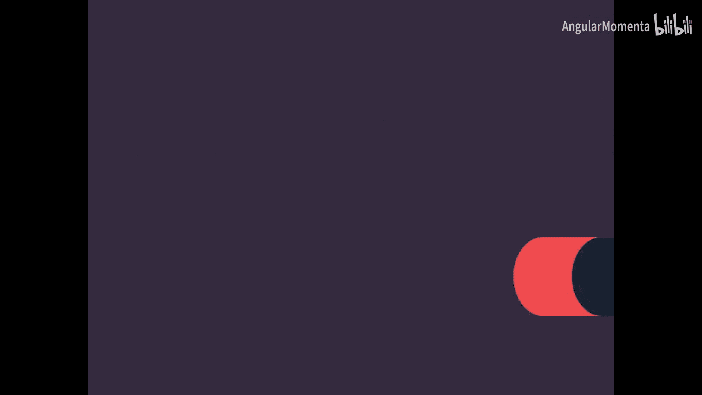
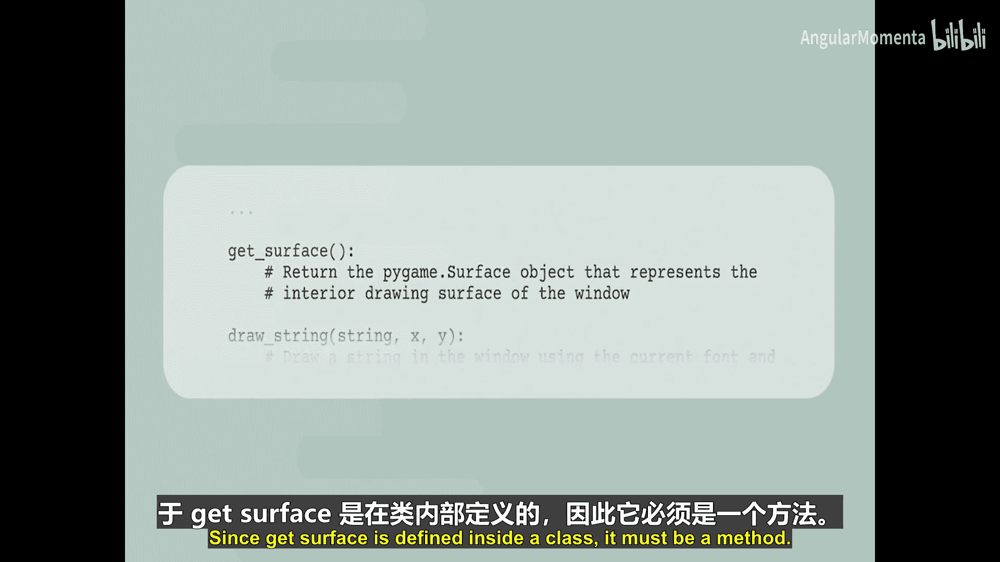
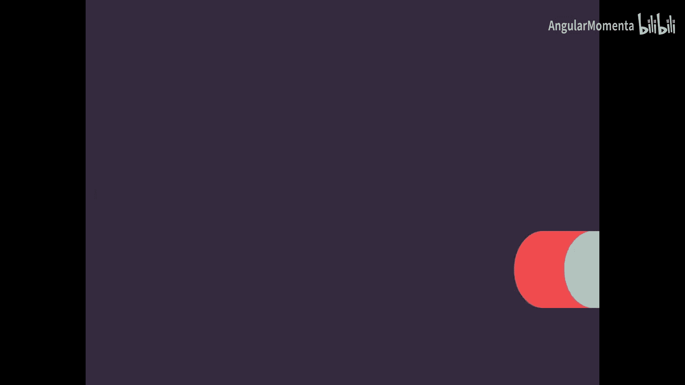
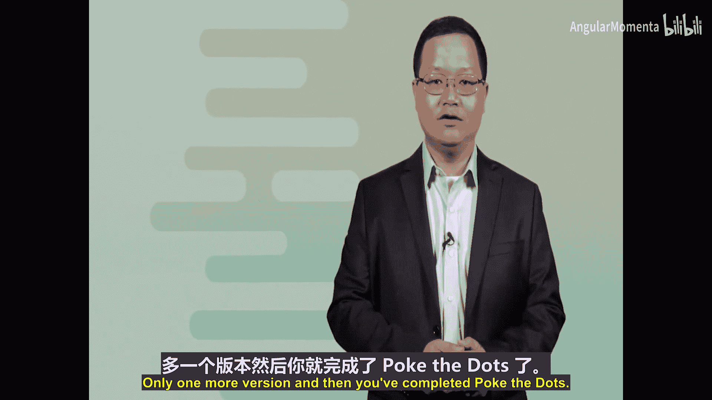

# 【阿尔伯塔大学】问题解决Python编程和电子游戏 ｜ Problem Solving, Python Programming, and Video Games p98 11_06_01_review-code-for-poke-the-dots-version-4 -BV1N5rLBWE1c_p98-

🎼。Welcome to the reflection for Pokea dots version 4。

 Now that you've created your own user defined methods。

 you can explore some of the differences between methods and functions using the debugger。

 Let's investigate the in method。 First， I'll place a break point next to the assignment statement in main that creates a new game object。

 Then I'll press the bug button。The debugger stops at the break point and highlights the call to the game class function。

 Notice that there are no objects in locals and that the game class function has no arguments。

 Since the game class function is not a method。 There is no expression before the call to game。

 No special argument will be added to the argument list。I'll press the step into button。Yeah。Now。

 I'm in the in method of the game class definition。

 Why is in knit the active function instead of the game class function。

 There is no visible code for any class function When a class function is called an instance of that class is immediately created and passed to the in method as a special argument。

 Therefore， games in method has one parameter self。

Self is bound to the new object that the game class just created。

 it appears in stack data and is bound to the newly created game object。

Take note of the memory address of self。 Now， I'll step out of the init method and return to the main function。

 The identifier game has been added to the locals namespace and is bound to the object that was passed to an in it。

Remember the address of the game object。The play method call has no regular arguments and one special argument。

 which is the game object。When I press the step intoto button。

 there is already an object bound in the methods namespace。In the method definition。

 play has one parameter， self like in it， self is bound to the special argument that's added to the argument list when the method is called。

 you can compare the address is to see that self is bound to the same game object from the main function。

 which was created when the game class function was called。

I'll stop this trace so I can explore the difference between normal function calls。

 class function calls and method calls。 It is impossible to differentiate between them just by looking at their syntax。

 For example， we only know from experience that time dot sleep is a function and window dot set font name is a method。

 However， they both have identical syntax。 An identifier followed by a dot followed by an identifier followed by parentheses and arguments。

 whether a function is normal class or method depends on whether the identifier before the parentheses。

 is a normal function object， a class function object or a method object。

There are three common ways to determine the exact type of the function object an identifier is bound to。

 You could call the print function on this object。 You could look at the code where the object is defined if you have access to it or you could check the documentation。

 which is the usual way。To explore this issue， I'll add a few statements to the play method。Next。

 I'll add an import statement so I can access Pga。t drawaw dot circleir using its long name that includes dots。

I'll remove the break point in Maine and then place a new break point next to the first new statement of play。

Print pie game dot quit。 Then I'll press the bug button。

These print calls。 Let me examine the objects that the expressions evaluate to。

 I'll step over the first statement that prints pi game dot quit in the shell。

 the integer value forqui is displayed。The second statement printsBil in function circle。

The third statement prints class piga dot color and the fourth statement prints bound method window get surface of UA game window object at a memory location。

All four of these statements use attribute reference syntax。

 yet each evaluates to a different type of object。 Pi game dot Qui evaluates to an integer。

 and the other three evaluate to a normal function， class function and method function respectively。

When you are reading code that contains a function call。

 don't rely on a visual inspection to determine its meaning。

 instead check the documentation to determine whether that function call is a normal function。

 class function， or method function。Let's look at the documentation for pie game dot color。

 Since pie game is bound to a module， Pi game dot color is an attribute of this module。

 I'll click on the Pi game color link to view the documentation for color。

Pyga uses the Python Naming convention for identifiers， since color starts with an uppercase letter。

 it is a class instead of a module。Color of name represents the color class function。

I know it is a class function since it is uppercase。

 and the documentation says Pi game object for color representations。

 and below this it says the color class represents。

Let's look at the documentation for P game dot draw dot circle。 Since pie game is bound to a module。

 P game dot draw is an attribute of this module。I click on the Pi game Draw link to view the documentation for draw。

Since draw starts with a lower case letter， it is a module， not a class。

 Pi game dot draw dot circle is a normal function since it appears directly in the draw module。

 not inside a class。Let's look at the documentation for self dot window dot get surface。

 Se is bound to an object whose type is game。 The window attribute of the game is bound to a window object。

 Therefore， get surface is an attribute of a window， which is defined in the U A game module。

So I'll look for get Surface in the window class of the UA game documentation。

Since getEt surface is defined inside a class。

It must be a method。

Time for software quality for this version of Polka dots。

 I'll add three new software quality tests to the classes section。

To pass a software quality test for this version， attributes defined in user defined classes must not be accessed outside of the class where they are defined。

In addition， your new user defined methods must satisfy the software quality tests for user defined functions。

Make sure that your code satisfies these three new tests and all the previous tests from earlier versions。

Congrats， your finished version4， only one more version， and then you've completed pokeke the dots。

