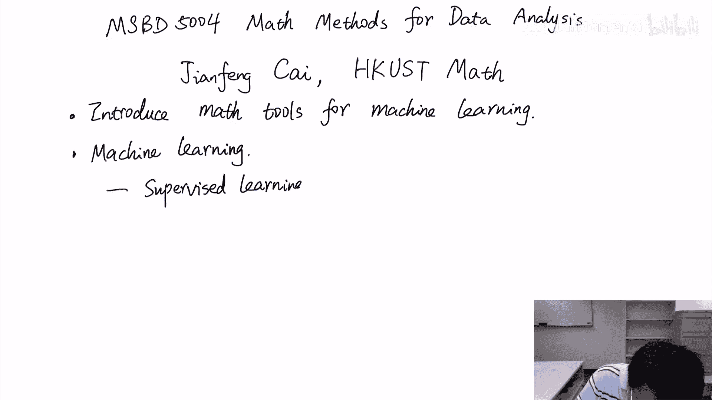
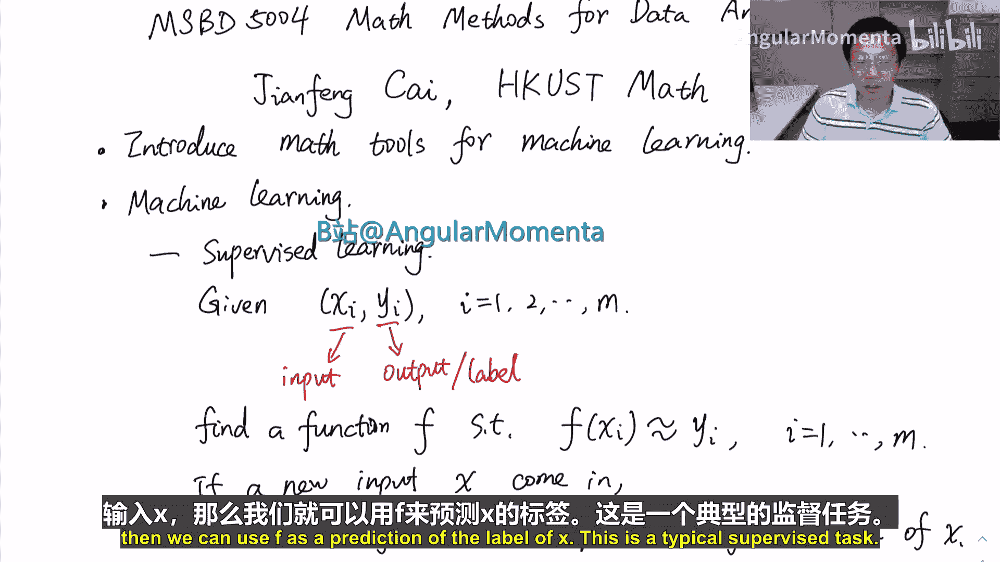
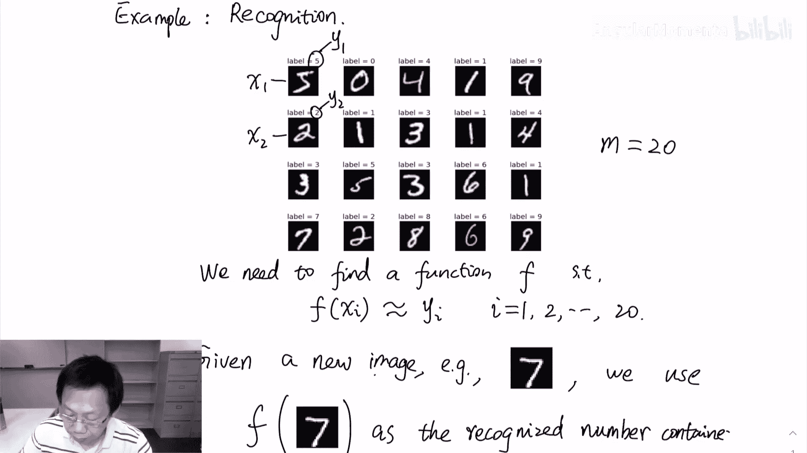
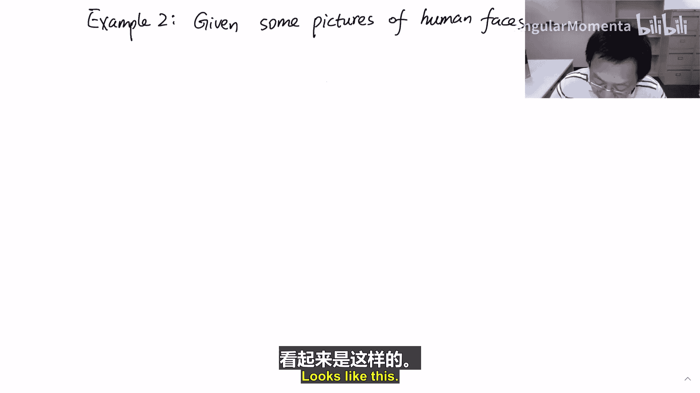
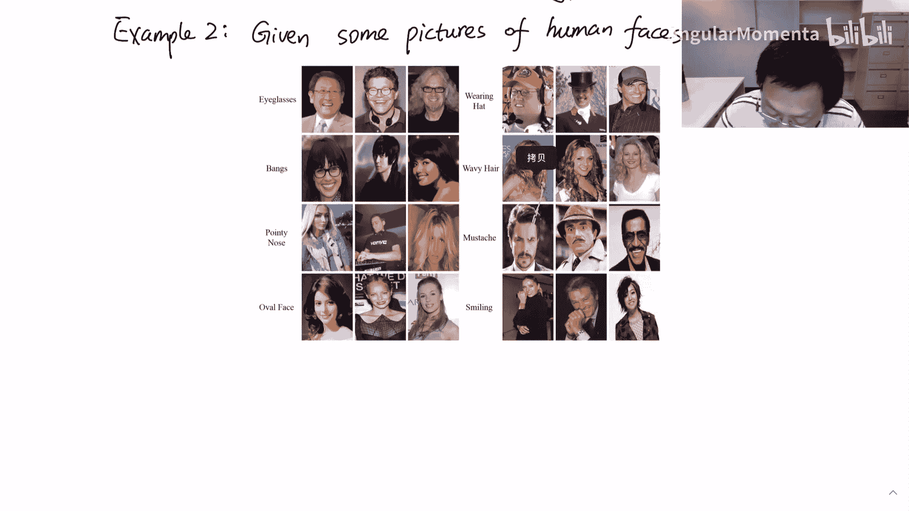
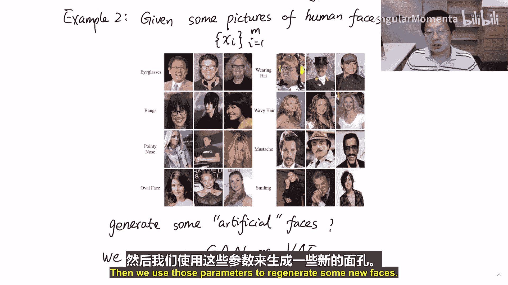
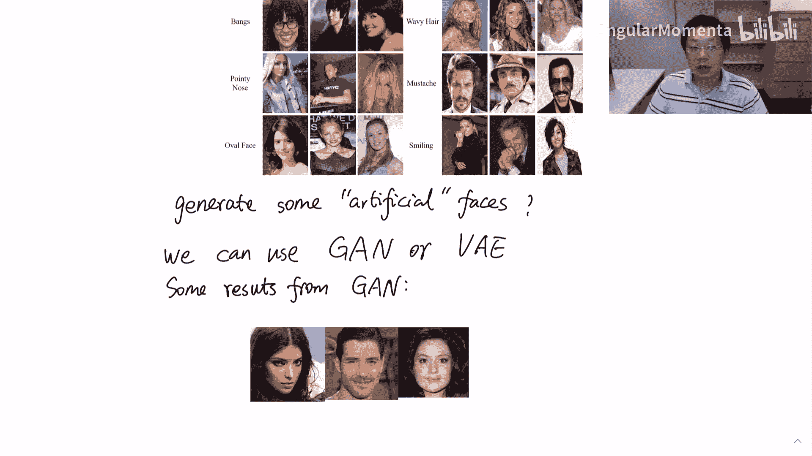

# 【香港科技大学】数据分析的数学方法 ｜ Mathematical Methods for Data Analysis p01 03-01-02-视频 -BV1DEFDzGEZW_p1-

Hello， everyone。 Welcome to MSP D 5004 mathematicalthe Me for data analysis。

 My name is Jian Fang Cai， and I am from Department of Mathematics H K UST。

 I am the instructor of this course。This course is about mathematical methods for data analysis。

 which is quite a big topic， so it is impossible to cover all of them in the following eight weeks we will mainly focus on mathematical tools for machine learning。

To this end， I would first like to give you an overview of which mathematical tools will be involved in machine learning。

Let me start with the typical machine learning tasks。

The first machine learning task I would like to discuss is supervised learning。

In supervisor learning， we are given a training data set in the form of input output pairs。X， I， Y。

 I。And then we have many pairs of data， so I is from 1 to2M。Here， X I is the input。

It is some kind of features。It could be in many different forms， it could be a vector， a matrix。

 or even a text paragraph。Y I here is the corresponding output。Or the label of the input。

It can also be in many different forms， such as binary values， real numbers， and so on。

With this training data。Said our goal is then to find the relationship between the input and the output。

So from mathematical point of view， we want to find a function F。

Reflecting the relation between the input and output。Mathematically。

 this F function should satisfy F X I。Is approximately Yi for all I。Now。

 once we have found such a function F， if we have a new feature， input X come in。

Then we can use Fx as a prediction of the label of x。This is a typical supervised task。

 This problem is called a dataing problem。 Now， let me show you an explicit example of supervised learning recognition of handwritten digits。

The training data set in the recognition is shown here。

The input are the images of handwritten numbers。Like。This image is x1。 This image is x 2 and so on。

The corresponding Y eyes are the corresponding recognition of。

Of the head of the digits contained in the image。For example。

 here this Sur Y1 is5 because obviously we have a five number five contained in this image。

This Y 2 is 2。Because obviously， number two is contained in this image。From this data set。

 you can see that we have 20 input output pairs。 then in this example， M equals to 20。Now。

 our goal here is to find a map from the images to the。Numbers。Over the labels。

We want to find a function that maps the。Image to the corresponding number contained in the image。

Therefore， we needed to find a function F。Such that F applies to the image。Equals to the label。Or。

More rigorously， we want F applies to X I is about Yi for all I。Given a new image。

 we simply apply the derived function to that image to obtain the number contained in that image。

 for example。If we are given this image。Then， we use。F of this image。

As the recognized number contained in that image。

Now we discuss another machine learning task unsupervised learning。For unsupervised learning。

 we are giving only the input data X I without labels。Therefore。

 unsupervised learning is more challenging。Then。Supervised and ner。

The goal in unsupervised learning could be quite different based on different applications。

 For example， we may be required to find the common features or some essential parameters in those XI。

If this happened， this problem is known as the dimension reduction。Now。

 let me show you an explicit application problem again on hand handwritten digits。This is the X I。

We are given 16 images similar to the earlier example without labels。

Then our goal here is to find out which picture contains the same digits。This problem is very。

 very challenging。If you will take a look。Closer look at the images。

 You may notice that the first image shows that number 5。

But this number five is very close to number three。Well， in the last image， it's a number seven。

 but it is also very close to number one。This。Problem can be solved by clustering。Now。

 let me show you another example。We are given some pictures of human faces。Looks like this。

These faces are denoted again， by X， I。I is from one to M。Then the question is。

 how to generate some artificial faces？How to do that。Actually。

 this is a typical computer graphics problem。First。

 we'd like to find some common features from these known pictures， these known human faces。

Then we can use those common features to produce a face that does not belong to any real person。

Can we do that。The answer， of course， is yes， nowadays。 Actually。

 we can use the so called generative adversal network or variational auto encoder to generate those artificial faces。

Genative。Adversial network。Vational auto encoder， the idea behind G and BAE is as follows。 First。

 we learn some parameters from those pictures。 Then we use those parameters to regenerate some new faces Here I'm show you some results from G。

You can see here these three faces are all perfect， artificial faces。

Those three examples are three typical problems in machine learning。

And you should be very familiar with it。

