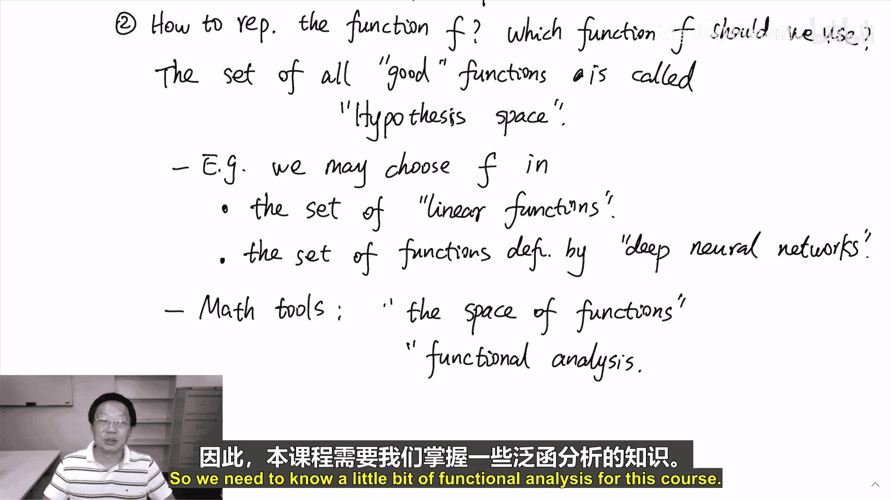

# 【香港科技大学】数据分析的数学方法 ｜ Mathematical Methods for Data Analysis p02 03-02-02-视频 -BV1DEFDzGEZW_p2-

Next， we are going to discuss。What type of mathematics will be involved in machine learning？

To answer this question， I think it is best to first have a summary on what is machine learning。

To answer this question， I would like you to refer to this paper。

A few useful things to know about machine learning， by Pedro Domingos。

This paper was published on。

Communication of the ACM in 2012。In this paper， the author gives a formula for machine learning。

Learning equals to representation plus evaluation plus optimization。Becausequal representation。Plus。

 evaluation。Plus。Optimization。It also has some detailed explanation on this formula in that article。

How to understand this formula。Let's go back to our three examples， previous。

Examples to see what does this formula mean exactly？We start with representation。

The first thing we need to represent is the input data X。How to represent the input data Xi？

Let's go back to our previous three examples。In our in all those examples。

 you can see that the input data X I are all images。In example 1， images of handwritten numbers。

 example 2， the same in example 3， the images of。Human faces。So for images。

 actually we can use matrices to represent it very well。

Each pixel of the image is represented by an entry in the matrix。Marices represent images。Each entry。

Corsponding to one pixel。In the image。Also， as I have said。

 the input data XI can be very different from application to application。In some other applications。

 we may need to deal with stock prices as the input data。In this case。

 we can use vector with each entry of the vector represent the stock price at a specific time。

Stock prices。Each entry。Stock price。At a time。And also， in some other applications， for example。

 in Google's page rank， we want to find the connections between different web pages。

The very important feature of the web page are the hyperlinks。

 How could we model on the links between different web pages。We can use a graph。Where each nose。

To represent each web page。And each connection on the graph represents the web connections。So， notes。

After the graph represents a web page。And listen。Edges on the graph。To represent the hyperlinks。

Now let's see which mathematical tools will be involved here。Obviously。

 because we want to operate matrices， vectors and graphs。

 So then we need mathematics for matrices vectors。And the graphs。For matrices and vectors。

 we need to know any algebra。4。Graphs， we needed to know graph theory。

Sometimes we also use elements on Manifold to represent the input data。 In those cases。

 we need to know some knowledge。Maifold。The other thing we need to represent is the function F in supervised learning。

How to represent。functionction在 functionF。Alway say a function， the function may be too arbitrary。

If you have learned real analysis， you know that there are many strange functions。

 their behavior is very， very strange to us， and it is highly unpredictable。However。

 in supervisor learning， we want to predict something。Then obviously， those kind of functions。

 unpredictable functions， should not be used here。In order to do the prediction very well。

 we need to use some special functions whose behavior is completely predictable。

In supervisorvis learning， the function we want to find is not arbitrary and it must be good enough。

So then we may ask， which function F should we use？We needed to define。

What are good functions for our supervised learning task？We needed to constrain the function。

Then we need to define the set of all good functions that we want to use。

 This is called the hypothesis of space。Is card。Hypoesis is a space。

We have to define the hypothesis space very well and exclude those very irregular functions from the hypothesisesis space。

For example。We may choose our F。Yun。嗯。In high dimensional machine learning problem。

 we may assume that this F is an linear function。Because we know that the behavior of linear function is。

Completely predictable。Then， in this case， the。Hypothesis space is the set of linear functions。

This is the simplest hypothesis space we can use。Another example of hypothesis space could be the set of all functions represented by deep neural networks。

Deep。Nura。Networks。Nowadays， deep learning is a very hot topic。 For me， deep learning is just。

Use functions that can be represented by deep neural networks as hypothesis space。In other words。

 we just parameterized the function by the artificial neural networks。

 So these are some simple examples of hypothesis spaces。From this part， you can see that。

The math tools you with。Here。We need to deal with functions。

 so we need to study the set of all interesting functions， such as the set of all linear functions。

 the set of functions represented by deep neural networks。We call those set of functions。

 the space of functions。In mathematics， this belongs to functional analysis。

So we need to know a little bit functional analysis for this course。

