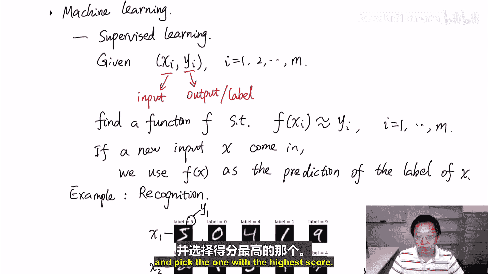
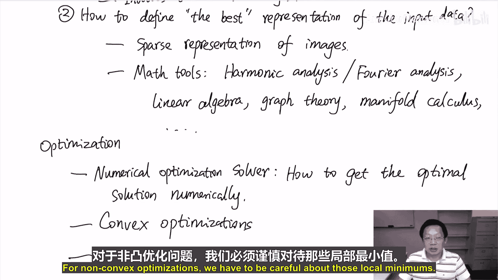

# 【香港科技大学】数据分析的数学方法 ｜ Mathematical Methods for Data Analysis p03 03-03-02-视频 -BV1DEFDzGEZW_p3-

All this belongs to representation， and we have many tools to discuss it。

Once we have a proper representation of functions in the hypothesis space。

We need to determine which function that best fits our machine learning task。

 This procedure is called evaluation。Which is the second element in our formula in the definition of machine learning。

In evaluation that we need to define。Who is the best function in the hypothesis space。

Or how to define the best function。In the hypothesis space。For example， in supervised learning。

We want to find a function F。ThatSuch that F satisfies this F X I is about y I。

Then for each function in the hypothesis space， we needed to evaluate。

Is this function fit the given data good enough？Then what we are going to do is we just define a score for each function in the hypothesis space and pick the one with the highest score。

This is called the evaluation here。In more generally， for each function in the hypothesis space。

 we need to define a score to it。

Then mathematically， we need to define a map from a function in the hypothesis space to a number。

This function maps。A function in the hypothesis space。To a number。

So that this number is just a score， the evaluation of this function in the hypothesis space。

Then we just pick the function in the hypothesis space with the highest score as the best function。

To for our machine learning task。So you can see here we need to define a function whose variable is a function。

Or。We need to define a function of function。Mathematically， we just call such a thing a functional。

Then the math2 involved here。Is the study of functions of function。Wish is。Functional analysis。

This stage， this evaluation， also involves a lot of domain knowledge。For example。

 if that machine learning problem comes from biology。We need some。

Knowledge of biology to define the functional。If that problem comes from computer vision。

 we need some knowledge from computer vision to define the functional。If that problem comes from。

 for example， speech recognition， we need some knowledge about language。In this part。

 domain knowledge may dominate。In this part， statistics may also used here。

That is the evaluation of functions in supervised learning。In many other situations。

 we also need to evaluate the representation of the input data。The central question there is。

What is the best representation for the input data？How to define。The best。Representation。

Of the input data。This problem arises very frequently， in unsupervised learning。

Because in unsupervised learning， we are given only the input data。

And we want to give a good summary of the input data。In this case。

 we need to find the best representation of the input data。For example。For imaging data。

One representation is the so called sparse representation。

The basic idea is that we represent the image in some transform domain and in the transform domain the coefficient is sparse。

 then in order to find the best sparse approximation to the input image。

 we needed to evaluate all sparse vectors。And we pick up the best one。

Mathematical tools involved here include。For example， in sparse approximation。

 the images are sparse in the transformal domain。 So then we need to study the transforms。

Like the full transform， discrete cosine transform and so on。

 so those are related to applied harmonic analysis。Or fullier analysis。

Some other mathematical tools involved include linear algebra。Graph theory。And the manyfold them。

Calculus。And theす well。In the evaluation， our goal is to pick up a best possible function from hypothesis space to fit the given data or to pick up a best possible representation of the input data。

Then the next step is to find out the best possible functioning or the best possible representation。

 numericalmerly。This is done by numerical optimization。In particular， we needed to。

Minimize the functional， we need a numerical server to get the optimal solution numerically。

How to get the optimal solution numerically。Many resulting optimization in machine learning are convex optimizations。

 especially in the early stage。For complex optimizations， local minimum is global minimal。

 so we don't need to worry about local minimum。But nowadays， non convicts。

Optimization becomes more and more important。For example， in deep learning。

In deep neural network training。We naturally have non convex optimization。

For non convex optimization， we have to be careful about those local minimum。

