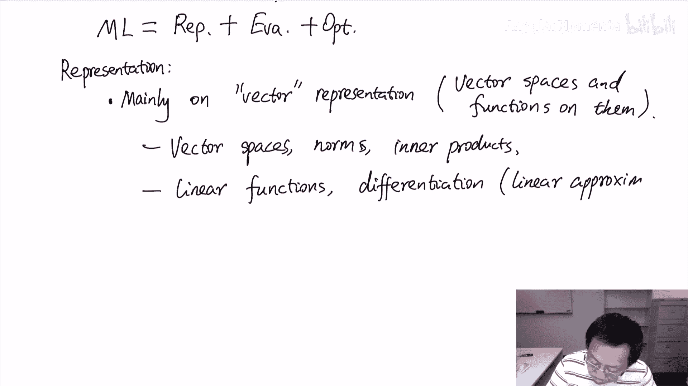
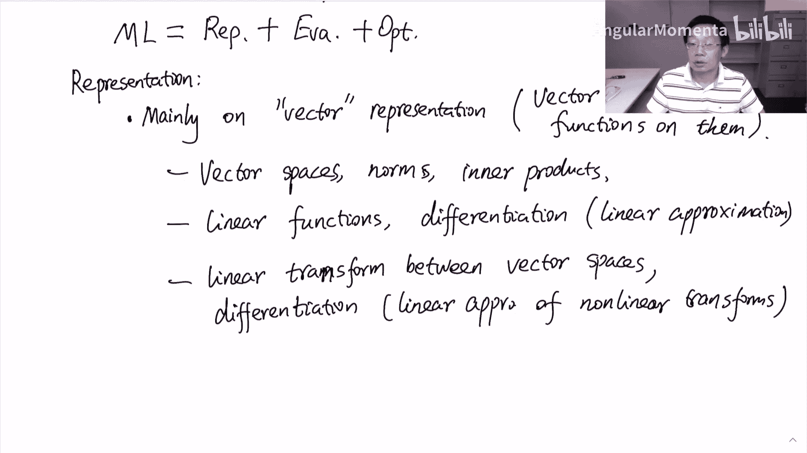
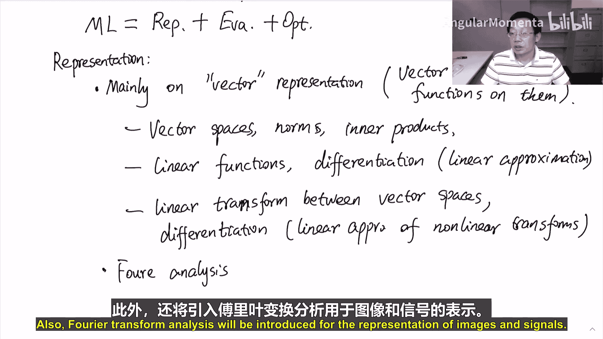
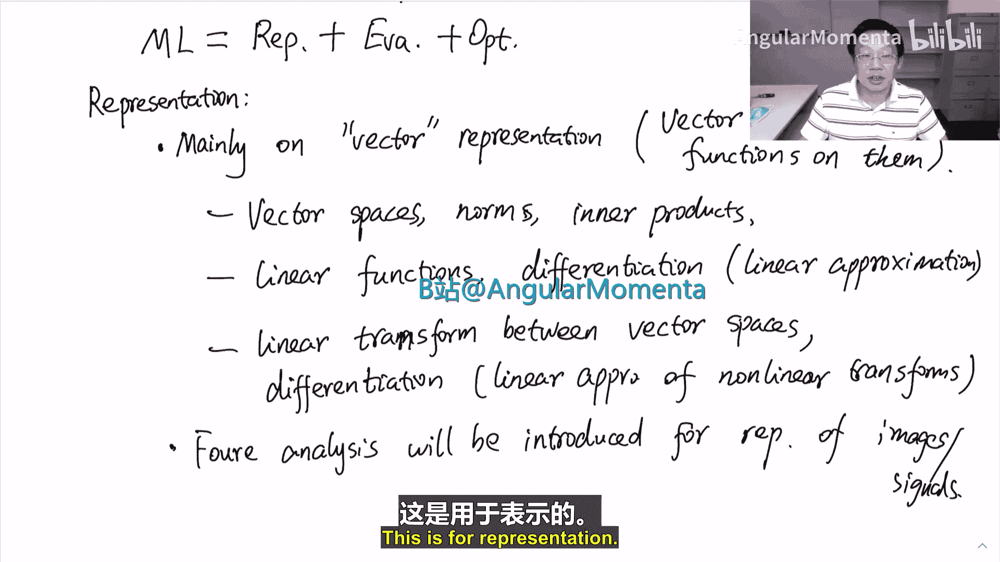
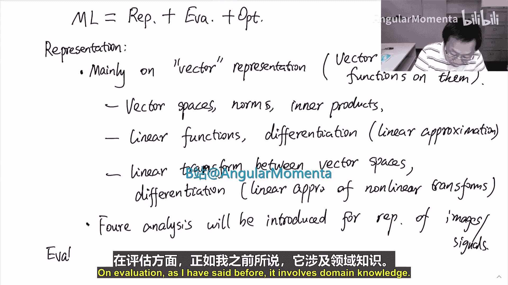
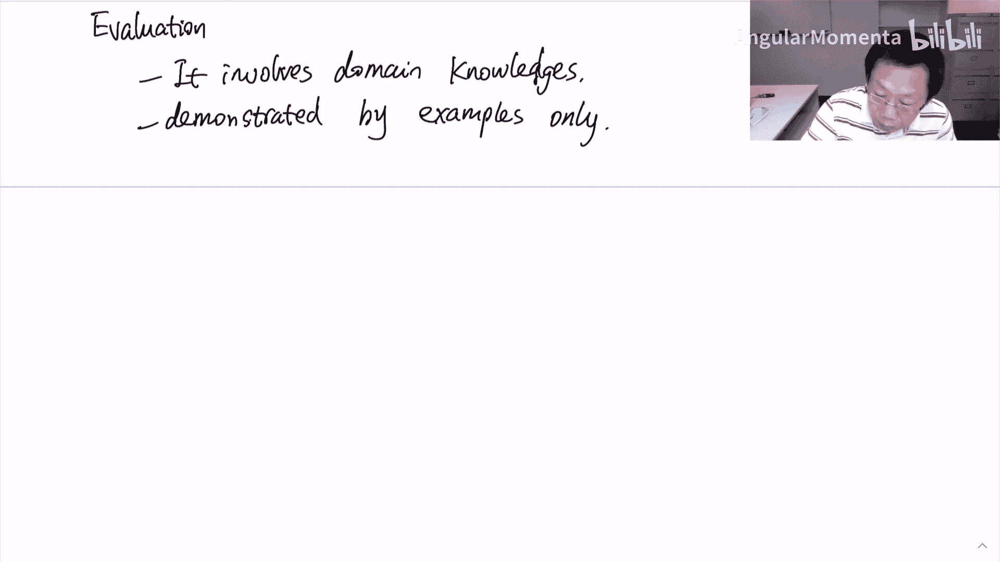
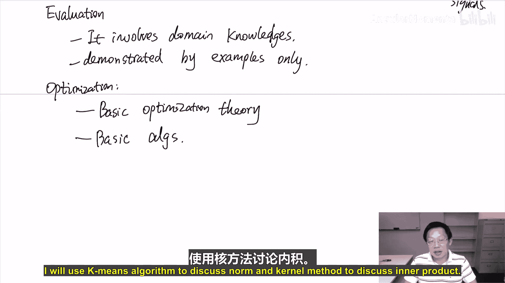

# 【香港科技大学】数据分析的数学方法 ｜ Mathematical Methods for Data Analysis p04 03-04-02-视频 -BV1DEFDzGEZW_p4-

So far， you may notice there are many mathematical tools involved in machine learning。

Due to time limitation， we can only discuss part of them。Most specifically。

 this course will follow our machine learning formula。Machine their knee。Es 2。Representation。

 plus evaluation。Plus， optimization。In representation。We will mainly focus on vector presentation。

Which means that。We needed to study。Vectctorors and functions on vector spaces。Vector spaces。

And the functions on it。Eng。Then。We will go over multivari calculus and basic functional analysis。

 such as。Vor vector spaces。Norms。In the products。And functions on vector spaces included linear functions。

Lar approximation of non nonlinear functions， which is known as differentiation。

And we will also learn linear transformations， linear transforms。Between vector spaces。And of course。

 it's the linear approximation of nonlinear。Transforms。In your approximation。粉 longmin。Transforms。

Also， full real transfer， full real。Analysis。Will be introduced for the representation of images and signals。

This is for。Representation。

On evaluation。

As I have said before， it involves domain knowledge since it involves too much。

The evaluation stage were mainly demonstrated by examples， only。

With optimization， we will discuss some basic optimization and some basic algorithm。

And the basic algorithms。These are all topics will be discussed in this course。

All those concepts will be demonstrated in machine learning setting， if possible。For example。

 I will use Kms algorithm to discuss norm。And the kernel method to discuss in the product。

