# 【香港科技大学】数据分析的数学方法 ｜ Mathematical Methods for Data Analysis p05 04-01-02-视频 -BV1DEFDzGEZW_p5-

Let's go to chapter2 on vector spaces， metric and limits and convergence。

Let me start with vector spaces。A vector space is also known as a linear space。

You must have learned Ek Canadianadian space in Calculus。

Here we generalize it to general vector spaces。Let me give the definition of the vector space， first。

A back your space。If we want to define a vector space。

 we must specify a vector space in which domain here we just discuss vector space in the real domain。

Here and in the rest of this course， I always use R to denote the set of all real numbers or the real domain。

A vector space over R is just a set V。This set of B can be set of anything。

And then we organize elements。Of V in a linear way in order to have a linear structure of elements on V。

 we define two operations of elements on V and real numbers。

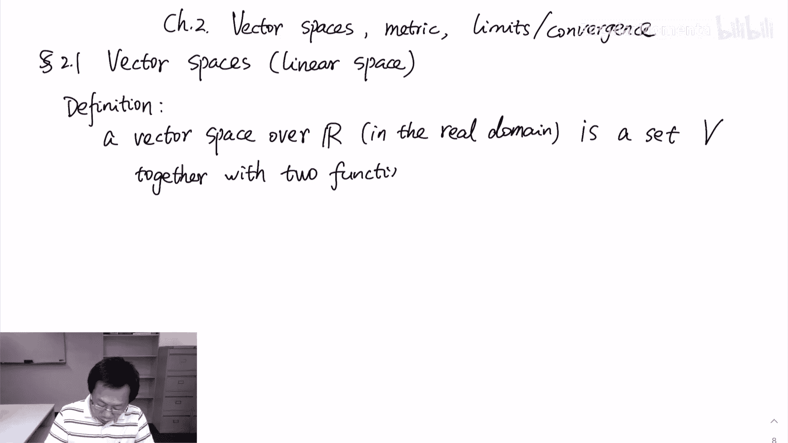

One operation is the addition。So in order to define the addition， we need two elements in V。

And it maps。Two elements on B2。1， elements。U。This just means that。If we have X and Y on V。

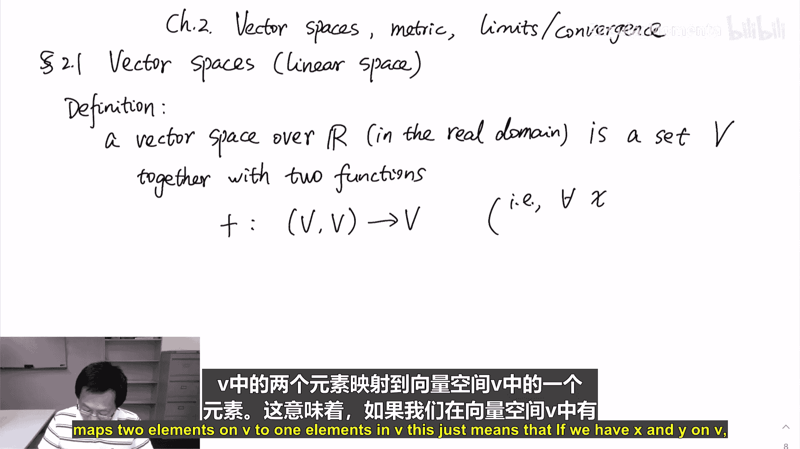

Then。X plus y， we define x plus y。This x plus1 should also be on。So this operation。

 we call it vector addition。

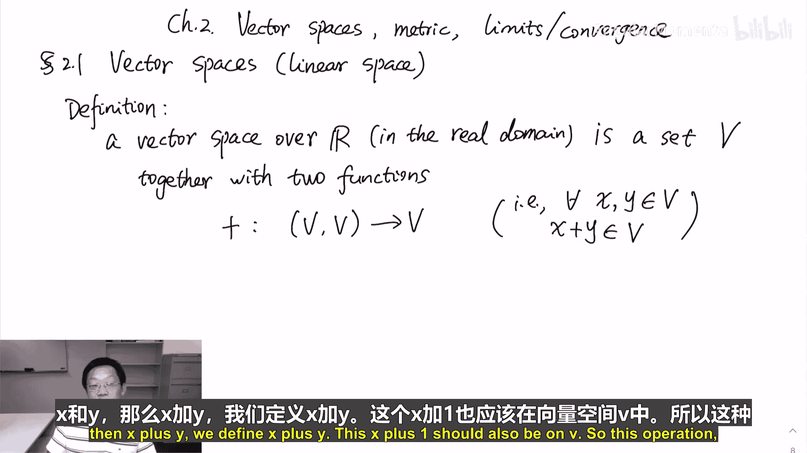

We also needed the scar multiimplication。Which is denoted by a dot here。So， it's a。

It's the operation of a real number and an element on V。And the result is an element of me。

So that is。If we have。A阿法。Real number and。An end on V。

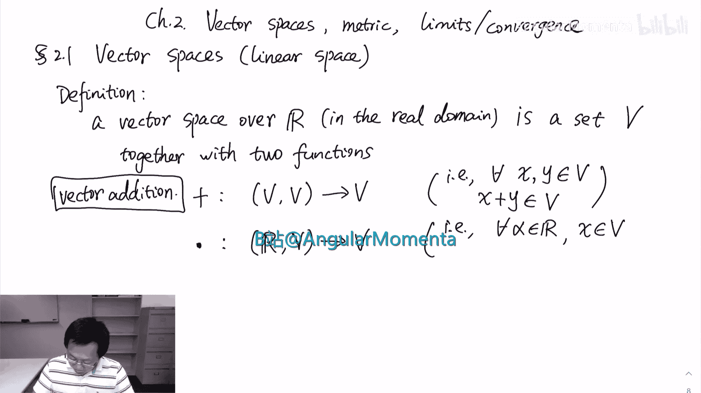

Then we needed to define alpha。Dot X。This。And should be an element on me。

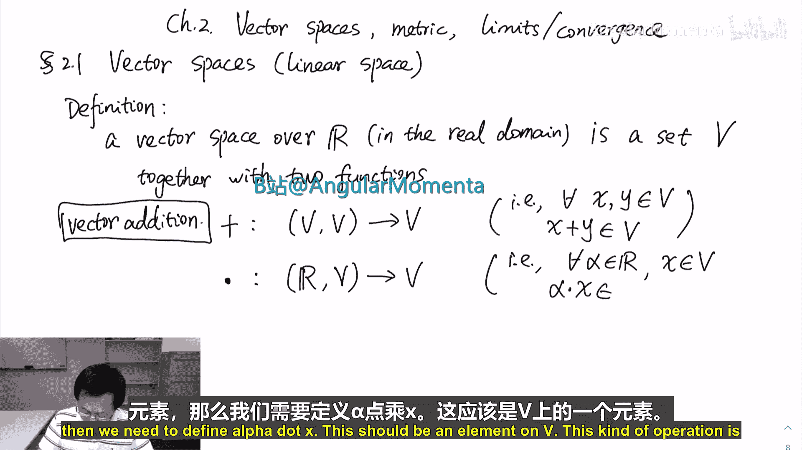

This kind of operation is called a scalar。Mtiplication。These two operations should satisfy。

And the following eight conditions， those conditions are too long。

 I just copy and paste the conditions here。

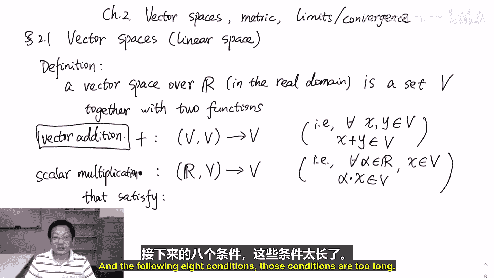

All these conditions are make sure that this V。

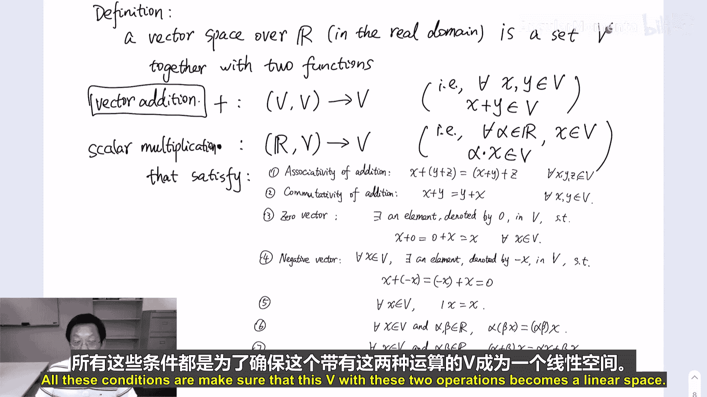

With these two operations becomes a linear space。 Once this set B has a nice linear structure。

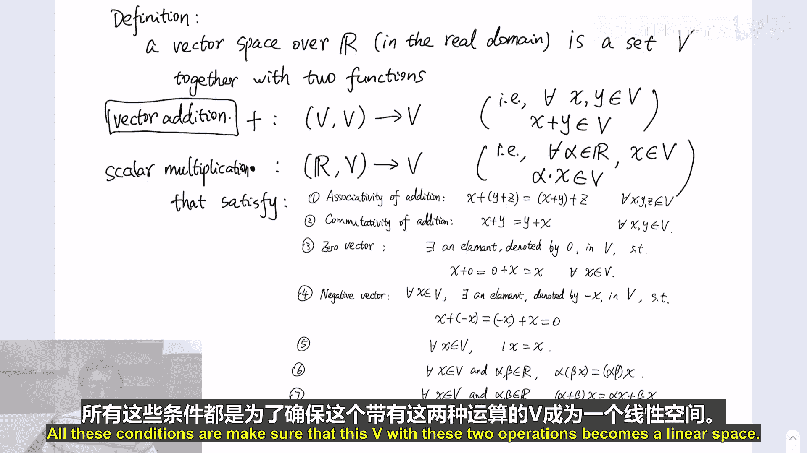

Then for elements on V， we can define their linear combinations。

And these linear combinations satisfy very nice properties like the associivity in addition。

 the commutivity in addition， and many other good things。

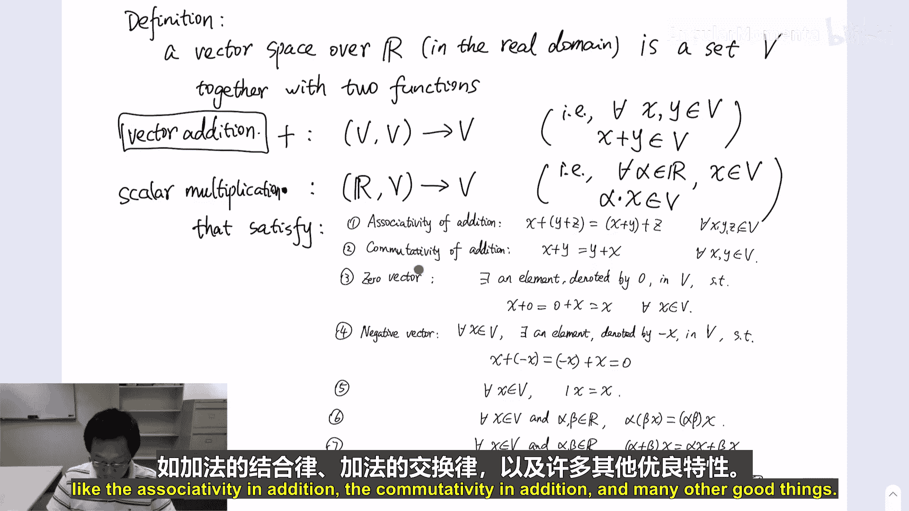

In summary， a vector space is a set together with addition and scalar matchplication to make this set linear。

 It is just a generalization of the eucanian space。

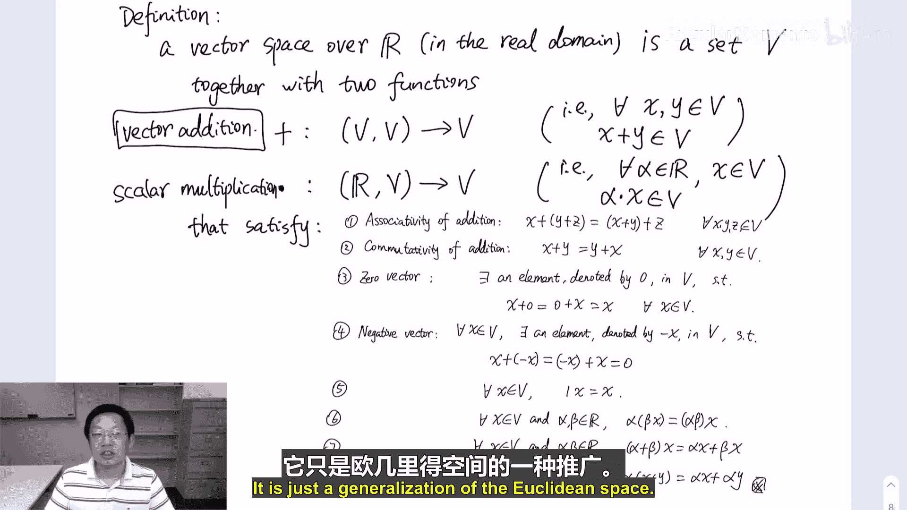

I want to make a remark on this definition。

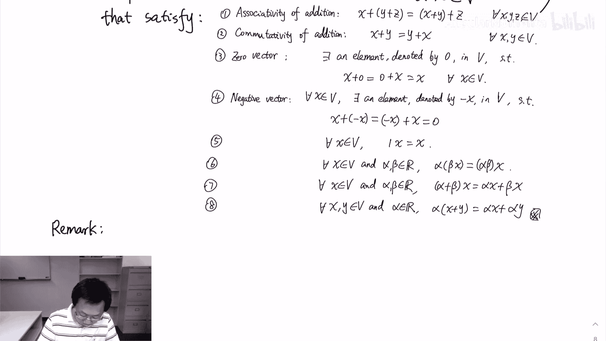

In this definition， I we defined。Vector space in the realo domain。Actually。

 we can extend this definition to vector space in the complex number domain。

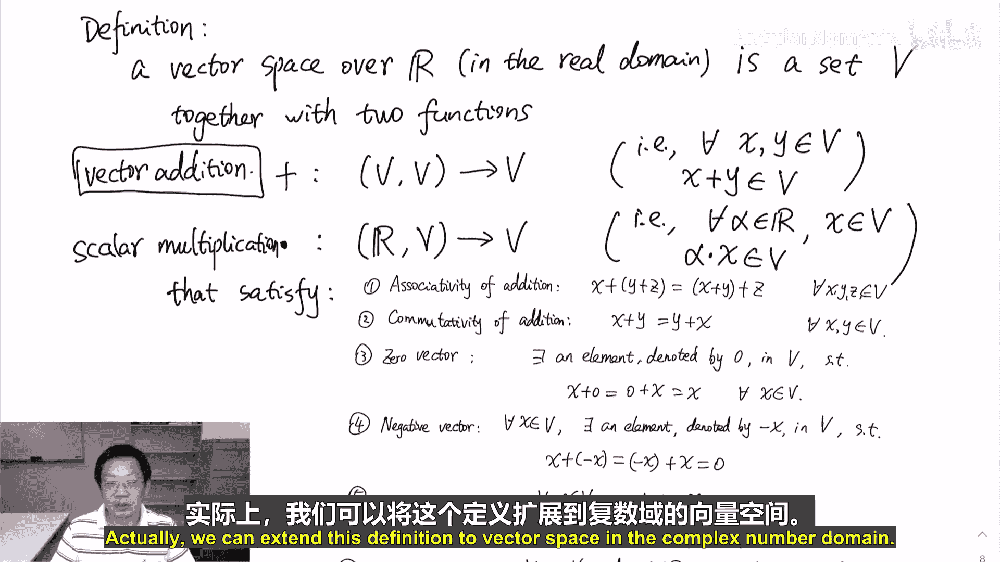

However， in machine learning， the data we have is always in real domain。So。

Without loss of generality， if not specified by default。When we say a vector space。

 we mean a vector space in the real domain。Which means that we will assume。Vector space。

In the real domain。By default。

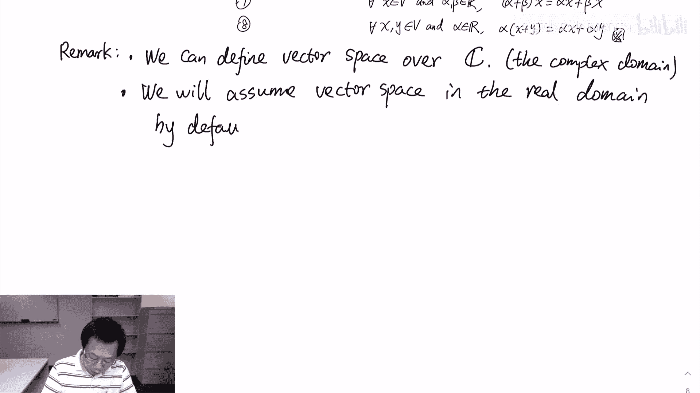