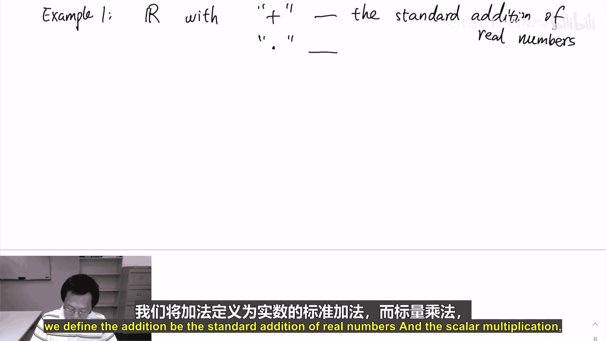
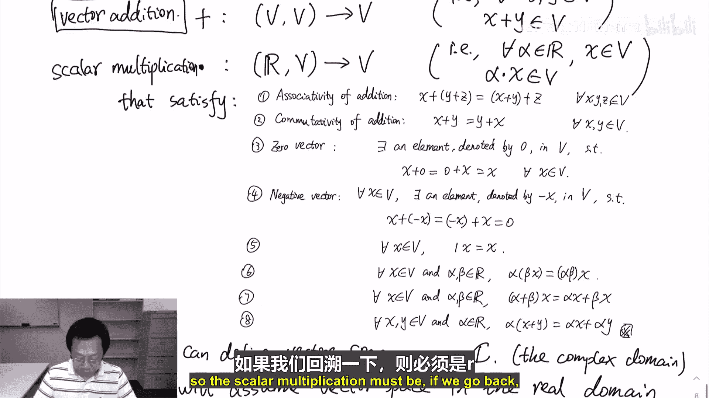
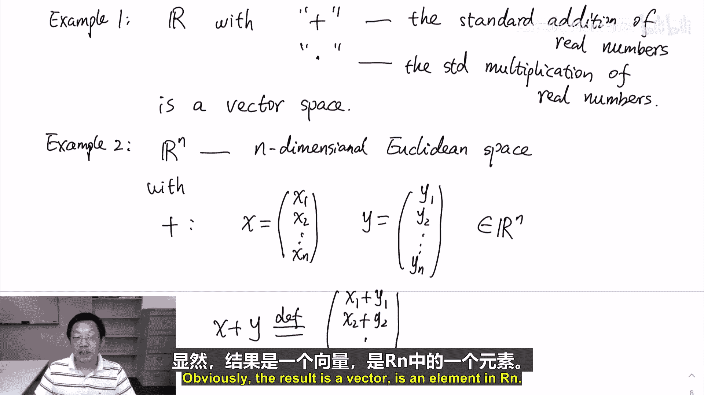
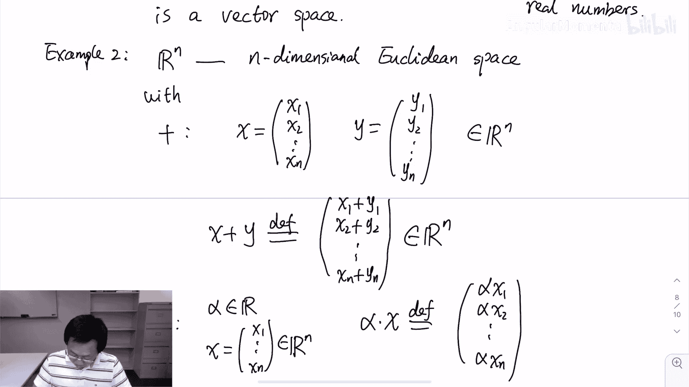
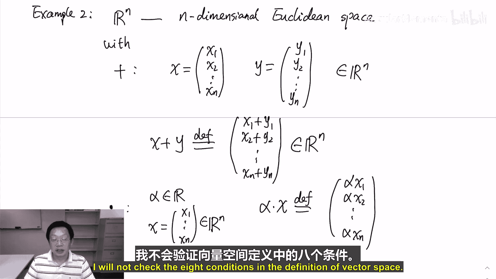
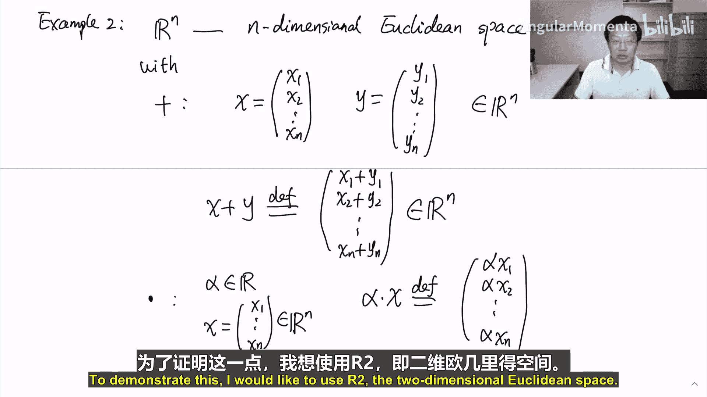
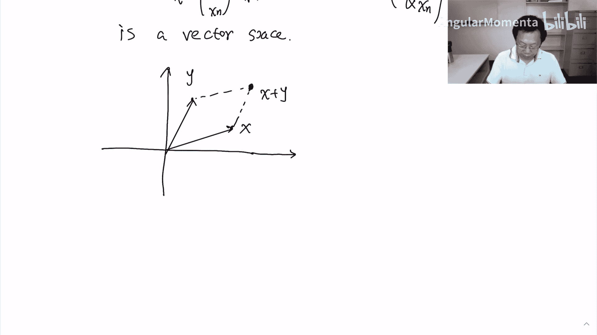
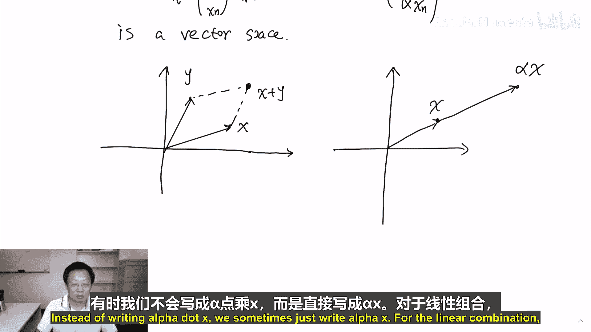
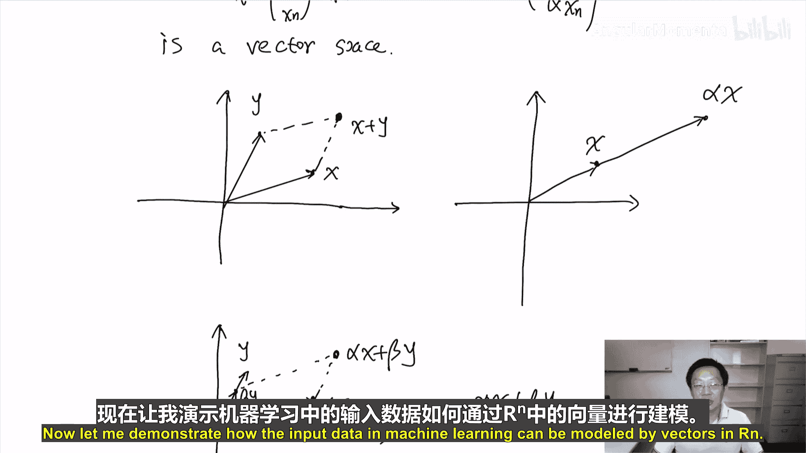
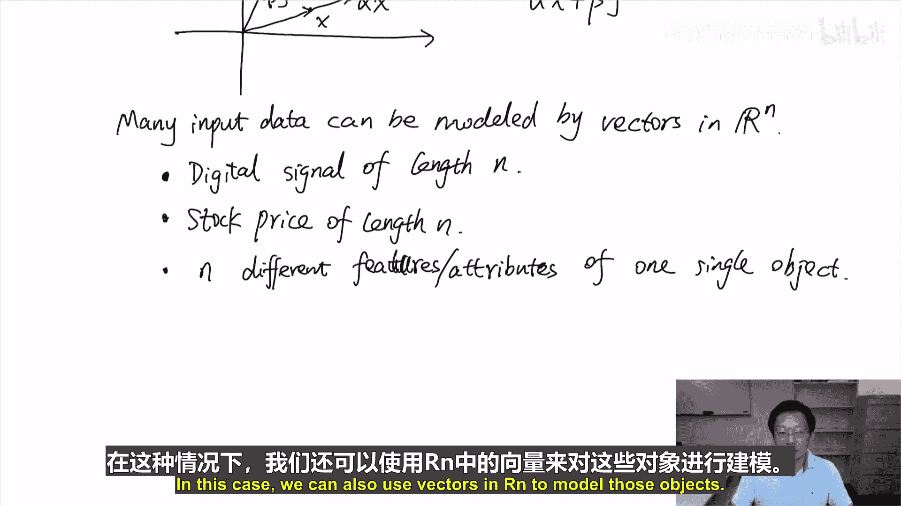

# 【香港科技大学】数据分析的数学方法 ｜ Mathematical Methods for Data Analysis p06 04-02-02-视频 -BV1DEFDzGEZW_p6-

Let me give you some examples of vector spaces and how we can use vector space to model。

The input data， example  one。We consider R the set of all real numbers。So when we say R。

 it is just a set of real numbers。Then we need to define the vector addition and scalar multiplication。

If we just define the addition。And the scalear multiplication。

We define the addition with the standard addition of real numbers。And this。

Scalar multiplication， so the scalar multiplication must be if we go back。

Must be R， and V now v equals to R。So。We can use the standard。Muchplication of real numbers。

Then are with such two。Operations。It is a vector space。I will skip that。

Checking of the eight conditions in the definition of vector space。

You can do it if you are interested in that。You example 2。We consider the undisional eukkuian space。

With。The vector addition define in this way。X in R N， which means that x is an array of n numbers。

Y in R N。Which means that why is an array of。N real numbers。The both are in R， N。

Then we define x plus y。This is a definition to be。The addition of the corresponding entries。

The first entry is just the X1 plus y1 on the sew。Obviously， the result is a vector。

 is an element in RN。

And we define the scalar matchmun in this way。For any阿法 in R。For any x equals to x1 to x N。云 RN。

We define alpha times x to be。Every element。Every entry。Is skilled by alpha。

You can check that R N with these two。Functions with the addition and the scalar batchplication。

It is， It forms a vector space in R。Again， I will not check。

The eight conditions in the definition of vector space。

Instead， I would like to give you a visualization of the vector addition and scalar large medication。

And how we obtain linear combination of two vectors in R N to demonstrate this。

 I would like to use R 2， the two dimensional U Canadianian space。

Lets x be this vector and y be with this vector。 Their sum actually can be obtained by using the so called。

Ploogram law。Actually， this point will be X。Plusus why。Then by this way。

 we obtain x plus y shown here。

And for the scale multiplication， it's even simpler。We have a vector X here。

Then alpha times x is just the scanning of this vector。This is x， this is just a x。

Notice here that sometimes we just drop this dot here。TheFor the。

 for the scalear match communication。Instead of writing alpha dot x， we sometimes just write alpha x。

For the linear combination。Assume we have two given two vectors。X under Y。

We want to get their accommodation Al x plus beta y。Here， alpha and beta are two real numbers。

Then we first scale X and y respectively。This is offer X。This is a bit Hawaii。Then。

We find the alpha x plus B Hawaii。So that this is just alpha x plus beta y。

So you can see here this alpha x plus beta y is still in R2。That's Y R2 is a linear space。 Basically。

 it means that for any given two vectors， X and Y。They're in your combination。

Should also be in this space。That's the meaning of linear space。In the definition of vector spaces。

 we introduced this vector addition and scalar multimun and the conditions these two operations to satisfy。

We just won't。Any linear combination of vectors on this vector space still in the vector space。Now。

Let me demonstrate how the input data in machine learning can be modeled by vectors in R N。

Indeed， many input data。Can be modeled。By vectors in R N。

If the input data is a bunch of digital signals of length n。Then for each digital signal。

 we just use a number to memorize it。Then in this case， we can use a vector in R N。

To model a digital signal。We have many， many digital signals， so we have many， many vectors in Rn。

Also， stock prices can also be modeled by vectors in R。Asum we have some input data。

 which are stock prices of different stocks。For each stock。

 we have their prices at any different time。Then。We can use a vector in R N to represent the prices of that stock at different time。

The last example is that's n different。Features。Or attributes。Of one single object。If。

One single object contains exactly1 different attributes or features。

 then we can just use add numbers to describe that object。

Then each object is identified with a vector in iron。In this case。

 we can also use vectors in RN to model those objects。

