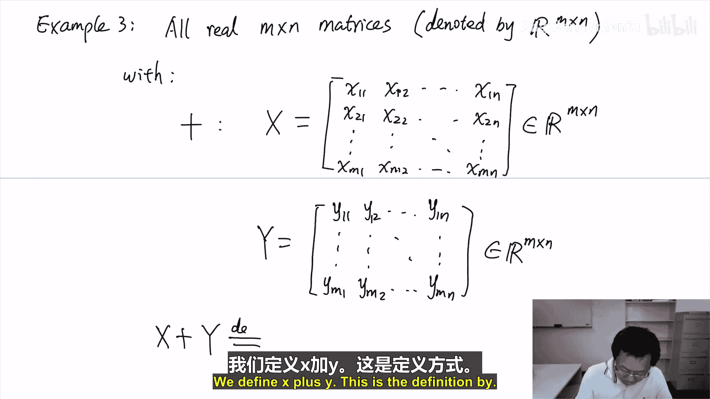
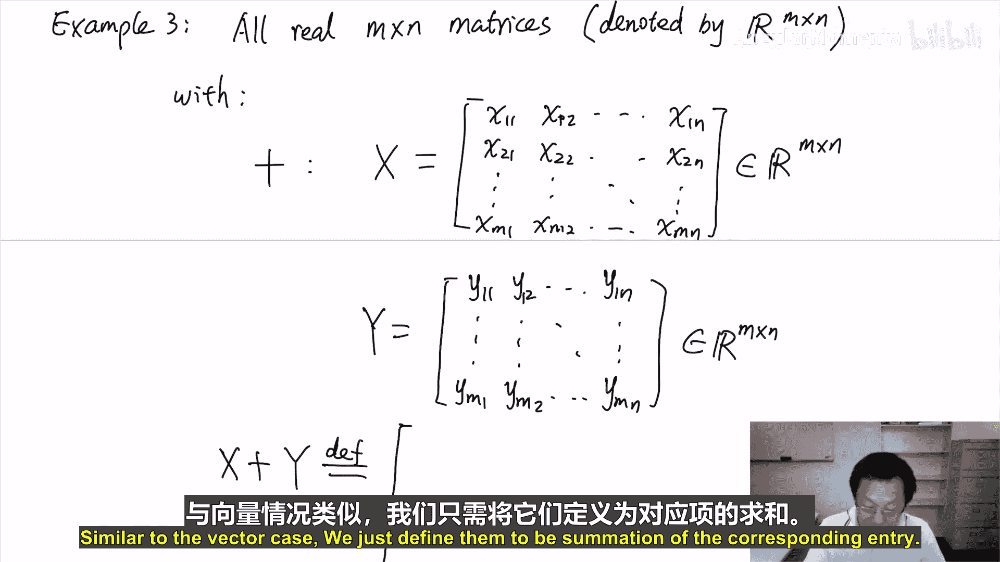
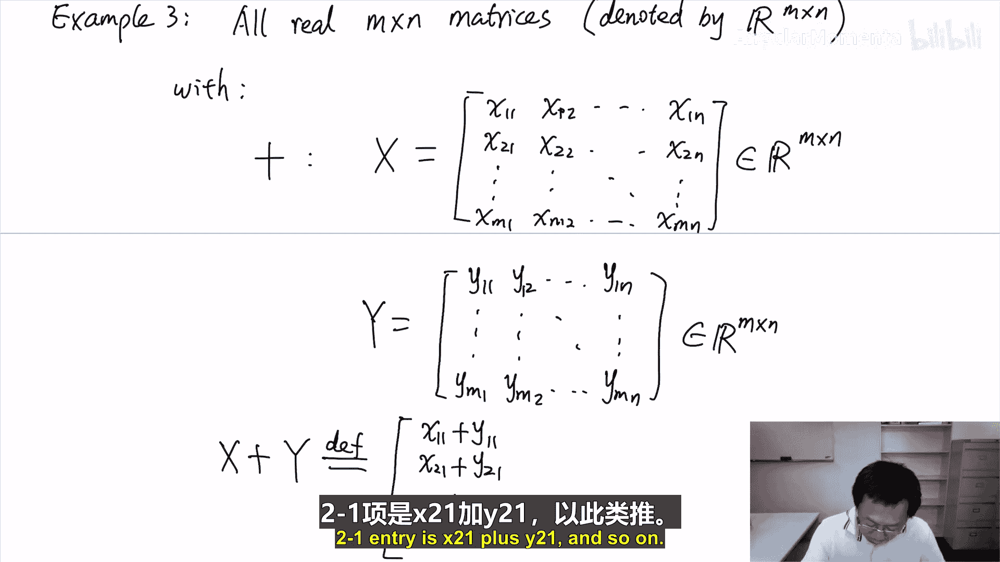
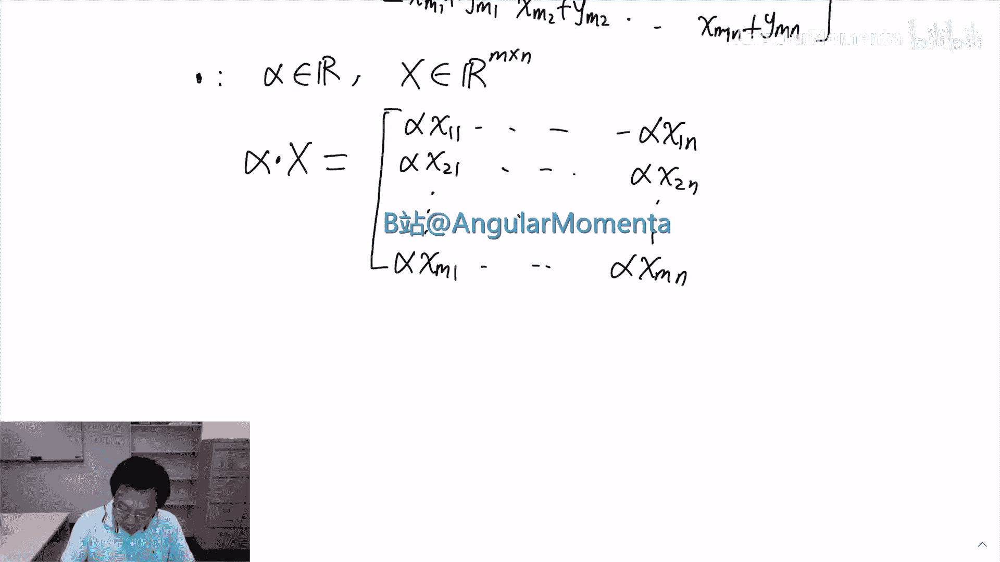
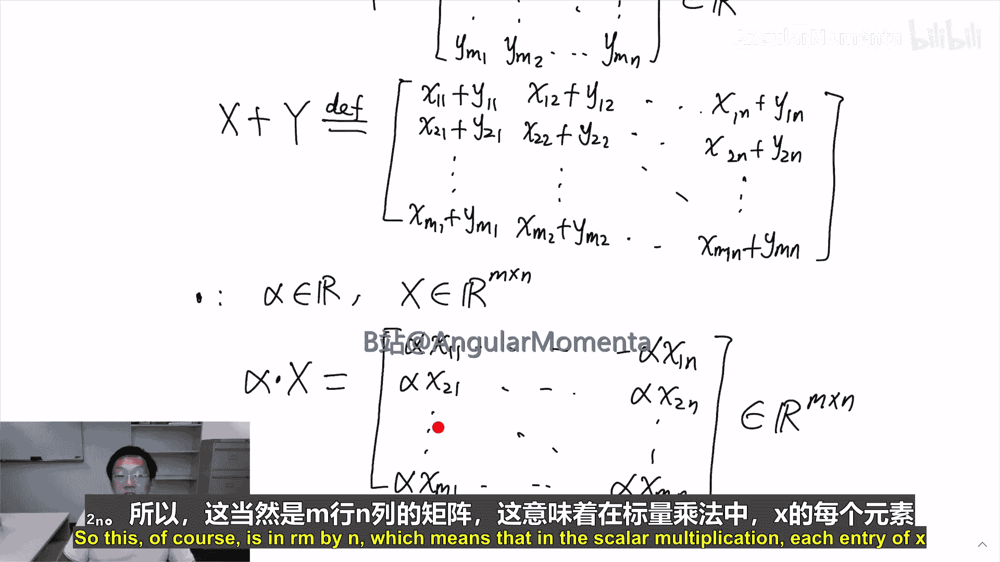
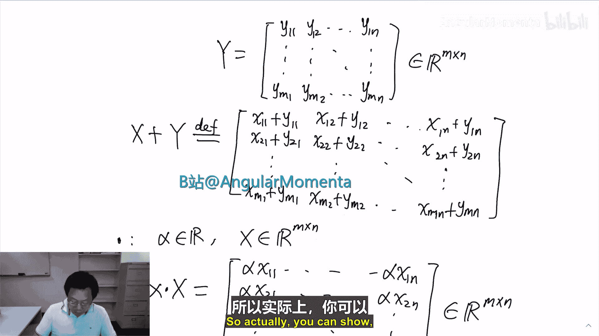
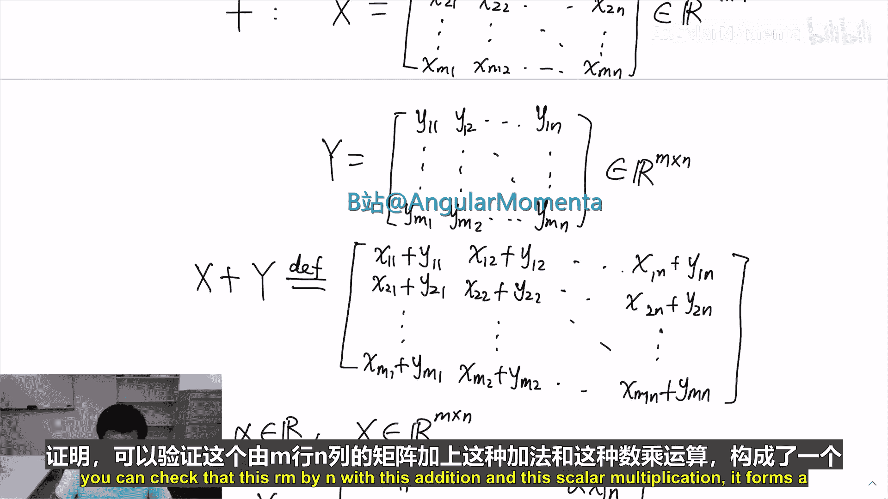
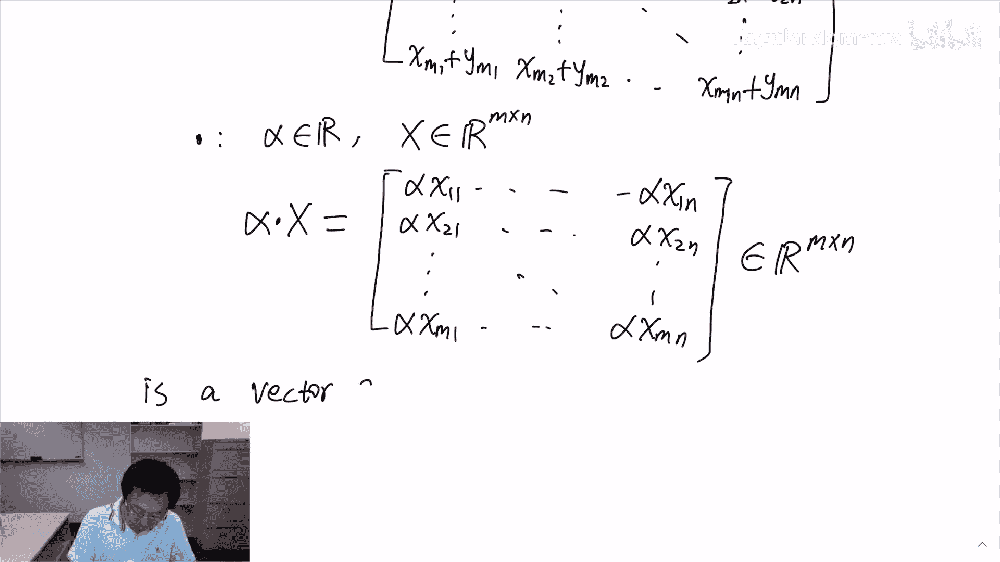
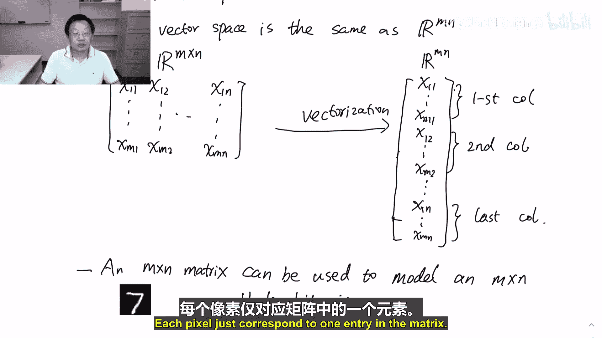

# 【香港科技大学】数据分析的数学方法 ｜ Mathematical Methods for Data Analysis p07 04-03-02-视频 -BV1DEFDzGEZW_p7-

The previous two examples of vector spaces might be standard。

 and they could be in a standard textbook of linear algebra。Now， in the following。

 I would like to give you some examples。That might not be in a standard。Linear algebra textbook。

 but they are quite useful in machine learning。Example 3。We consider all real M by N matrices。

They are denoted by R， M by N。Here are miss。Entries are real number。

 This super secrets M by n means the size of the mates are M by n。With。The two operations。Plus。

 defining this way。For any matrix， x and Y， they are。M by M matrices。

 so I can write them in entrywise form X 1，1， x to 1 until X M1。And this is x1，2 to x1。Next，2，2。X2 N。

X， M， N。X， M2。And the希。This is a matrix of size， M， I， N。And this X I J is a real number。

Why is the same？It is also in R M， I， and。Then we define their sum by。We define x plus Y。

 This is a definition by。

Similar to the vector case。We just define them to be。Smation of the corresponding entry。

For example， the 1，1 entry is x 1，1 plus y 1，1。1，2 entry is 21 entry is x 2，1 plus y 2，1。

And so on。This is the addition defined in this way for the scalner matchplication we defined in this way。

For any alpha in R and X in。R。M by n， we define alpha times x。Equals 2。We just scare each entry of x。

Which means this is alpha x 1，1， alpha x 2，1。Under silver X。M1。Apha X， M， N。Alpha x 1， n。

Apha x 2 and。

So this， of course， is in our M Biden。Which means that in the skin。Scalar match ver。

 each entry of x is just scaled by alpha。

So actually， we can， you can show。 You can check。

That。This R， M by N。With。This addition and this scalar multi， it forms a vector space。

This vector space is the same as the vector space of RMN。To see this。

 let's just consider any element in RM by N， which is a matrix。

 then we just do a simple conversion by stacking all the columns of this matrix to form a very long vector。

Which means that's。The first part。Is。The first column。The second part。Is it's a second column。

And the still well。This is the first column。This is a second column。

And the last part is the last column。So from here you can see by a simple convers。

 a matrix is converted to a very long vector， this kind of operation is called vectorization。

You can see that。The addition in the matrix space。It's the same as the addition in the。

Long vector space。The scalar multiplication in the matrix space is also the same as the scalar multipl in this very long vector space。

 so that this R M by N is actually the same as。RM， N。

This matrix vector space is also very useful in the modeling。Data in emission learning， for example。

AndIn the very beginning， I have used the recognition task。

To demonstrate a supervised learning where the input data are just small images like this。

You can see it is exactly assume that there are M by M pixels of this image。So for each pixel。

 we just have a black white value for the pixel。So that you can view this one as just one m by n matrix。

So， so this and。M by M matrix。看毕。Yoursday。To model。And。M by N。Black white image。

Each pixel just corresponded to one entry in the matrix。

