# 【香港科技大学】数据分析的数学方法 ｜ Mathematical Methods for Data Analysis p08 04-04-02-视频 -BV1DEFDzGEZW_p8-

You example before。In example 2， we use the one dimensional array， the Eucconad space RM。

 In example 3， we use the two dimensional array that is a matrix。

Then how about we increase the dimension of the array？Then we consider all real。

Three dimensional array， I call it a three array。Of， of a fixed size of size， say。M by N by L。

This one， we just denoted by。Can you note。Do you notice to buy R。M byM byL。This set。Now on this set。

 we define an addition。In this way， So for any X and y on。R M， by， M by L。Now， for simplicity。

 I will write this X as X， I， J， K。IJK。This means that。嗯。Since this x is a three dimension array。

 So we need three indexes to identify entries in this three array。

So when I write this just means the IJKs entry of this array is X I JK。Similarly。Why is just a Y IJK？

Whose I J K entry of this one is lowercase Y， I J K。Then we define。X plus y。

This is just a definition to be。The same as example 2 and example 3。

Just add the corresponding entries together。 So the IJK entry。Of this new array is just X， I JK。Plus。

 Y， I， J K。Definitely， this one is an。M by N by L，3 array。 So it is just stealing R M by N by L。

This is the addition。For this to scan on match medication。For any alpha in R and for any x in。

M by N by L。We do the same thing。As。The scale multiplication in in in the matrices space or in the in the Euculeidean space。

 we define alpha times x to be。Its。I JK entry is just alpha times the I JK entry of X that is X。

 I JK。So which means that。Apha times x equals to we multiply each entry of this three array by alpha。

Then。These three are。Of with this。Add and scale of multiplication is again a vector space。

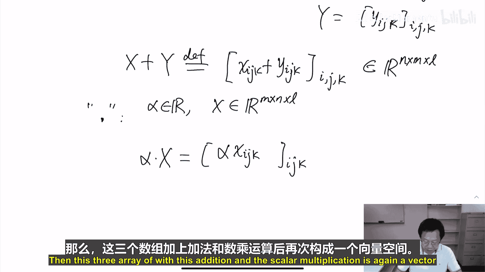

This is the vector space of three arrays of a fixed size。Similar to matrices and。Euclideian vector。

 vectors。These are also very useful in modeling data in machine learning。For example。

We use the matrix to。Represent black， white images。 How about。Color images。

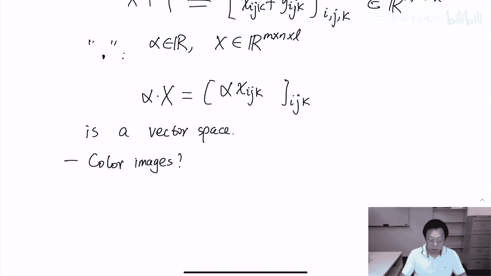

For color images。You know that we。Just assume that we have a M by N。Color image。

To represent the color， actually， we have three channels to represent the channel。

 the the the the color RGB。 So for each pixel， we need three numbers。To form the color。

Which means that we have this R。子。B。So we， we need three channels to represent a color and M by an image so then we can use them can be。

Moel the by。M by n by3， array。Right。So we can use M by n by3 array to model color images。

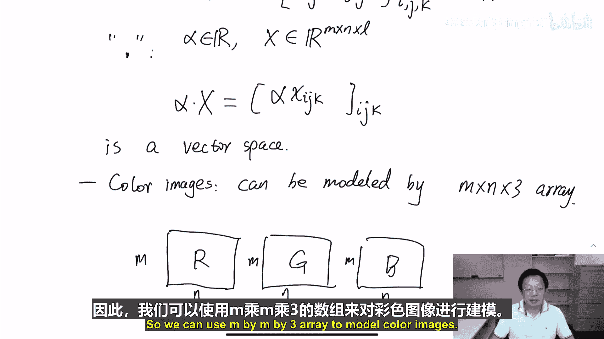

This is one application。 Some other applications include if we want to model some black， white video。

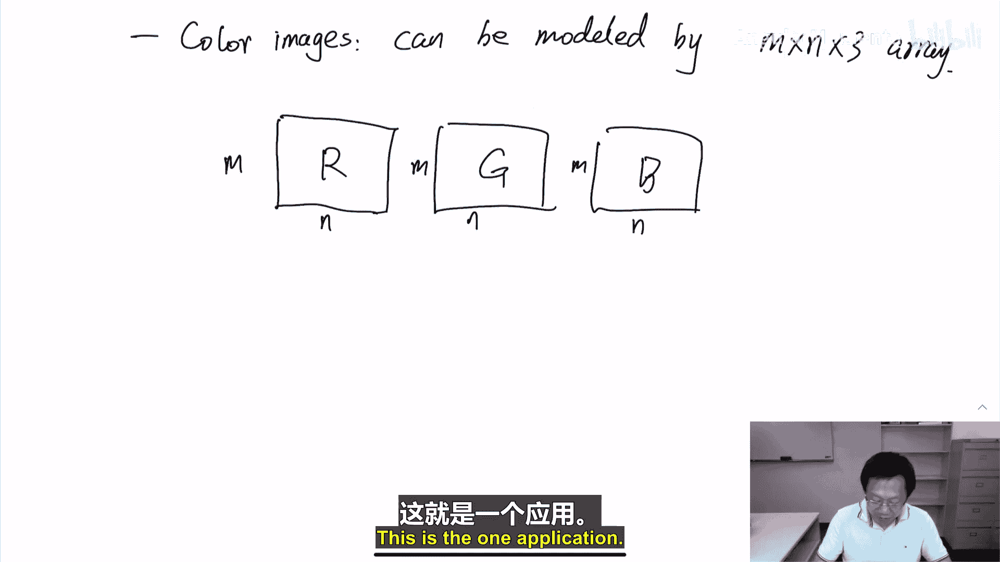

For videos， we know that we have many， many frames， right at each at a fixed time instance。

 we have one frame because we have many。Time instances so that we have many， many frames。So， then。

We can use a three array to model color black， white videos。So we just have this M by n。

 this is frame1。And then we have many， many frames。This is the frame l。Again。

 each frame is just of size M by n。So we have L frames so that we have a naturally a three dimensional array。

 n by N by L。Then we can use M by N by L to to3 array to model black white videos。

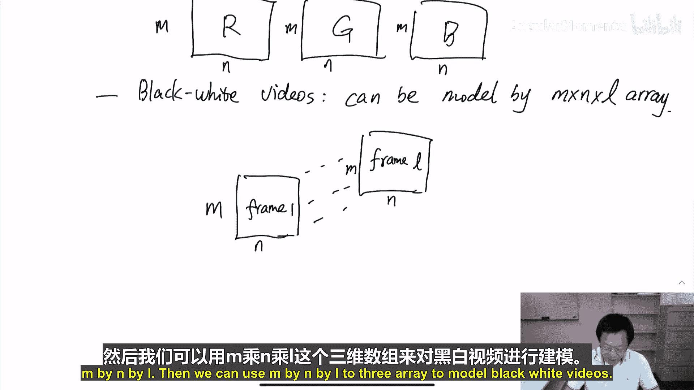

These are two obvious applications of this vector space。So actually。

 how about you may wonder how about the color？Color videos。 So for color videos， each video。

 each frame is an M by M。By3。Aray， right， so we have L frames so。We can use。We can use。

Is a M by M by 3 by。L， R。

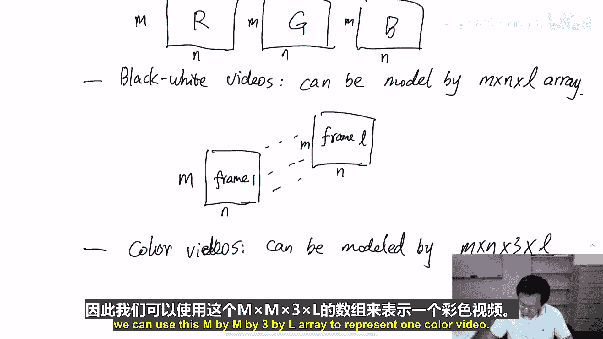

To represent one color video。Okay， so this， this is now a four。I mean。

 it's not a three area anymore because we have four dimension。

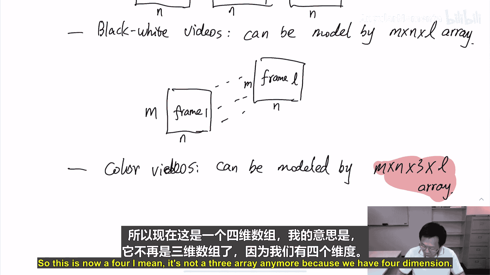

W is forward。So to index each value， we needed four numbers， we need four indexes。

 so this is just a four array here。Indeed， we can check that the set of all four arrays also form a vector space if we define similarly the addition and scale of multiplication。

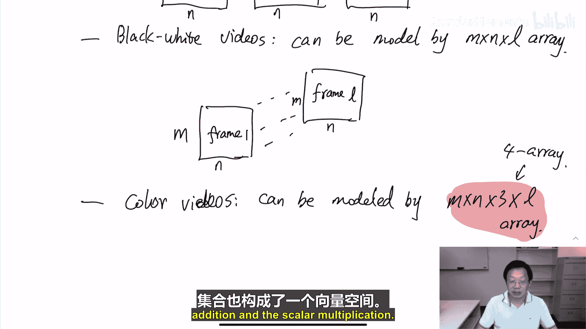

So those some。3 a。4 array。And so on those all these high dimensional arrays。

 they have a name are called。Tsors。These high dimensional arrays are just called tensors。

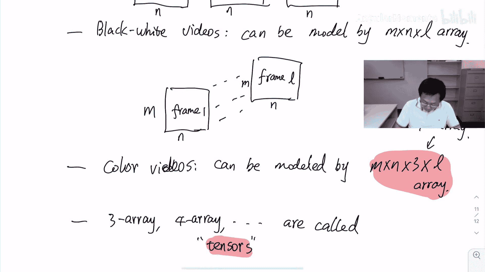

So type four tensors of the same size， Actually， they can be a vector space if we set up a proper vector。

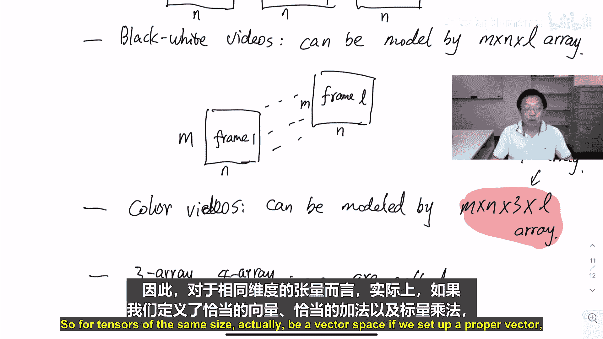

Proper addition and scalar multiplication。If you have some experience in deep learning。

 you must know that the software package Tensor flow。SoIntensor flow， actually， the tensors are。

The very basic object to operate in this software package， So then tensors actually。

 they are quite important in neural network training in deep learning。

 this vector space of tensors of the fixed size is a very important vector space in image learning。

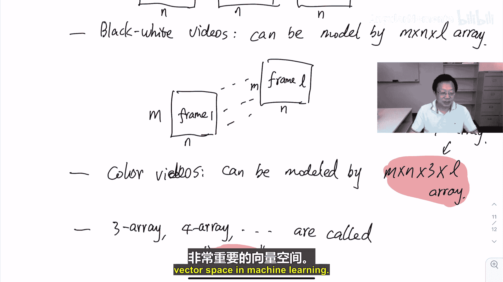

The previous four examples they are all successful examples of vector spaces Now in example5。

 I would like to give you a few example counter example of vector spaces。In many applications。

 in machine learning， we needed to。To analyze text data。Now you may wonder。

 can we set up a vector space for the text data？Now we just to consider。All the set。Of all。Strengs。

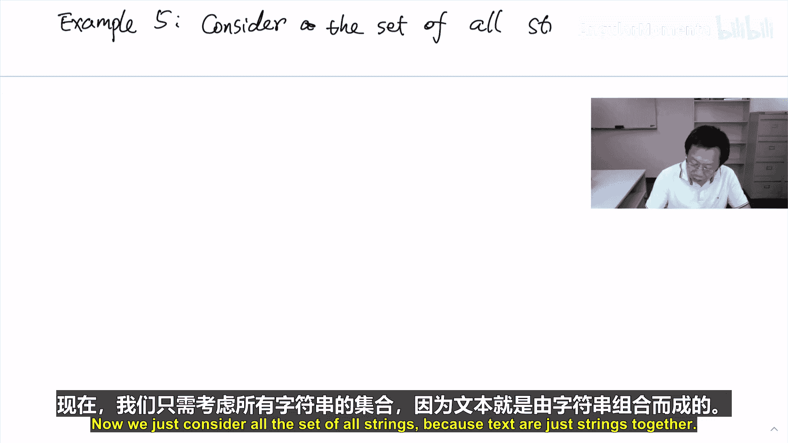

Because texts are just strings together？Then on this， I in order to set up a vector space。

 I need to define addition and scale the match communication we。This addition by。For example。

 just by this very naive way。I have this strain eye and space， plus。And a space。To be。

Their combination。I， space。Space to be this new stream， this is still a string。

So that this is a valid addition。Because the sun is also a string。안 돼。

I also need to define some scalr。Much communication。Which I don't care。一。😊。

Then this will not be a vector space。The reason is quite simple just because the commutability is not satisfied。

 This edition is not commutable。In the sense that this eye。Plus， M。Is not。

In the sense that if I switched the two terms in the summation。I put M first。And I。The second。

Definitely， according to our definition， these two are not the same。So that the condition。

 one of the condition in the definition of the vector space is not satisfied so that this does not form a vector space。

This means that we can use the tools for an linear space to study text data related problems。

If we use this kind of。啊。Space， if we use this kind of addition and see multi。

We cannot use the vector space。The tools for vector spaces。

But the tools for vector spaces is really powerful， we want to use it。

Then there is natural a question。How could we vectorize？The text of data。Text data。Right。

 how could we vectorize strings， How could we set up a vector space in the set of all strings。

 How could we do that。So actually， this is just a fundamental problem in the research of text data analysis。

So from this example， you can see how important the vector spaces is in machine learning。If we。

 we just wanted to set up a vector space for some specific input data， is' already a very。

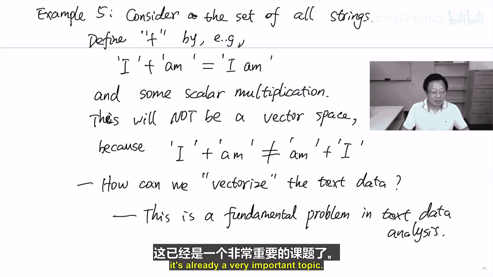

Important。Topic。