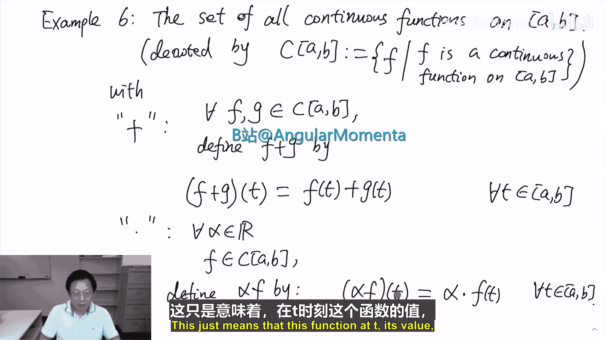
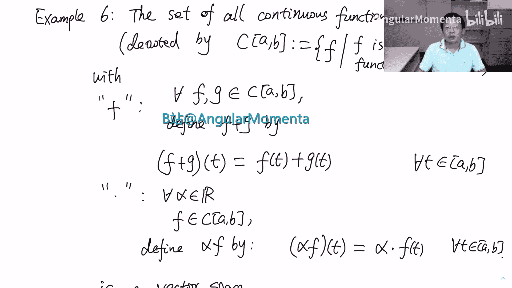
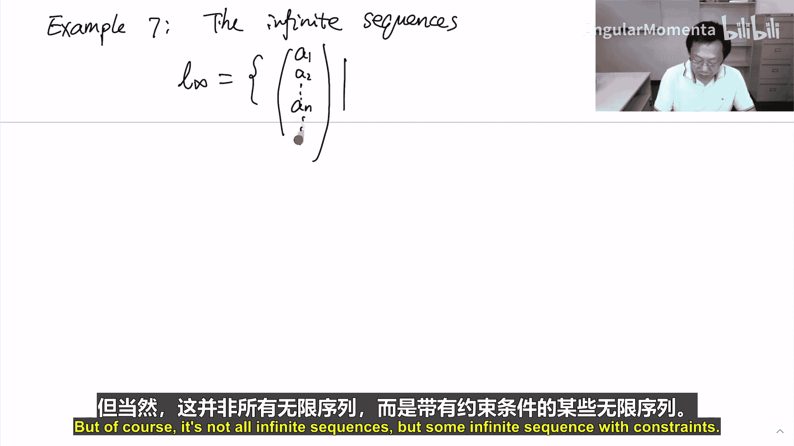
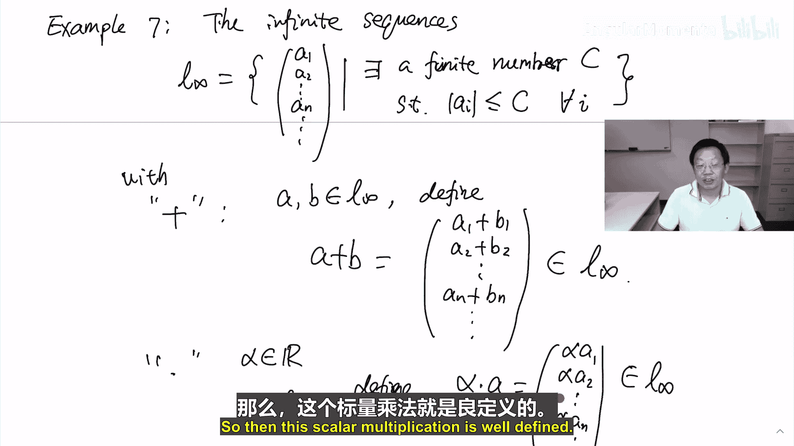
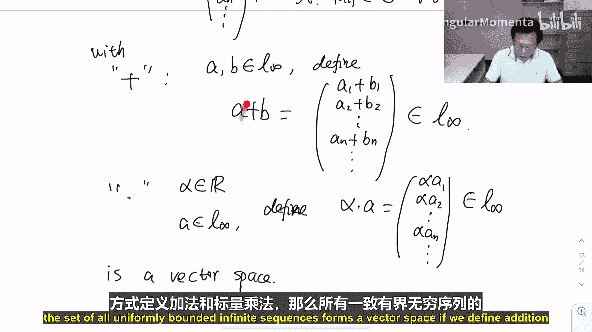
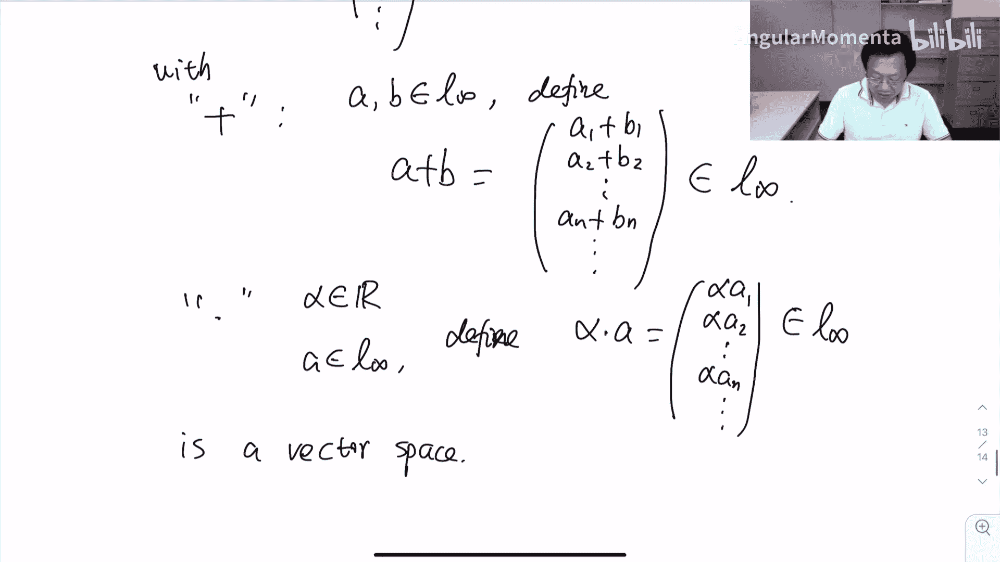
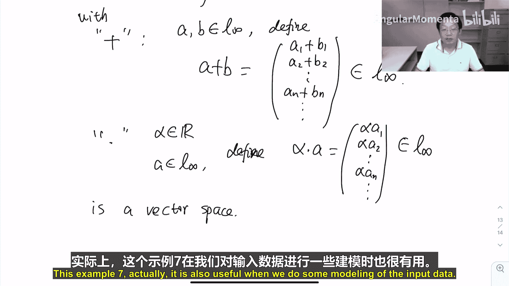
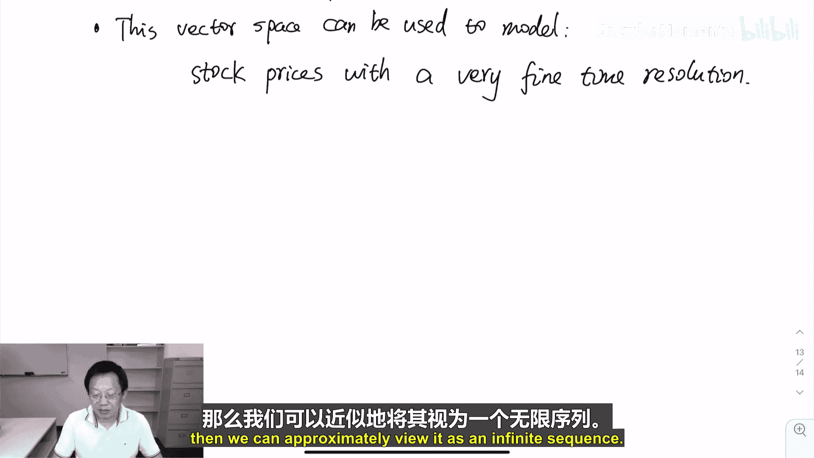

# 【香港科技大学】数据分析的数学方法 ｜ Mathematical Methods for Data Analysis p09 04-05-02-视频 -BV1DEFDzGEZW_p9-

Example 6。The previous five examples， they are all about the input data。But remember we have。

Supervising learning where we want to find a function。Not only the input data。

 we also need to represent the functions。Then we consider actually the set of particular class of functions will also。

Form a vector space。In this example， we consider the set of。Or continuous functions。Define the own。

On the close the interval from A to B。 So here this AB is is the closed the interval。

 is the interval A B。Which means that the number in between A and B。This sets we just denoted。

It is denoted by。It's a C of AB。That is CA is just the F。Function F is continuous。Function。On A B。Oh。

 this is set。In order， it forms a vector space we need to define。The addition。就行。

We just define addition in this way for any F and the G。That are continuous functions。

On the interval from A to B。We define。F plus G by。This F plus G should be also because F energy are on CAB。

So this Cf plus also should be on CA A B， so it is a function。

This function means that for any number on F A on A and B， we should get another number。

We just need define this way。 F plus G， this function applies to a number T。 Of course， T is on A B。

It is just the F T plus G of T。Which means that。The value of F， F plus G at T is just F T plus G， T。

This is the addition。For the skin or much medication。For any alpha on。In R and for any F on C， A B。

Again， we define。This alpha times F。Bye。Again， alpha times f is a function。So we just define it。By。

We apply this to T equals to alpha times F at the T。ForAT on AB。7。Just define it this way。

This just means that this function at T is value is just alpha times the value of f at T。

This CA A B with these two operations， indeed， you can check this is a vector space。

This is a vector space。 So then by this way， you can we we we sometimes we call this C A B a function space because it indeed is a vector space。

就 c a b。For this reason， because it forms a vector space。 It's a space。 So is。Referred。

As a function space。So the function space， actually， this function space。

Might be a hypothesis space in some machine learning task might be a hypothesis。For some。

Machine learning husk。The vector space is not only used for representing them。The input data。

 it also can be used for representing the hypothesis space。

The last take example I would like to give。Is on infinite sequences in R N， you know that。

For each vector in RN is only a vector of n numbers。In many applications。

 we may need an infinite numbers for each vector。For this， we consider the infinite at the sequence。

We consider this special infinite sequence as we call the little L infinity。This set。

It is just each element of this set is just an infinite sequence， a1， a2。To A N and。

 So it's infinite。It contains infinitely many number for each， for each element in this infinity。

 but of course， it's not。It's not all infinite sequences。

 but some infinite sequence with constraints。

So here for the L infinity， the constraint is that we need a finite number。Number C。

 this C does not depend。 This C is just constant， such that all AI is just smaller than C for all I。

Just means that the entries in this infinite sequence should be uniformly bounded。

So this is called the L infinity。 The set of all uniformly bounded infinitefin sequences is called the L infinity。

 We， we just consider this set。 on this set， I can define to。Operations， plus。In this way。

 for the plus， if we have two sequences in L infinity。Then we just define。Is a plus B， this one。

It is just this。We added the corresponding entries together。

So we still get an infinite at a sequence。Now because you know that the entry。

 I mean the entries of a are uniformly bounded， the entries of B are also uniformly bounded so that a plus B is also uniformly bounded so that this sequence a plus B defined in this way is still in L imp。

So， this is a valid at。Addition。It's a good addition。This definition is good。

For the scar multiplication， we， we do similar things。 Al in R and A in L infinity。We just define。

The same。Apha times a equals to alpha a 1， Al a 2， Al A N， and so on。So that again。

 because each entry of AI is uniformly bounded by C， so that in this definition。

 alpha times A A AI will be uniformly bounded by alpha times C right so that the entries in this。

Sequence is still uniformly bounded so that this is still in the L infinity。

So that this scalener multiplication is well defined。

Actually， this sequence it form is a vector space。The infinite sequences。

 the set of all uniformly bounded。Infin sequences forms a vector space if we define addition and scale multiplication in this way。

This example 7， actually， it is also useful when we do some modeling of the input data。

 This vector space can be used to model stock price。

With a very fine。Time resolution。Because the time resolution is very fine so that we have too many prices for the same stock。

Then we can approximately view it as an infinite sequence。

