# 【香港科技大学】数据分析的数学方法 ｜ Mathematical Methods for Data Analysis p10 05-01-02-视频 -BV1DEFDzGEZW_p10-

We have defined vector spaces or linear spaces， which has a very nice linear structure。

Any linear combination of vectors is also in that vector space。

But this linear space property is not enough in many applications。 For example。

 in machine learning tasks， for example， in clustering， we need to。Group。

Different input vectors into several groups。Then we need at to be able to compare the closeness of two vectors。

Actually， the vector space itself does not tell us the closeness of two vectors。

Then we need a metric on vector spaces。In particular， we need to define。We need to define closeness。

Or distance。Of two vectors。Let we be a vector space。Of course。

 with vector addition and scalar moduleplication， now assume assume we have two vectors。X on the Y。

Now we want to define the distance between x and y。Let's see what this distance should satisfy。

We see the distance。Between x and Y， first of all， because it's a linear space。

 now if I do a shifting。The distance between x and Y should not change it， right， So then。I shift。

Both vectors， x and y by y。Which means that x is subtracted by y， and y is also subtracted by y。

This is just because distance。Should be。Shift invari。Then。

According to the definition of conditions in the。For vector space。

 we know that this is the distance of x minus y and y minus y is always0。

 is one of the condition in the definition of vector space。Then。

This just tells us that the distance between x and y should be the distance of x minus y to0。

Then in order to define the distance between x minus y。

 we only needed to define distance of x minus y to0。So we just need to define for any given vector。

 we just need to define the distance of that vector to0。We only need to define。

The distance of some vector to 0。 What is， what does this mean， This just mean that。

The length of x minus y。So we just needed to define the length。Of vectors。

 so this with just the length。off。X minus y。So now we only need to define the length of x minus y。

 Now let's see how to define the length of a vector。To define the length。Let。V， X， even B。

Be a vector。Doote。This。Be the。Lth。Of x。I use a doubleo bar。Then what should this length satisfy？

Should this length function satisfy？The first thing is that since it's a length。

So that it must be non negative。 We don't。 we， we cannot have a negative length。 right。

 so this is the first condition。 This should be larger than or equals to 0， the length。Should be。

Non negative。This is quite obvious。Also。If the length equals to 0。What can we conclude。

So according to our intuition， if something， its length is0， then simply we set it to zero。

So we can derive that x equals to the zero vector in the。Vector space。

And the reverse is obviously true。 if we have a zero vector， of course， its length should be0。

 so this two should be equivalent。Just to means that to。The length of x equals to 0。

 then x must be the zero vector。Just this means that only。0ero vector。Has。呃，是。0，0 length。

This is also。Quite natural。This is the first condition。

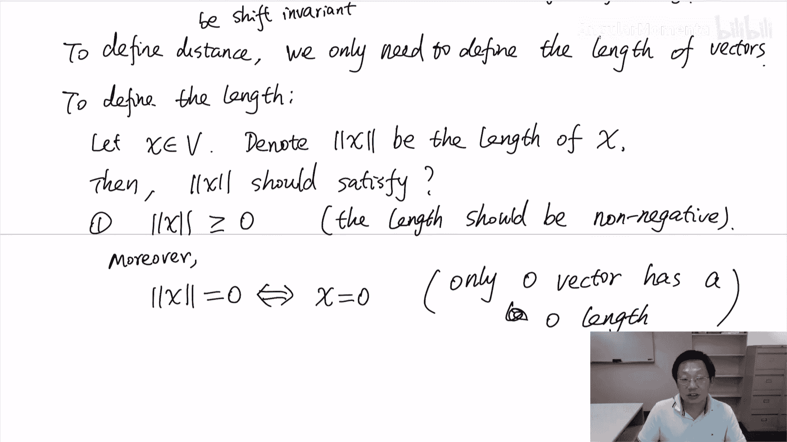

The second the condition is that's。An important feature of linear space is the sckeni。

 we have defined scar muchmed。然后一。Intuitively， if we have a vector x， now。

 if we do a skinny alpha times X， what do you。Find。Actually， from here。

 we can see that the lens should also be scaled by alpha。So then we should have that to this alpha。

Times x。This length。Should be。Apha times X。For any alpha larger than0 and x。Yin。V。

This should be true。And if we have a negative skin。This is alpha larger than 0。

 If this alpha is smaller than 0。Then you can see， of course， the more negative this alpha is。

This length of alpha x should be more。So then when alpha is negative， actually。

This length of alpha x should be the absolute value of alpha times x。So。

This should be changed to in order to deal with both positive and negative alpha。

 we should change this to alpha x。 the length should be the absolute value of x of alpha times the length of x。

This should be true for any x in V。This is the second condition。手術さですよ。

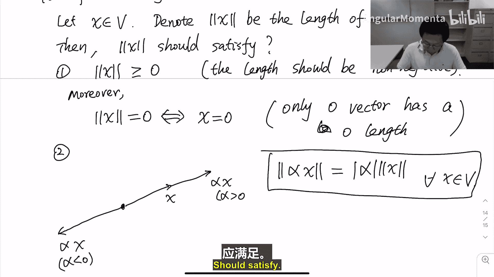

This condition。Just means that the the lens of。A skinny of a vector。

Is a scny of the length of the vector。So this is the second step。

Condition should this length satisfy。Condition 3。Now we are working in linear space。

So in linear space， we know that there is a very nice property that is if we have two points。

 A and B， we go from A to B， our intuition tells us that。The straight line has the shortest path。

 has the shortest length from A to B。This is A B， and I have another way， for example。

 I I go from A to B through C。Then we know that。This length of A B should be always smaller than or equals to this AC plus。

CB。This is known from elementary geometry。The length of one side of the triangle is always smaller than the sum of the。

Lenses of the other two sides。This is true because this plane。

 this triangle is in a plane in the linear space。Now， of course。

 our length function should also satisfy this property。For this。

 we need to translate this AABC into vector language。So now I just set this to be the origin。

Now I set this C point to be the x vector。This is an x vector。And from this sum。哦。And now。

 this vector。I call it the B vector， y vector。Then what is this point B？This point， B， it is。

This point。It is exactly x plus y because this one is exactly y from here to here is exactly the same as from O to this point。

So that this is exactly x plus y。Then， we know that。

This length should be smaller than this length plus this length， so this length is just x plus y。

The length of x plus y。This length is just the length of the vector x， so it's the length of x。

And this length is the same as the length of this one， right， actually， they are the same vector。

So that this lens is just the。Lth of wine。So then altogether， we should have that this。X plus y。

 the length should be smaller than this the length of x plus the length of y。

This should be satisfied。Because we are in the plane， We are in the flat plane。

Because we are in a linear space。If this is not satisfied， then our。Playing our space is not flat。

 so this is not an linear space。So this has to be true。This is known as the triangle inequality。

Because it， it is its intuition from， is from a triangle。

The length of one side of the triangle of a triangle is always smaller than the sum of the lengthes of the other two sides。

偶尔。Using plain language， it is just say that。Lth。Of direct path。Should be。Smaller than。The length。

Of indirect parts。We go from this point to this point， we go direct path。

 we should have the smallest length。So this is an indirect part。 This is an indirect part。

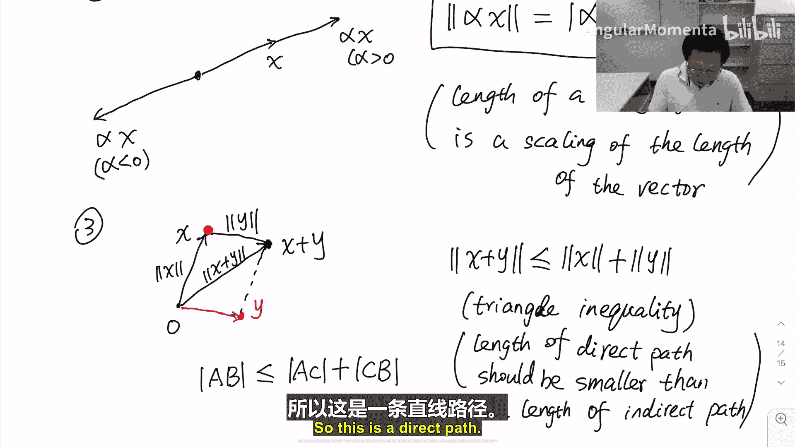

So then altogether， at least our length function should satisfy these three conditions。

 The first is the non negativity。 The length should be non negative。

 The second is that only zero vector has zero length。

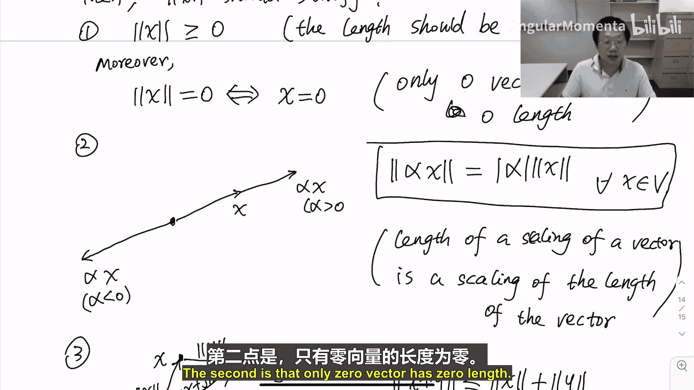

This is consistent with our intuition。And also for after scanning。

 the length of a scanning of a vector is a scanning of the length of the vector。

If we scale this x by alpha， then its length is scaled by the absolute value of alpha。

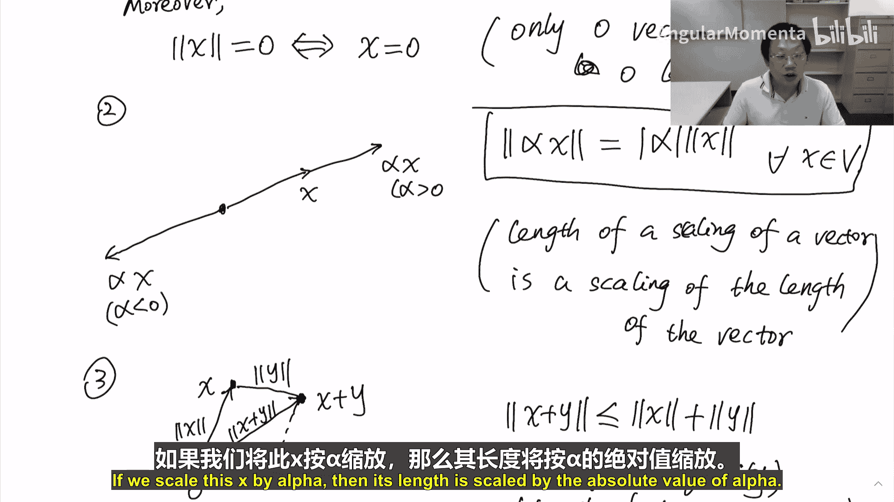

And thirdly， we should also have the triangle in quantity。This x plus y。

 the length should be smaller than the length of x and the length of y for any x and y， of course。硬币。

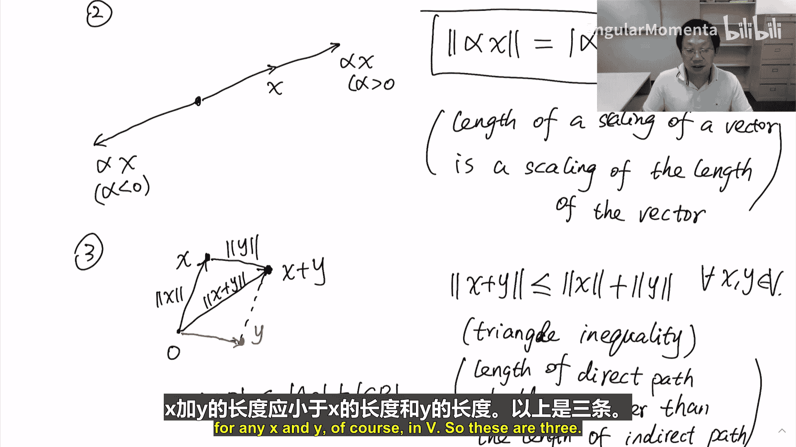

So these are three necessary conditions to define a length。Actually， this。

 these three conditions are enough to define a length。

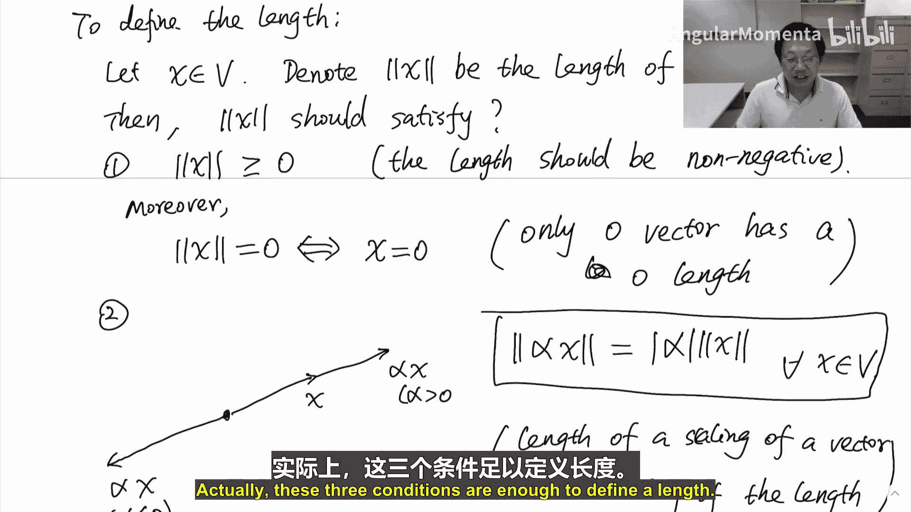

So let me give you the definition in mathematics， this length is known as the norm。

 We call it a norm。Definition。Let we be a vector space。And we call a function such by this 1，2，3。

 a norm。A norm。On we。Is a function。So this actually， we we just， this is a， I mean。

 norm is the mathematical terminology for for this for this length I I。I used the here。

Then this function。And we just use this， right， we have used the double bar。Okay。

 so this dots means the variable， the variable。We put the variable here。 Okay， like like here。

 X is the variable。 and this， this norm of x is the output。 So this is a function from V to R。

RightFor any， for any vector in x， we have a number。 So it maps a vector in V to a number。

This function should satisfy。The three conditions that we have summarized。If just now。

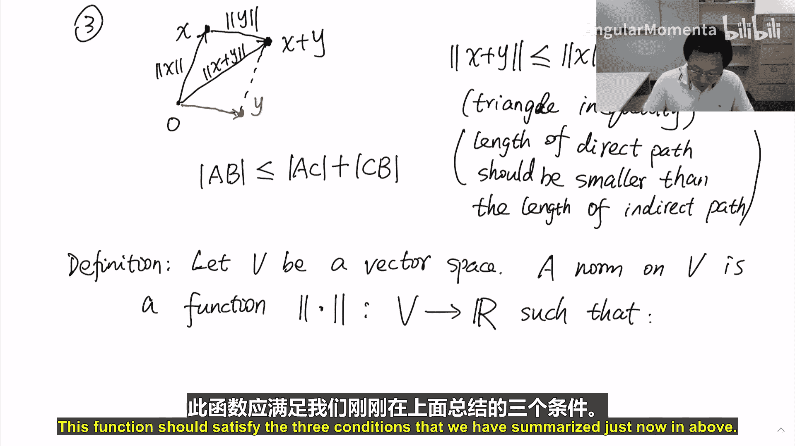

In in above。The first condition is， you see。

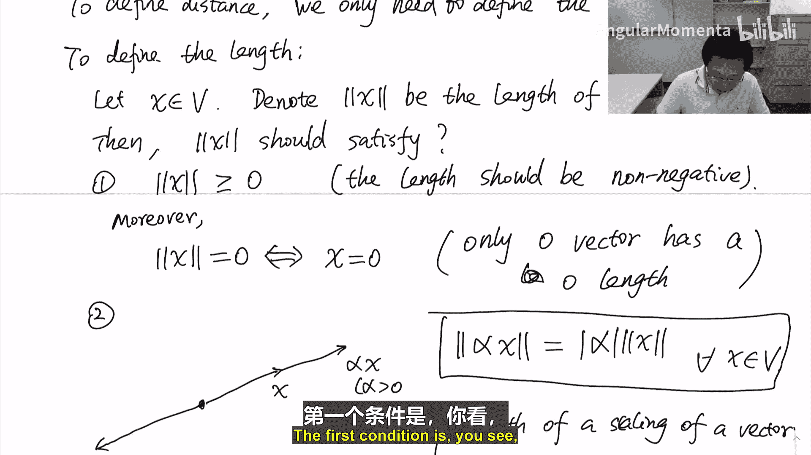

Non negativity。Is x should be larger than all equals to0 for any x in V。And。Also。

 only the zero vector has the zero norm。This is the first condition。The second condition。

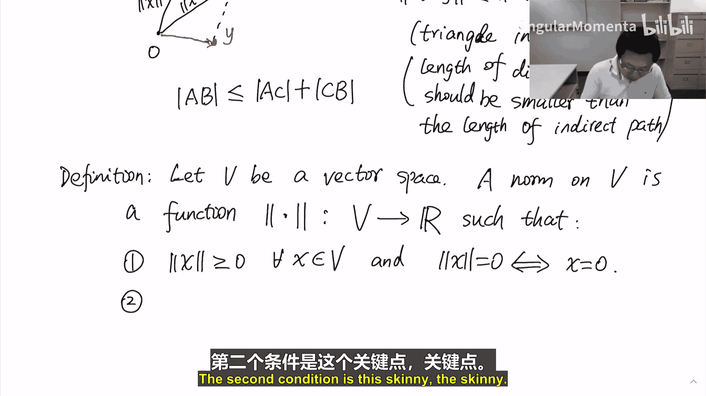

Is this skinny。The skinny， if I scale this x by alpha。

 then its norm should be scaled by the absolute value of alpha。

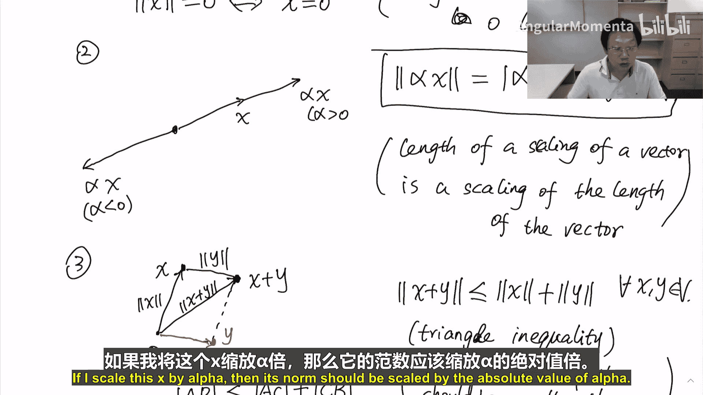

For any scaling factor of alpha， alpha is a real number， of courses， and x u be。

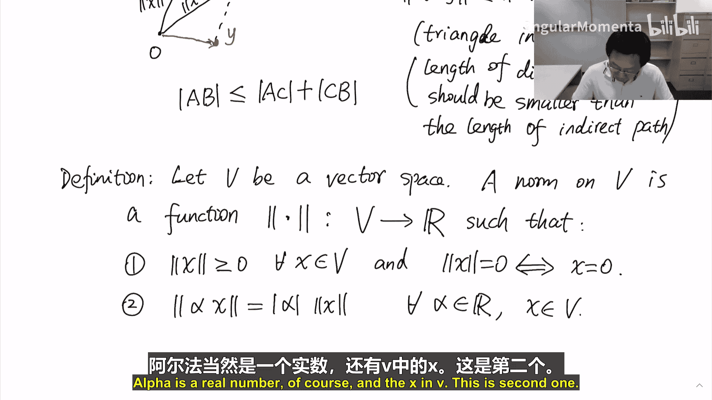

This is second one。The third one。Because we are in。In the flat plane in the linear space。

 so this triangle inequality should be satisfied。For all X and Y in B。

So this is the definition of of the。

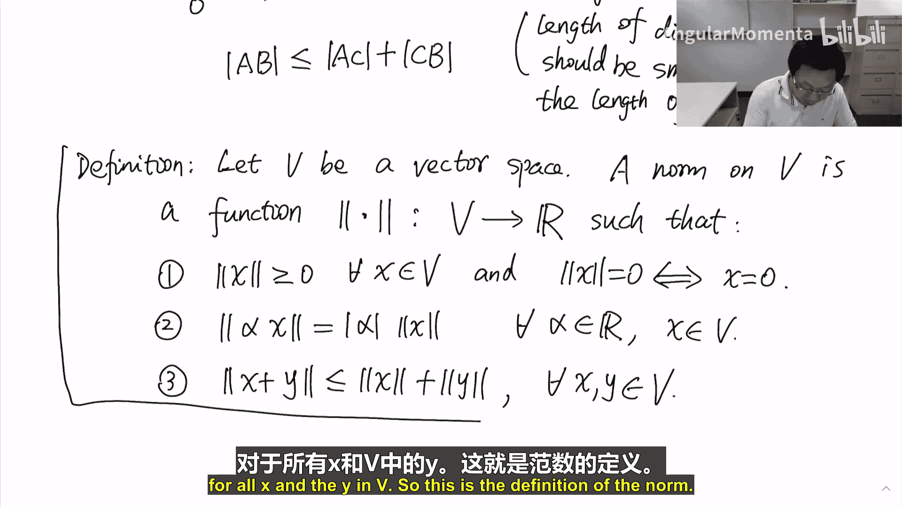

Of the norm， a norm is just a length。A lo me is just a length。So let me have the remark here。

First of all you， that's norm。The norm of x。Is a length。Of X。this is。But mathematically。

 we just call it a norm。 This is the first one。The second one is that the distance。

 right with the norm， how do we， how could we define the distance between two two vectors。

 So the distance between x and y， as we have demonstrated here。

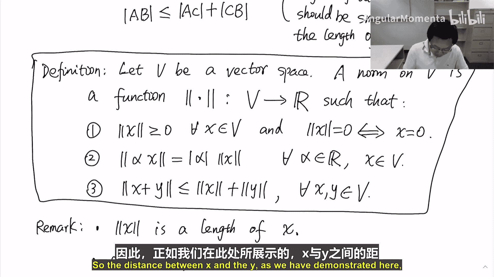

It should be shifter environment。So that the distance of x and y should be the distance of x minus y to0。

 which we define it to be the length of x minus y。

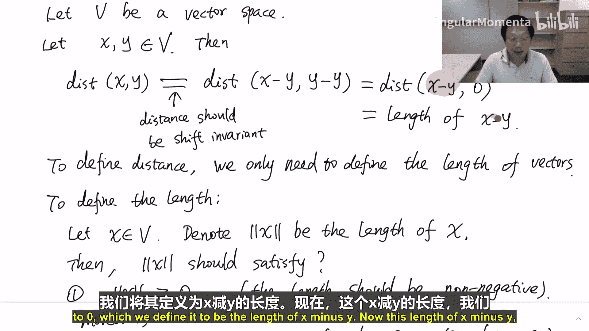

Now， this length of x minus y， we call it the norm of x minus1， right， So the distance of x。

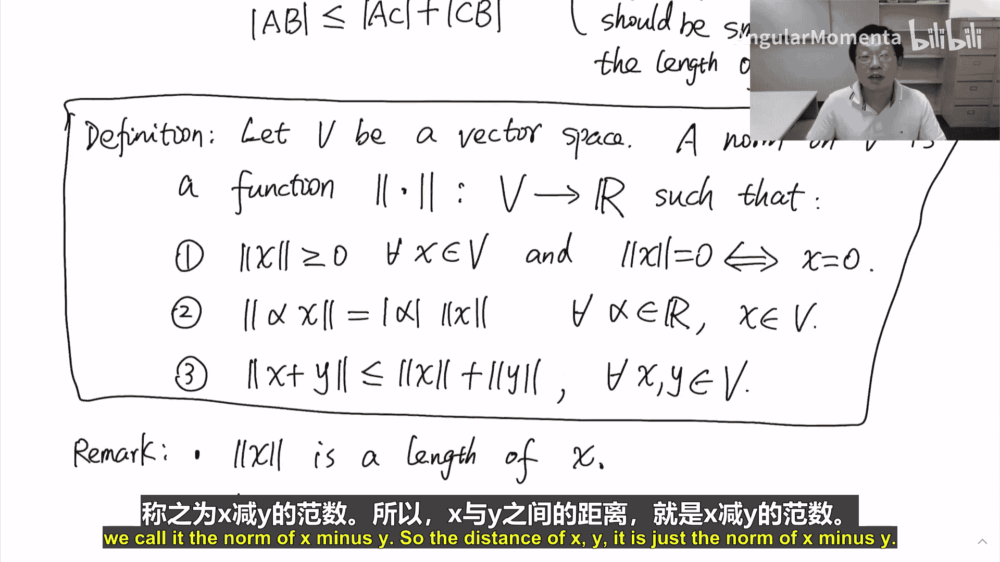

Yhy should it is just the norm of x minus y。

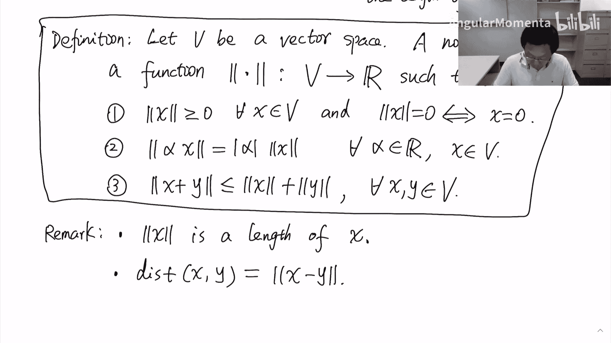