# 【香港科技大学】数据分析的数学方法 ｜ Mathematical Methods for Data Analysis p100 17-03-02-视频 -BV1DEFDzGEZW_p100-

In the following， I will demonstrate how to use the tools。

That we have developed for differentiation to find the gradient WFI and the gradient UFI respectively。

For gradient W。F I WU。Recall that。F I of W。It is。FW。X， I。Minus Y I the squared。

I wanted to write this into a composition form， and then we use the chair rule。For this purpose。

 I would like to denote this。As an inner function and the rest as an outer function。In particular。

 we define。H of W。Since now we are。Takeakn the gradient with respect to W。

 Then all this should be viewed as functions of W。 and U is fixed。

 Then I just define this H of W to be this F X I。This is a number in R。 Its value is a number in R。

 Therefore， this H is from。The W， which is RRP by N。To a real number。

And I will set the rest part of this function to be。

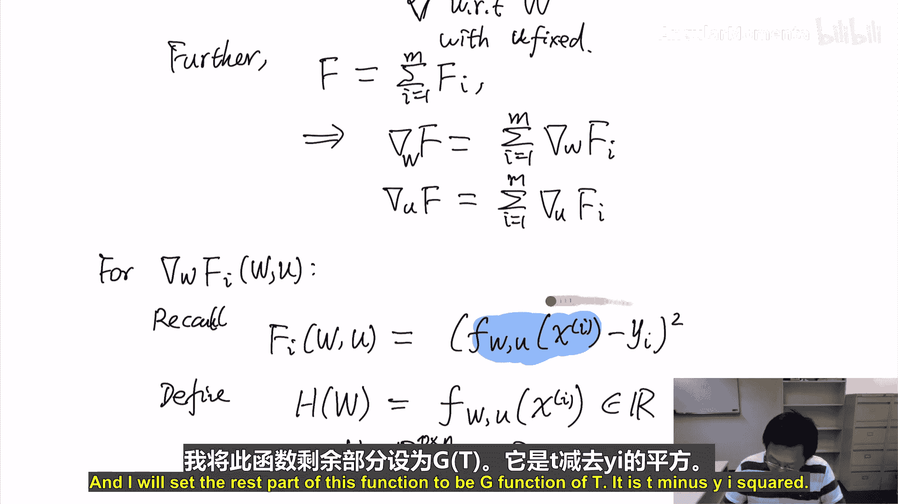

G function ofT。It is。T minus Y I， the squared。

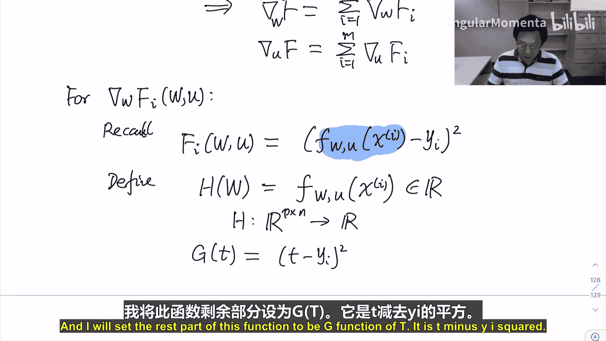

Obviously， this G is a function from R to R。It maps T to T minus Y I the squared。Then。Our F I of W U。

It is。Just。G of HW。It is she composed， which H。And then， W。Then we use the chain rule。

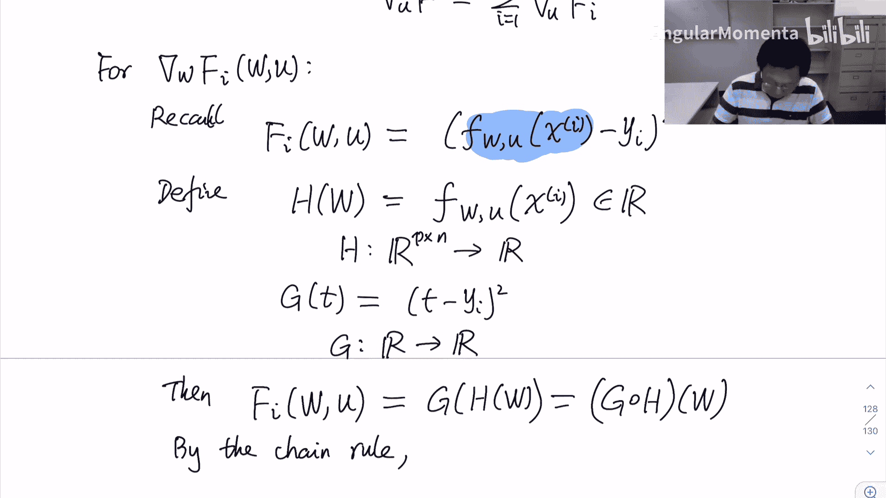

Now， here， our H function， the inner function is a function on the Huer space。

 Our alterer function is a function on R。 It's a single variable function。

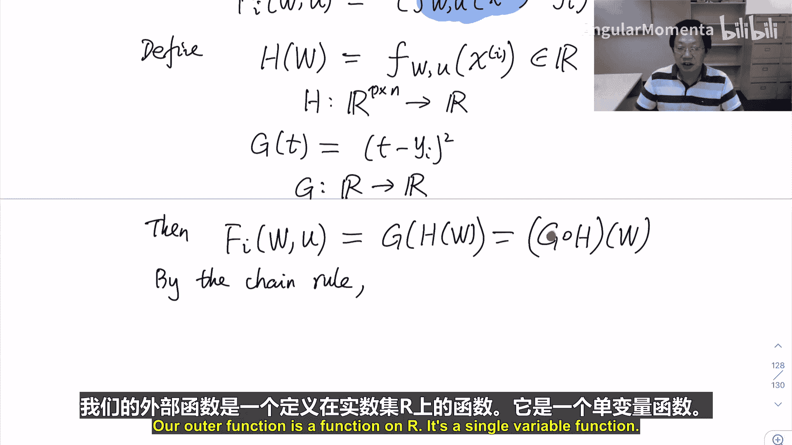

We use the chain rule， our very preliminary version of the chain rule。

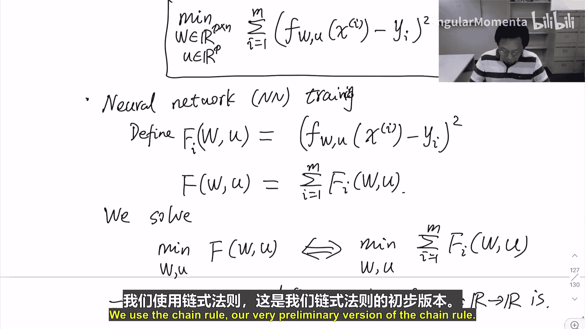

We use the chain rule here。Now， this inner function is from a huber space to R。

 Our outer function is from R to R。 It's exactly our case。

It is just the G prime times the gradient of F。

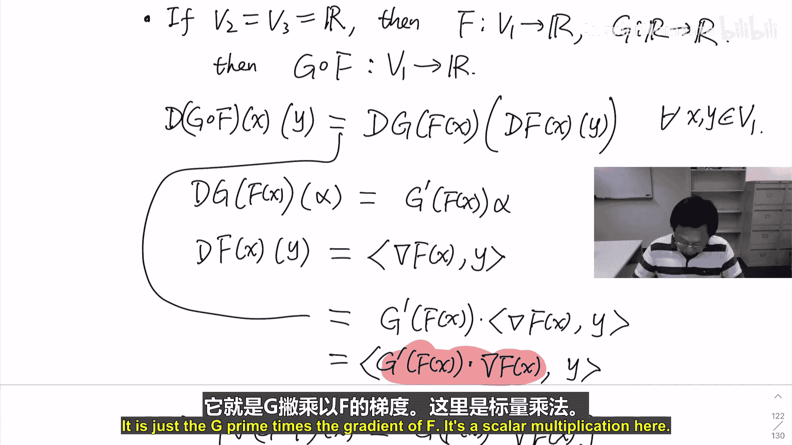

It's a skin or much medication here。I gradientient WfiI of W U。Will be the G prime。Off。Now。

 I just drop the variables in the G prime for simplicity times the gradient of this H W。

For the G prime。It is obvious C prime at T is just two times t minus Yr。Therefore， our T。

 it is now this。H of W， which is just this function。So it。Two times F， W， U。X， I。

Which is exactly the value of this neural network function。Minus Y I。Times， the gradient。Of this H W。

Which is。F W。えい。The gradient with respect to W only。This F function viewed as。Function of W。

It remains to find that。

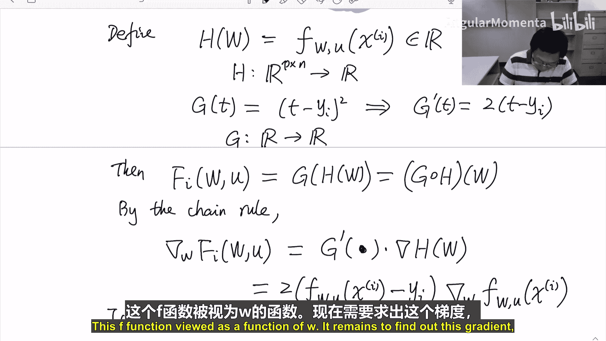

This gradient。The gradient with respect to the W of the neural network function。For this purpose。

 we need to rewrite this F function， this little F function into a composition。

By the definition of this little FW。It is the inner product of。You。Sigma W X。

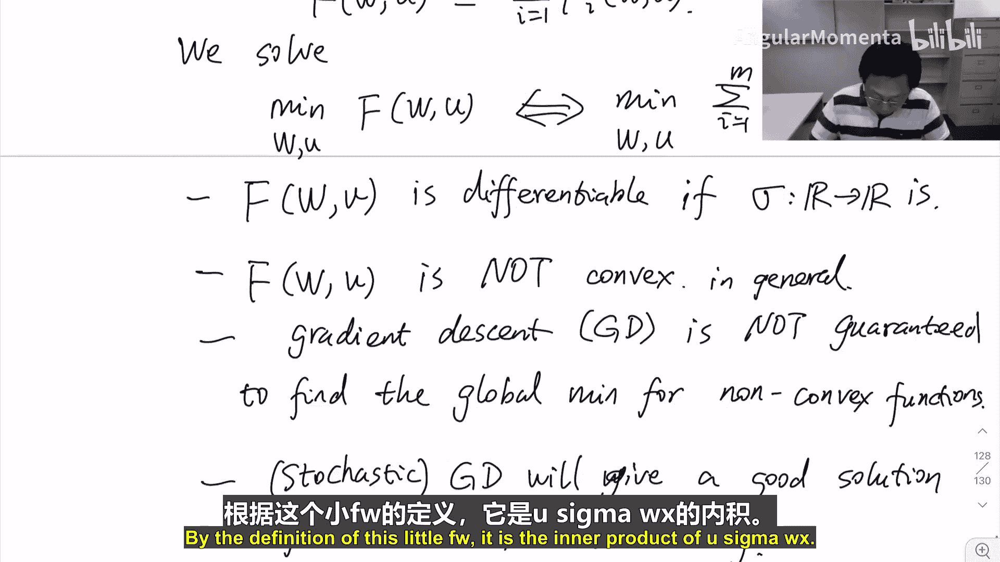

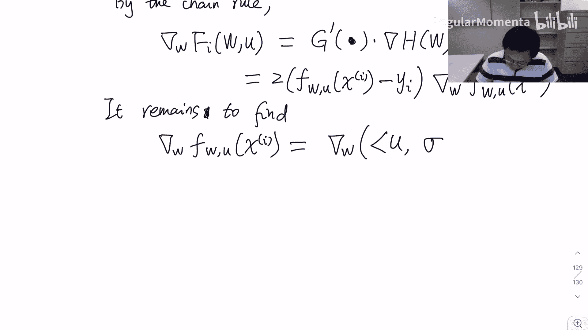

I wanted to rewrite this sigma as a function and this you in the productor of this part。

 another function。 in particular， I will define this to a function。Defy。

The inner function is still denotted by H。It is a function of W， which is sigma of W X， I。

This sigma W X I is in our P。Because it's the activation of the P neurons。Therefore， this H function。

 this inner function H is from R。P8N。From W。2。RP。It is now a mapping between two vector spaces for the outer function。

 G of Z。E calls the inner product of U and Z。

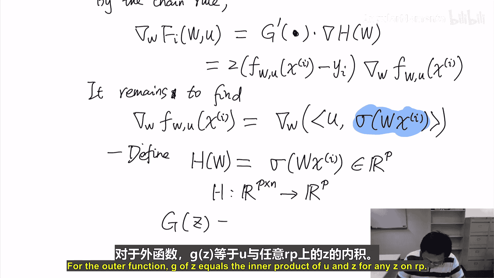

For any Z RRP。Then。Our function U sigma of W， X， I。Is the composition of the。And is。Our G here。

 this function is from。而P。去玩。Now， we apply the Qnru。The gradient with respect to W of this U。Sigma。

 W， X， I。This one， it is。The gradients of G composed with H of W。Now。

 this inner function is a matching between two vector spaces。

 This G order function is a function on the vector space。

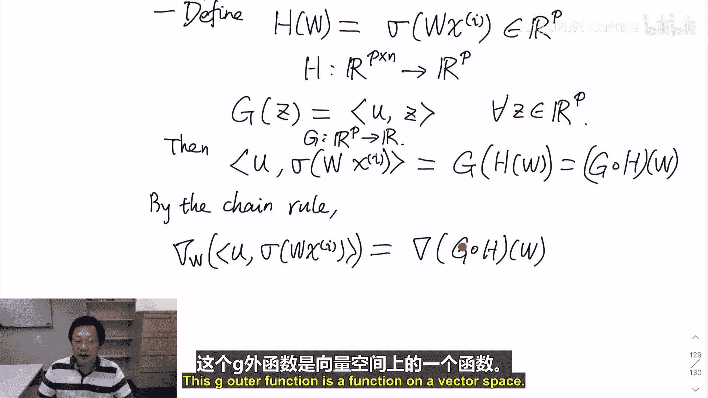

We will use this chain rule。 The inner one is a mapping between two hub spaces。

 and the outer one is a function on the here birth space。We get this one。But our G and F。

 our inner and outer function has some special structure。

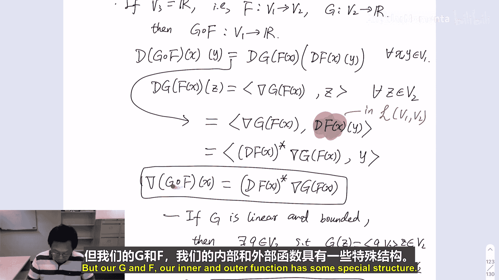

That is。Our outer function has some special structure。 Our G function here is linear。

Let's go back how gang。

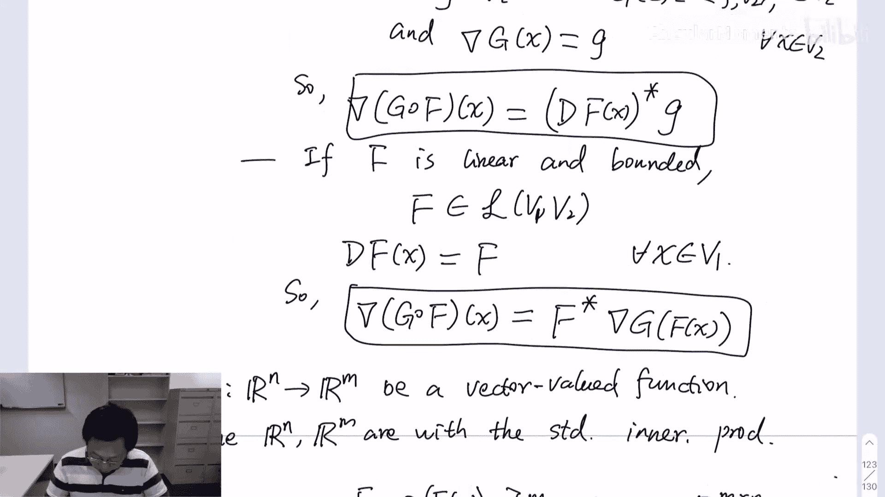

We will see that when this G is linear and bounded。This G is in the inner protective form。

 Then this gradient should be D FX star G。By applying this rule。

 we obtain that this gradient should be D of H at W。 This joint applies to the U vector。

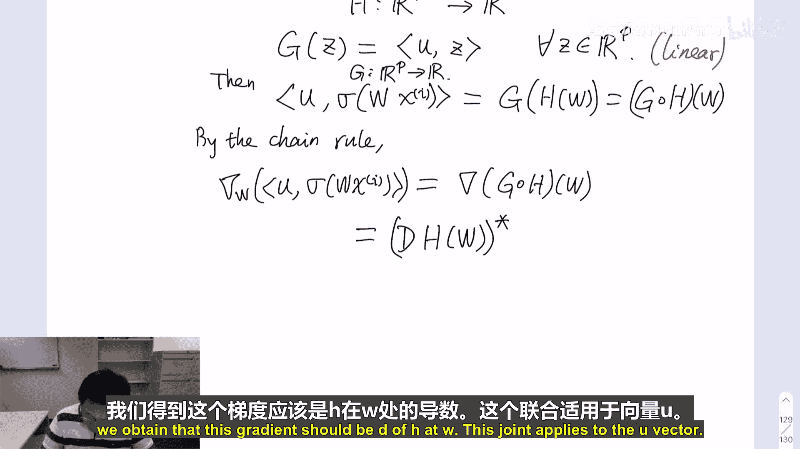

This further is the of sigma， App to W X， I。Ls。The ajo operator。Times you。Now we wanted to find that。

Do you offer sigma。The differentiation here should be with respect to W。 So I write a DW。

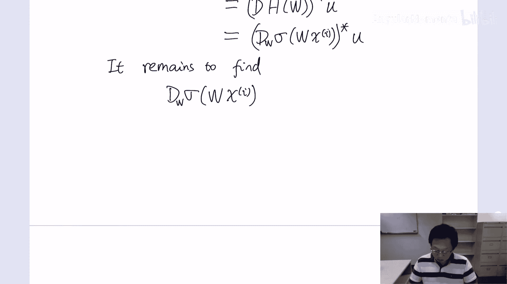